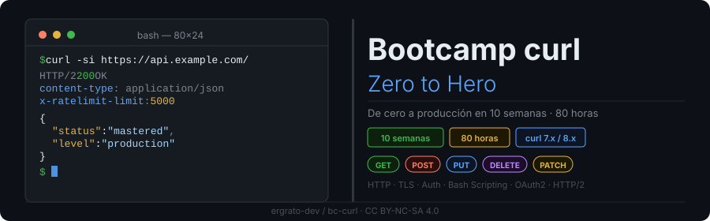

<p align="center">
  
</p>

<p align="center">
  <a href="LICENSE"></a>
  
  
  
  
  <a href="README_EN.md"></a>
</p>

---

## 📋 Descripción

Bootcamp intensivo de **10 semanas (80 horas)** para dominar `curl` desde cero
hasta nivel producción. No es un tutorial de flags: es aprender a **operar y
depurar HTTP** desde la terminal.

### 🎯 Objetivos

Al terminar serás capaz de:

- ✅ Leer una traza `-v` completa y decir en qué punto exacto falló la petición
- ✅ Construir cualquier método HTTP con el cuerpo y los headers correctos
- ✅ Elegir el mecanismo de autenticación adecuado y **no filtrar la credencial**
- ✅ Subir y descargar archivos, incluidos multipart y transferencias reanudables
- ✅ Diagnosticar un fallo de TLS distinguiendo cadena, nombre, versión y cifrado
- ✅ Medir una petición con `--write-out` y explicar dónde se va el tiempo
- ✅ Escribir scripts bash que fallan cuando deben fallar y reintentan cuando deben
- ✅ Implementar client credentials, authorization code + PKCE y device code
- ✅ Usar HTTP/2, HTTP/3 y paralelismo, y saber cuándo no aportan nada
- ✅ Integrar curl en un pipeline de CI/CD sin dejar secretos en los logs

### 🚀 ¿Por qué un bootcamp entero sobre curl?

Porque el 90% de la gente usa el 2% de curl, y ese 2% es justo el que se traga
los errores en silencio. `curl -s https://api/deploy` sale con código **0**
aunque el servidor responda 500: para curl la transferencia fue un éxito. El
script sigue, el pipeline pasa en verde, y el despliegue no ocurrió.

Este bootcamp existe para ese hueco.

---

## 🗓️ Estructura del Bootcamp

| Fase | Semanas | Horas | Temas |
|---|:--:|:--:|---|
| **Fundamentos** | 01-03 | 24 h | HTTP, métodos, headers, JSON, autenticación básica |
| **Intermedio** | 04-06 | 24 h | Archivos, SSL/TLS, cookies, output, depuración |
| **Avanzado** | 07-09 | 24 h | Scripting bash, OAuth2, HTTP/2, HTTP/3, rendimiento |
| **Producción** | 10 | 8 h | Testing, documentación, CI/CD, entrega |

---

## 📚 Contenido por Semana

Estado de publicación semana a semana en [`bootcamp/README.md`](bootcamp/README.md).

| # | Semana | Descripción |
|:--:|---|---|
| 01 | [HTTP y curl básico](bootcamp/week-01-http_y_curl_basico/) | Cliente-servidor, anatomía de la URL, GET, flags esenciales, status codes |
| 02 | [Métodos HTTP, headers y JSON](bootcamp/week-02-metodos_http_headers_json/) | POST/PUT/PATCH/DELETE, cuerpos JSON, headers, negociación de contenido |
| 03 | [Autenticación básica](bootcamp/week-03-autenticacion_basica/) | Basic Auth, `.netrc`, API keys, Bearer, JWT, no filtrar la credencial |
| 04 | [Archivos, formularios y multipart](bootcamp/week-04-archivos_formularios_multipart/) | Descargas reanudables, rangos, `-F`, `-T`, control de transferencia |
| 05 | [SSL/TLS, cookies y redirects](bootcamp/week-05-ssl_tls_cookies_redirects/) | Handshake, CA propia, mTLS, cookie jar, redirects, timeouts y reintentos |
| 06 | [Output, debug y configuración](bootcamp/week-06-output_debug_configuracion/) | `--write-out`, `--trace`, `.curlrc`, `--libcurl`, proxies, URL globbing |
| 07 | [Scripting bash con curl](bootcamp/week-07-scripting_bash_con_curl/) | Códigos de salida, `--fail-with-body`, jq, paginación, backoff |
| 08 | [OAuth2 y autenticación avanzada](bootcamp/week-08-oauth2_y_autenticacion_avanzada/) | Client credentials, PKCE, device code, refresh, almacenamiento seguro |
| 09 | [HTTP/2, paralelismo y rendimiento](bootcamp/week-09-http2_paralelismo_performance/) | HTTP/2, HTTP/3, `-Z`, reutilización de conexión, ETag, WebSockets |
| 10 | [Proyecto final](bootcamp/week-10-proyecto_final/) | `api-toolkit` con tests, documentación y CI |

### 🔑 Componentes de cada semana

```
week-XX-tema/
├── README.md                  # Objetivos, contenidos, trucos, entregables
├── rubrica-evaluacion.md      # 30% conocimiento / 40% desempeño / 30% producto
├── checks.json                # Las comprobaciones automáticas de la semana
├── 0-assets/                  # Diagramas SVG
├── 1-teoria/                  # 7-8 archivos, un concepto cada uno
├── 2-practicas/               # 4 prácticas sobre el laboratorio local
├── 3-proyecto/
│   ├── README.md              # La capa que esta semana añade a api-toolkit
│   └── starter/               # Esqueleto con TODOs. Nunca la solución
├── 4-recursos/
│   ├── ebooks-free/
│   ├── videografia/
│   └── webgrafia/
└── 5-glosario/
```

---

## 🛠️ Herramientas

| Herramienta | Versión | Uso |
|---|---|---|
| `curl` | 7.81 o superior | La herramienta del bootcamp |
| `jq` | cualquiera | Procesar JSON desde la Semana 02 |
| `shellcheck` | cualquiera | Auditar los scripts del proyecto |
| Docker + Compose v2 | Compose **v2** | Levantar el laboratorio |

> [!IMPORTANT]
> Mira tu versión con `curl --version` antes de empezar. Ubuntu 22.04 trae
> **7.81**, que no tiene `--json` (es de 7.82). El material marca cada flag
> posterior a 7.81 y da la alternativa: ver
> [`docs/versiones-de-curl.md`](docs/versiones-de-curl.md).

### El laboratorio local

Nada de `httpbin.org`. Tres contenedores en tu máquina, ~300 MB de RAM:

| Servicio | Dónde | Para qué |
|---|---|---|
| httpbin | `http://localhost:8080` | Métodos, status, headers, auth, cookies, redirects, compresión, multipart, ETag |
| OAuth2 | `http://localhost:8081/default` | Tokens firmados de verdad, con `exp` y `jwks` |
| TLS | `https://localhost:8443` | HTTPS con CA propia, HTTP/2 y HTTP/3 |
| mTLS | `https://localhost:8444` | Exige certificado de cliente |

Contra un servicio público no puedes provocar un fallo de certificado a
propósito, ni pedir un token OAuth2, ni apagarlo para ver qué hace tu script
cuando el servidor no está. Aquí sí.

---

## 🚀 Inicio Rápido

### Prerrequisitos

Terminal Linux, macOS o **WSL2** en Windows. En PowerShell `curl` es un alias de
`Invoke-WebRequest` y no es el mismo programa: trabaja dentro de WSL.

No se requiere saber programar. El bash se aprende durante el bootcamp.

### 1. Instalar las herramientas

```bash
# Debian / Ubuntu
sudo apt update && sudo apt install -y curl jq shellcheck
```

### 2. Clonar y levantar el laboratorio

```bash
git clone https://github.com/ergrato-dev/bc-curl.git
cd bc-curl
./scripts/start.sh
```

### 3. Comprobar que funciona

```bash
curl -s -o /dev/null -w '%{http_code}\n' http://localhost:8080/get
# 200

curl --cacert docs/lab-ca.pem -s -o /dev/null -w '%{http_version}\n' https://localhost:8443/get
# 2
```

Y la comprobación que **tiene que fallar**:

```bash
curl -s -o /dev/null https://localhost:8443/get; echo $?
# 60
```

El 60 es curl negándose a hablar con un certificado que no puede verificar. Eso
está bien. Hay un flag para apagar esa comprobación, y en la Semana 05 verás por
qué no se usa.

### 4. Elegir tu dominio y empezar

El proyecto es uno solo y crece diez semanas:
[`docs/proyecto-hilo-conductor.md`](docs/proyecto-hilo-conductor.md).

```bash
cd bootcamp/week-01-http_y_curl_basico/
```

---

## ✅ Verificación Automática

```bash
./scripts/verificar-semana.sh --doctor   # tu entorno
./scripts/verificar-semana.sh 03         # la Semana 03
```

```
Semana 03 — Autenticación básica

  ✅ auth-check.sh existe y es ejecutable
  ✅ El script sale distinto de 0 cuando la API responde 401
  ❌ El token no aparece en la línea de comandos de ningún curl
     pista: 2-practicas/04-no-filtrar-la-credencial.md, paso 3

  8/9 comprobaciones superadas.
```

Cada pista dice **en qué práctica y en qué paso** se arregla. Cómo funciona:
[`docs/autograding.md`](docs/autograding.md).

---

## 📊 Metodología

**Autoestudio asincrónico**, 8 h/semana. Cada semana: teoría (2 h), cuatro
prácticas sobre el laboratorio (3-4 h), y una capa nueva de `api-toolkit` (2 h).

### Evaluación

| Evidencia | Peso | Instrumento |
|---|:--:|---|
| 🧠 Conocimiento | 30% | 10 preguntas conceptuales por semana |
| 💪 Desempeño | 40% | Las cuatro prácticas, verificadas por `checks.json` |
| 📦 Producto | 30% | 60 pts automáticos + 40 pts de rúbrica manual |

**Mínimo 70% en cada evidencia**, no en el promedio.

---

## ⚠️ Exención de Responsabilidad

Este material es educativo. Los ejemplos apuntan al laboratorio local; cuando
apuntan a una API pública es para leer, nunca para escribir ni borrar. Antes de
ejecutar cualquier comando de este bootcamp contra un sistema real, entiende qué
hace. Eso es precisamente lo que el bootcamp enseña.

---

## 📄 Licencia

[CC BY-NC-SA 4.0](LICENSE) — uso libre para fines educativos no comerciales.

---

## 📚 Documentación Adicional

- [Índice de la documentación](docs/README.md)
- [Preparar el entorno](docs/setup-entorno.md)
- [Versiones de curl](docs/versiones-de-curl.md)
- [El proyecto hilo conductor](docs/proyecto-hilo-conductor.md)
- [Autograding](docs/autograding.md)
- [Trucos de curl](docs/trucos-curl.md)
- [Glosario global](docs/glosario-global.md)
- [Índice de semanas y estado](bootcamp/README.md)
- [Guía de autoría](.github/copilot-instructions.md)
- [Cómo contribuir](CONTRIBUTING.md) · [Seguridad](SECURITY.md) · [Código de conducta](CODE_OF_CONDUCT.md)

---

<p align="center">
  <strong>Tu terminal. Tus peticiones. Tus errores, vistos a tiempo.</strong>
</p>

<p align="center">
  <a href="bootcamp/week-01-http_y_curl_basico/">Empezar Semana 01</a> ·
  <a href="docs/setup-entorno.md">Preparar el entorno</a> ·
  <a href="https://github.com/ergrato-dev/bc-curl/issues">Reportar un problema</a>
</p>
