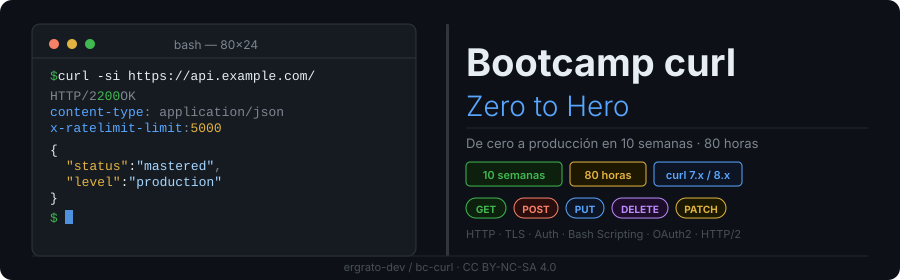

<p align="center">
  
</p>

<p align="center">
  <a href="LICENSE"></a>
  
  
  
  
  <a href="README.md"></a>
</p>

---

> [!NOTE]
> **Course content is in Spanish.** This file is the only English mirror; the
> weekly material, exercises and glossaries are Spanish-only. Commands, flags,
> code and commit messages are in English throughout.

---

## 📋 Overview

A **10-week, 80-hour** bootcamp to master `curl` from zero to production. Not a
flag tutorial: it teaches you to **operate and debug HTTP** from the terminal.

### 🎯 Outcomes

By the end you will be able to:

- ✅ Read a full `-v` trace and name the exact point where a request failed
- ✅ Build any HTTP method with the right body and headers
- ✅ Pick the right authentication mechanism and **not leak the credential**
- ✅ Upload and download files, including multipart and resumable transfers
- ✅ Diagnose a TLS failure, telling chain, name, version and cipher apart
- ✅ Measure a request with `--write-out` and explain where the time goes
- ✅ Write bash scripts that fail when they should and retry when they should
- ✅ Implement client credentials, authorization code + PKCE and device code
- ✅ Use HTTP/2, HTTP/3 and parallelism, and know when they buy you nothing
- ✅ Wire curl into a CI/CD pipeline without leaking secrets into the logs

### 🚀 Why a whole bootcamp on curl?

Because most people use 2% of curl, and that 2% is exactly the part that
swallows errors silently. `curl -s https://api/deploy` exits **0** even when the
server answers 500: as far as curl is concerned the transfer succeeded. The
script carries on, the pipeline goes green, and the deploy never happened.

That gap is why this bootcamp exists.

---

## 🗓️ Program Structure

| Phase | Weeks | Hours | Topics |
|---|:--:|:--:|---|
| **Foundations** | 01-03 | 24 h | HTTP, methods, headers, JSON, basic authentication |
| **Intermediate** | 04-06 | 24 h | Files, SSL/TLS, cookies, output, debugging |
| **Advanced** | 07-09 | 24 h | Bash scripting, OAuth2, HTTP/2, HTTP/3, performance |
| **Production** | 10 | 8 h | Testing, documentation, CI/CD, delivery |

---

## 📚 Weekly Content

Per-week publication status in [`bootcamp/README.md`](bootcamp/README.md).

| # | Week | Description |
|:--:|---|---|
| 01 | [HTTP and curl basics](bootcamp/week-01-http_y_curl_basico/) | Client-server, URL anatomy, GET, essential flags, status codes |
| 02 | [HTTP methods, headers and JSON](bootcamp/week-02-metodos_http_headers_json/) | POST/PUT/PATCH/DELETE, JSON bodies, headers, content negotiation |
| 03 | [Basic authentication](bootcamp/week-03-autenticacion_basica/) | Basic Auth, `.netrc`, API keys, Bearer, JWT, not leaking the credential |
| 04 | [Files, forms and multipart](bootcamp/week-04-archivos_formularios_multipart/) | Resumable downloads, ranges, `-F`, `-T`, transfer control |
| 05 | [SSL/TLS, cookies and redirects](bootcamp/week-05-ssl_tls_cookies_redirects/) | Handshake, custom CA, mTLS, cookie jar, redirects, timeouts and retries |
| 06 | [Output, debugging and configuration](bootcamp/week-06-output_debug_configuracion/) | `--write-out`, phases, `-v`, `--trace`, `.curlrc`, `-K`, `--libcurl` |
| 07 | [Bash scripting with curl](bootcamp/week-07-scripting_bash_con_curl/) | Exit codes, `--fail-with-body`, jq, pagination, backoff |
| 08 | [OAuth2 and advanced authentication](bootcamp/week-08-oauth2_y_autenticacion_avanzada/) | Client credentials, PKCE, device code, refresh, secure token storage |
| 09 | [HTTP/2, parallelism and performance](bootcamp/week-09-http2_paralelismo_performance/) | HTTP/2, HTTP/3, `-Z`, connection reuse, ETag, WebSockets |
| 10 | [Final project](bootcamp/week-10-proyecto_final/) | `api-toolkit` with tests, documentation and CI |

### 🔑 What each week contains

```
week-XX-topic/
├── README.md                  # Goals, contents, tricks, deliverables
├── rubrica-evaluacion.md      # 30% knowledge / 40% performance / 30% product
├── checks.json                # The week's automated checks
├── 0-assets/                  # SVG diagrams
├── 1-teoria/                  # 7-8 files, one concept each
├── 2-practicas/               # 4 hands-on labs against the local lab
├── 3-proyecto/
│   ├── README.md              # The layer this week adds to api-toolkit
│   └── starter/               # Skeleton with TODOs. Never the solution
├── 4-recursos/{ebooks-free,videografia,webgrafia}/
└── 5-glosario/
```

---

## 🛠️ Tooling

| Tool | Version | Used for |
|---|---|---|
| `curl` | 7.81 or newer | The subject of the bootcamp |
| `jq` | any | Processing JSON from Week 02 onwards |
| `shellcheck` | any | Auditing the project scripts |
| Docker + Compose v2 | Compose **v2** | Running the lab |

> [!IMPORTANT]
> Check your version with `curl --version` before you start. Ubuntu 22.04 ships
> **7.81**, which lacks `--json` (added in 7.82). The material flags every
> option newer than 7.81 and gives the fallback: see
> [`docs/versiones-de-curl.md`](docs/versiones-de-curl.md).

### The local lab

No `httpbin.org`. Three containers on your machine, ~300 MB of RAM:

| Service | Where | What it covers |
|---|---|---|
| httpbin | `http://localhost:8080` | Methods, status, headers, auth, cookies, redirects, compression, multipart, ETag |
| OAuth2 | `http://localhost:8081/default` | Real signed tokens, with `exp` and a `jwks` endpoint |
| TLS | `https://localhost:8443` | HTTPS with its own CA, HTTP/2 and HTTP/3. Also `/paginas` (pagination with `Link`) and `/limitado` (429 with `Retry-After`) |
| mTLS | `https://localhost:8444` | Requires a client certificate |

Against a public service you cannot break a certificate on purpose, ask for an
OAuth2 token, or shut it down to see what your script does when the server is
gone. Here you can.

---

## 🚀 Quick Start

Linux, macOS, or **WSL2** on Windows. In PowerShell `curl` is an alias for
`Invoke-WebRequest` and is not the same program: work inside WSL.

```bash
sudo apt update && sudo apt install -y curl jq shellcheck

git clone https://github.com/ergrato-dev/bc-curl.git
cd bc-curl
./scripts/start.sh
```

Check it works:

```bash
curl -s -o /dev/null -w '%{http_code}\n' http://localhost:8080/get
# 200

curl --cacert docs/lab-ca.pem -s -o /dev/null -w '%{http_version}\n' https://localhost:8443/get
# 2
```

And the check that **must fail**:

```bash
curl -s -o /dev/null https://localhost:8443/get; echo $?
# 60
```

That 60 is curl refusing to talk to a certificate it cannot verify. That is
correct. There is a flag to switch that check off, and Week 05 explains why it
is not used.

Full setup guide: [`docs/setup-entorno.md`](docs/setup-entorno.md).

---

## ✅ Automated Verification

```bash
./scripts/verificar-semana.sh --doctor   # your environment
./scripts/verificar-semana.sh 03         # Week 03
```

Every failed check prints a hint naming **which lab and which step** fixes it.
How it works: [`docs/autograding.md`](docs/autograding.md).

---

## 📊 Methodology

**Asynchronous self-study**, 8 h/week. Each week: theory (2 h), four hands-on
labs against the local lab (3-4 h), and a new layer of `api-toolkit` (2 h).

| Evidence | Weight | Instrument |
|---|:--:|---|
| 🧠 Knowledge | 30% | 10 conceptual questions per week |
| 💪 Performance | 40% | The four labs, verified by `checks.json` |
| 📦 Product | 30% | 60 automated points + 40 points of manual rubric |

**A minimum of 70% in each evidence type**, not on the average.

---

## ⚠️ Disclaimer

This is educational material. Examples target the local lab; when they target a
public API it is to read, never to write or delete. Before running any command
from this bootcamp against a real system, understand what it does. That is
precisely what the bootcamp teaches.

---

## 📄 License

[CC BY-NC-SA 4.0](LICENSE) — free for non-commercial educational use.

---

<p align="center">
  <strong>Your terminal. Your requests. Your errors, caught in time.</strong>
</p>

<p align="center">
  <a href="bootcamp/week-01-http_y_curl_basico/">Start Week 01</a> ·
  <a href="docs/setup-entorno.md">Set up the lab</a> ·
  <a href="https://github.com/ergrato-dev/bc-curl/issues">Report an issue</a>
</p>
