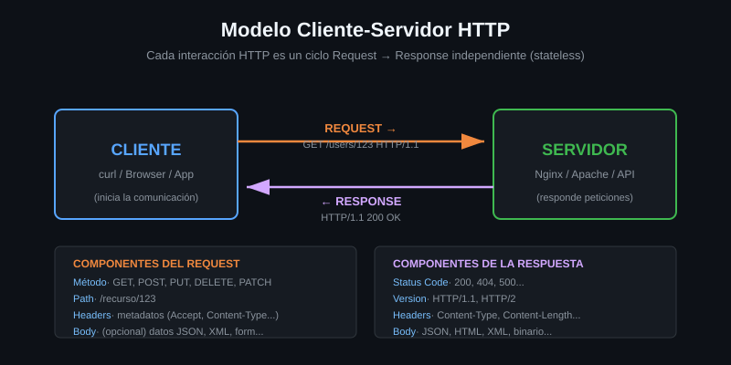

# Qué es HTTP

> HTTP es texto que viaja por un socket. Todo lo demás — navegadores, APIs,
> frameworks — es una capa encima de eso.



## 🎯 Objetivos

- Explicar el modelo cliente-servidor y el ciclo request/response
- Nombrar las cuatro partes de un mensaje HTTP y decir cuáles son opcionales
- Escribir a mano una petición HTTP válida y reconocerla en la traza de curl
- Explicar qué significa que HTTP no tenga estado y qué se hace al respecto

---

## 1. Qué problema resuelve

Dos programas en dos máquinas distintas necesitan intercambiar datos. Podrías
inventarte un formato: los primeros cuatro bytes son la longitud, luego un
identificador de operación, luego los datos. Funcionaría, y nadie más en el
mundo podría hablar con tu servidor.

HTTP es el formato que se acordó para no tener que inventárselo cada vez. Su
apuesta es que el mensaje sea **texto legible**, aunque cueste unos bytes de
más, porque un formato que un humano puede leer es un formato que un humano
puede depurar.

Por eso este bootcamp existe. Cuando algo falla entre dos servicios, lo que se
mira es el texto que se mandaron. curl es la herramienta que te deja escribirlo
y leerlo sin intermediarios.

---

## 2. Cómo funciona

### 2.1 El ciclo

Siempre empieza el cliente. El servidor nunca habla primero: espera.

```
Cliente                            Servidor
   |                                   |
   |------ REQUEST (petición) -------->|
   |                                   |  procesa
   |<----- RESPONSE (respuesta) -------|
   |                                   |
```

**Cliente** es quien inicia: tu terminal con curl, un navegador, otro servicio.
**Servidor** es quien responde. Un mismo programa puede ser las dos cosas en
momentos distintos.

Una petición, una respuesta. Si quieres dos cosas, mandas dos peticiones.

### 2.2 Las cuatro partes de un mensaje

Petición y respuesta tienen la misma estructura. Solo cambia la primera línea.

| Parte | En la petición | En la respuesta |
|---|---|---|
| **Línea inicial** | `GET /users/123 HTTP/1.1` | `HTTP/1.1 200 OK` |
| **Headers** | Metadatos de lo que pides | Metadatos de lo que te dan |
| **Línea en blanco** | Obligatoria. Separa headers de cuerpo | Igual |
| **Cuerpo** | Opcional. Los datos que envías | Opcional. Los datos que recibes |

Esa línea en blanco no es decorativa: es lo que le dice al servidor "los headers
terminaron aquí, lo que venga después son datos".

### 2.3 Una petición completa, tal cual viaja

```http
GET /users/123 HTTP/1.1
Host: api.ejemplo.com
Accept: application/json
User-Agent: curl/8.5.0

```

Cuatro líneas y una en blanco. Eso es todo lo que curl manda cuando escribes
`curl https://api.ejemplo.com/users/123`.

De esas cuatro, **tú solo escribiste la URL**. `Host`, `Accept` y `User-Agent`
los añadió curl por su cuenta. Verlos es el objetivo de la práctica 03.

### 2.4 Y la respuesta

```http
HTTP/1.1 200 OK
Content-Type: application/json
Content-Length: 47

{"id": 123, "name": "Ana", "email": "ana@x.com"}
```

La línea inicial de la respuesta se llama **status line** y trae tres cosas: la
versión del protocolo, el código numérico, y un texto que lo explica. El texto
es para humanos y ningún programa debería leerlo: lo que cuenta es el número.

### 2.5 Los verbos

La primera palabra de la petición es el **método**, y declara la intención.

| Método | Intención | ¿Lleva cuerpo? | ¿Idempotente? |
|---|---|:--:|:--:|
| `GET` | Leer un recurso | No | Sí |
| `POST` | Crear un recurso | Sí | **No** |
| `PUT` | Reemplazar un recurso entero | Sí | Sí |
| `PATCH` | Modificar parte de un recurso | Sí | No necesariamente |
| `DELETE` | Borrar un recurso | Normalmente no | Sí |
| `HEAD` | Como GET, pero sin cuerpo en la respuesta | No | Sí |
| `OPTIONS` | Preguntar qué métodos acepta el servidor | No | Sí |

**Idempotente** significa que ejecutarlo diez veces deja el sistema igual que
ejecutarlo una. `DELETE /users/123` diez veces borra el usuario 123 una vez y
después no pasa nada más. `POST /users` diez veces te crea diez usuarios.

Esa distinción importa mucho más de lo que parece, y la Semana 07 la usará: un
script puede reintentar sin miedo una operación idempotente, y no puede
reintentar un `POST` a ciegas.

Esta semana solo usas `GET`. El resto llegan en la Semana 02.

---

## 3. Cómo se usa

Míralo con tus propios ojos. Con el laboratorio levantado:

```bash
# -s calla la barra de progreso, que en -v se mezcla con la traza y estorba.
curl -sv http://localhost:8080/get 2>&1 | head -14
```

En la salida, `*` es curl hablando de sí mismo, `>` es lo que **envió** y `<`
lo que **recibió**:

```
*   Trying 127.0.0.1:8080...
* Connected to localhost (127.0.0.1) port 8080 (#0)
> GET /get HTTP/1.1
> Host: localhost:8080
> User-Agent: curl/7.81.0
> Accept: */*
>
* Mark bundle as not supporting multiuse
< HTTP/1.1 200 OK
< Access-Control-Allow-Credentials: true
```

Es exactamente la estructura de la sección 2. No hay magia por debajo.

El endpoint `/get` del laboratorio devuelve, en JSON, la petición que le hiciste.
Es un espejo:

```bash
curl -s http://localhost:8080/get | jq '.headers'
# {
#   "Accept": ["*/*"],
#   "Host": ["localhost:8080"],
#   "User-Agent": ["curl/7.81.0"]
# }
```

Los tres headers que curl puso solo, vistos desde el otro lado.

---

## 4. HTTP no tiene estado

Cada petición es independiente. El servidor no recuerda la anterior. Si haces
dos peticiones seguidas, para el servidor son dos desconocidos.

Eso no es un descuido: es lo que permite que un servidor atienda a millones de
clientes sin guardar nada de cada uno, y que puedas poner diez servidores detrás
de un balanceador sin que importe cuál te toque.

El precio es que "estar logueado" hay que reconstruirlo en cada petición. Las
tres formas de hacerlo, y las tres semanas donde aparecen:

| Mecanismo | Qué viaja en cada petición | Semana |
|---|---|:--:|
| **Credenciales** | Usuario y contraseña, o una API key | 03 |
| **Token** | Un `Authorization: Bearer ...` que el servidor sabe validar | 03 y 08 |
| **Cookie** | Un identificador de sesión que el servidor asocia a un estado suyo | 05 |

Los tres son el mismo truco: meter en cada petición lo que hace falta para que
el servidor sepa quién eres sin haberlo recordado.

---

## 5. Antipatrones

| Antipatrón | Por qué duele | Qué hacer en su lugar |
|---|---|---|
| Leer el texto de la status line (`OK`, `Not Found`) en un script | Es libre: un servidor puede mandar `HTTP/1.1 200 Todo bien`. Y desaparece en HTTP/2 | Comparar el número: `%{http_code}` |
| Usar `GET` para una operación que cambia algo | Los proxies y los navegadores precargan y cachean GETs. Alguien acabará borrando datos sin querer | `POST`, `PUT`, `PATCH` o `DELETE`, según la intención |
| Dar por hecho que si hubo respuesta, hubo éxito | Un 500 es una respuesta perfectamente válida a nivel HTTP | Mirar el código de estado. Semana 01, archivo 06 |
| Reintentar un `POST` fallido a ciegas | No es idempotente: puedes crear el recurso dos veces | Reintentar solo métodos idempotentes, o usar una clave de idempotencia |

---

## 6. Trucos

- **`/anything` responde a cualquier método** y te devuelve todo lo que le
  mandaste. Es el endpoint más útil del laboratorio para entender qué está
  saliendo de tu máquina:

  ```bash
  curl -s http://localhost:8080/anything | jq '{method, url, headers}'
  ```

- **Para ver el mensaje HTTP crudo, sin que curl lo interprete**, `--trace-ascii`
  te lo enseña byte a byte, con la línea en blanco incluida:

  ```bash
  curl -s --trace-ascii - -o /dev/null http://localhost:8080/get | head -20
  ```

- HTTPS **no es otro protocolo**: es exactamente este HTTP metido dentro de una
  capa TLS. Lo que viaja por dentro es el mismo texto. Por eso la Semana 05 se
  llama SSL/TLS y no "otro HTTP".

---

## 📚 Recursos Adicionales

- [RFC 9110 — HTTP Semantics](https://datatracker.ietf.org/doc/html/rfc9110) — la referencia actual. Los métodos están en la sección 9
- [MDN — Overview of HTTP](https://developer.mozilla.org/es/docs/Web/HTTP/Overview) — en español, con diagramas
- [everything.curl.dev — HTTP](https://everything.curl.dev/http) — el libro de curl, escrito por su autor

---

## ✅ Checklist de Verificación

- [ ] `curl -v http://localhost:8080/get` y sabes distinguir las líneas `>` de las `<`
- [ ] Identificas las cuatro partes en la petición y en la respuesta
- [ ] Sabes cuáles de los headers que salen los escribiste tú (ninguno)
- [ ] Explicas por qué `DELETE` es idempotente y `POST` no
- [ ] Explicas por qué un 404 no es un fallo de curl
