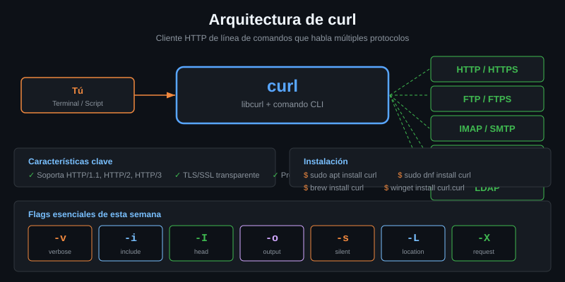

# Instalación y versiones de curl

> Saber qué versión tienes no es burocracia: es lo que evita que pierdas media
> hora depurando un comando que en tu máquina no puede funcionar.



## 🎯 Objetivos

- Instalar curl en tu sistema y comprobar que responde
- Leer las cuatro líneas de `curl --version` y decir qué significa cada una
- Distinguir `Protocols:` de `Features:` y saber por qué la diferencia importa
- Explicar qué es libcurl y por qué su versión aparece al lado de la de curl
- Saber qué hacer cuando un ejemplo del material necesita una versión posterior

---

## 1. Qué problema resuelve

curl lleva desde 1998 y **casi nunca rompe hacia atrás**: un comando escrito
hace quince años sigue funcionando hoy. Eso está muy bien, y crea un problema
que nadie espera.

El problema no es que un flag desaparezca. Es que **aparecen**. curl publica una
versión cada ocho semanas y va añadiendo opciones. Tu distribución, mientras
tanto, congela una versión durante años. Ubuntu 22.04 sigue en **7.81**, de
enero de 2022.

Resultado: copias un ejemplo perfectamente correcto de una web, lo ejecutas, y
curl te dice que esa opción no existe. No estás haciendo nada mal. Estás cuatro
años por detrás.

---

## 2. Cómo se instala

### 2.1 Por gestor de paquetes

```bash
# Debian / Ubuntu
sudo apt update && sudo apt install -y curl

# Fedora / RHEL / Rocky
sudo dnf install -y curl

# Arch
sudo pacman -S curl

# macOS (el del sistema es antiguo; Homebrew trae uno reciente)
brew install curl

# Alpine
apk add curl
```

### 2.2 Windows

Windows 10 y 11 traen un `curl.exe` de verdad en `System32`. El problema es
otro: **en PowerShell, `curl` es un alias de `Invoke-WebRequest`**, que no es
curl ni se le parece.

```powershell
Get-Command curl
# CommandType: Alias    Name: curl -> Invoke-WebRequest
```

Para este bootcamp: trabaja dentro de **WSL2**. Todo el material asume un shell
POSIX, y la mitad de las prácticas usan pipes y `jq`.

### 2.3 Comprobar que está

```bash
curl --version
```

Si eso responde, ya tienes todo lo que hace falta para la Semana 01.

---

## 3. Leer `curl --version`

Cuatro líneas, y cada una dice algo distinto:

```
curl 8.5.0 (x86_64-pc-linux-gnu) libcurl/8.5.0 OpenSSL/3.0.13 zlib/1.2.13 brotli/1.0.9 nghttp2/1.59.0
Release-Date: 2023-12-06
Protocols: dict file ftp ftps gopher gophers http https imap imaps ldap ldaps mqtt pop3 pop3s rtsp scp sftp smb smbs smtp smtps telnet tftp
Features: alt-svc AsynchDNS brotli GSS-API HSTS HTTP2 HTTPS-proxy IDN IPv6 Kerberos Largefile libz NTLM PSL SPNEGO SSL threadsafe TLS-SRP UnixSockets zstd
```

### 3.1 Línea 1: versión y librerías

`curl 8.5.0` es el programa. `libcurl/8.5.0` es la **librería** que hace el
trabajo de verdad; el programa `curl` es una interfaz de línea de comandos por
encima de ella. Cuando en la Semana 06 uses `--libcurl`, curl te generará el
código C que llama a esa librería.

Lo que sigue son las librerías con las que se compiló, y cada una habilita algo:

| Librería | Habilita |
|---|---|
| `OpenSSL` / `GnuTLS` / `NSS` | HTTPS. Cuál sea importa en la Semana 05 |
| `zlib`, `brotli`, `zstd` | Descompresión con `--compressed` |
| `nghttp2` | HTTP/2 |
| `libidn2` | Dominios con caracteres no ASCII |
| `libssh2` | `scp` y `sftp` |

### 3.2 Línea 2: fecha

`Release-Date` te dice de cuándo es. Es la forma más rápida de saber si vas muy
por detrás sin memorizar el calendario de versiones.

### 3.3 Línea 3: `Protocols`

**Lo que ese binario sabe hablar.** curl no es solo HTTP: habla FTP, SMTP, IMAP,
SFTP y una docena más.

Si un protocolo no está en esta lista, no hay flag que lo arregle. Lo más
frecuente: `http3` no aparece casi nunca.

### 3.4 Línea 4: `Features`

**Lo que se activó al compilar.** Es una lista distinta de `Protocols` y aquí
está la confusión más común de todo el bootcamp:

| Está en | No está en | Ejemplo |
|---|---|---|
| `Features` | `Protocols` | `HTTP2`, `HTTP3`, `brotli`, `HSTS`, `IPv6` |
| `Protocols` | `Features` | `http`, `https`, `ftp`, `smtp` |

> [!IMPORTANT]
> Un flag puede existir en tu versión **y aun así fallar**, porque la feature no
> se compiló. Mira siempre las dos líneas. `--http3` es el caso clásico: el flag
> es de 7.66, pero `HTTP3` casi nunca está en `Features`.

Comprobar una feature concreta:

```bash
curl --version | grep -o HTTP2
# HTTP2

curl --version | grep -o HTTP3
# (nada: tu curl no soporta HTTP/3)
```

---

## 4. Qué hacer si tu versión se queda corta

El suelo de este bootcamp es **7.81**, porque es lo que trae Ubuntu 22.04 y es
la versión más común entre alumnos. Todo lo posterior va marcado en el propio
ejemplo.

El caso que más muerde es `--json`, que es de **7.82**. Está a una versión de
distancia de 7.81:

```bash
# curl 7.82 o superior
curl --json '{"a":1}' http://localhost:8080/post

# Equivalente exacto en cualquier version. Es literalmente lo que hace --json.
curl -H 'Content-Type: application/json' \
     -H 'Accept: application/json' \
     -d '{"a":1}' http://localhost:8080/post
```

Tres salidas, en este orden:

1. **Usar la alternativa larga.** Casi todo flag nuevo es azúcar sobre algo que
   ya existía. La tabla completa está en
   [`docs/versiones-de-curl.md`](../../../docs/versiones-de-curl.md).
2. **Instalar un curl más nuevo** desde los backports de tu distribución.
3. **Usar un contenedor** con una versión reciente:

   ```bash
   docker run --rm --network bc-curl-lab_default \
     curlimages/curl:8.21.0 -s http://httpbin:8080/get
   ```

   Fíjate en el host: dentro de la red del laboratorio el servicio se llama
   `httpbin`, no `localhost`.

---

## 5. Antipatrones

| Antipatrón | Por qué duele | Qué hacer en su lugar |
|---|---|---|
| Suponer que el curl del alumno es igual que el tuyo | Un ejemplo con `--json` no funciona en Ubuntu 22.04 y el alumno cree que se equivocó | Marcar la versión mínima y dar la alternativa |
| Usar `curl` en PowerShell | Es `Invoke-WebRequest`: otros flags, otra salida, otro programa | Trabajar en WSL |
| Mirar solo `Protocols` para saber si hay HTTP/2 | HTTP/2 y HTTP/3 salen en `Features`, no ahí | Mirar las dos líneas |
| `curl \| bash` para instalar algo | Descargas y ejecutas sin leer, y un servidor puede servir algo distinto a curl que a un navegador | Descargar a un archivo, leerlo, y después ejecutarlo |
| Fijar la imagen del contenedor en `:latest` | Cada `pull` cambia la versión sin que nadie lo decida | Versión completa: `curlimages/curl:8.21.0` |

---

## 6. Trucos

- **Un solo comando para saber si te falta algo** antes de empezar una semana:

  ```bash
  ./scripts/verificar-semana.sh --doctor
  ```

- **Buscar en la ayuda por lo que hace la opción**, no por su nombre:

  ```bash
  curl --help all | grep -i 'timeout'
  ```

- **`curl --help all` son 245 líneas; `curl --help` son 17.** Si una opción "no
  existe", casi siempre es que estabas mirando el resumen.

- **La fecha de una versión** te sitúa más rápido que el número:

  ```bash
  curl --version | sed -n 2p
  # Release-Date: 2022-01-05
  ```

- **`curl --manual`** es el manpage entero empotrado en el binario, unas 5.000
  líneas. Funciona sin red y sin `man` instalado, que es justo lo que necesitas
  dentro de un contenedor.

---

## 📚 Recursos Adicionales

- [curl — Download](https://curl.se/download.html) — binarios y fuentes oficiales
- [Cuándo entró cada opción](https://github.com/curl/curl/blob/master/docs/options-in-versions) — la referencia autoritativa. Es un archivo de texto plano
- [Changelog de curl](https://curl.se/changes.html) — qué trajo cada versión
- [`docs/versiones-de-curl.md`](../../../docs/versiones-de-curl.md) — la tabla de este bootcamp, con las alternativas

---

## ✅ Checklist de Verificación

- [ ] `curl --version` responde y sabes decir tu versión de memoria
- [ ] Distingues la línea `Protocols:` de la línea `Features:`
- [ ] Sabes si tu curl soporta HTTP/2 y si soporta HTTP/3
- [ ] Sabes si tu curl tiene `--json` (7.82+) y cuál es la alternativa
- [ ] `curl --help all | grep -i timeout` te devuelve algo
