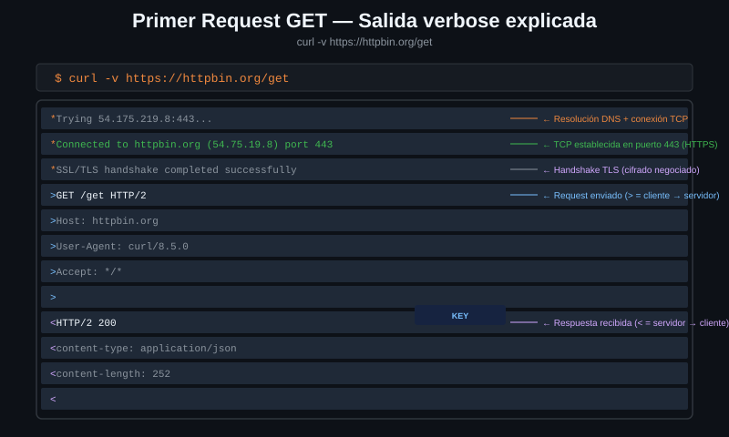

# El primer GET

> `curl URL` parece el comando más simple del mundo. Lo interesante no es lo que
> hace, sino todo lo que decide por ti sin decírtelo.



## 🎯 Objetivos

- Hacer un GET y explicar qué headers añadió curl sin que se lo pidieras
- Distinguir qué imprime curl en stdout y qué en stderr, y por qué importa
- Guardar una respuesta en un archivo con `-o` y con `-O`, y saber cuándo usar cada uno
- Explicar por qué curl no formatea el JSON y qué hacer al respecto

---

## 1. Qué problema resuelve

Lo mínimo que puedes hacer con curl:

```bash
curl http://localhost:8080/get
```

Sin flags, curl toma seis decisiones por ti:

1. El método es `GET`
2. El esquema, si falta, es `http://`
3. Añade `Host`, `User-Agent` y `Accept`
4. Imprime **solo el cuerpo** de la respuesta, en stdout
5. Manda todo lo demás — progreso, errores — a stderr
6. No sigue redirects, no comprueba el código de estado, y no tiene timeout

Las seis son razonables. Cinco de las seis te van a morder alguna vez.

---

## 2. Cómo funciona

### 2.1 Lo que curl manda sin pedírselo

```bash
curl -s http://localhost:8080/get | jq '.headers'
```

```json
{
  "Accept": ["*/*"],
  "Host": ["localhost:8080"],
  "User-Agent": ["curl/7.81.0"]
}
```

| Header | Qué dice | ¿Puedes cambiarlo? |
|---|---|---|
| `Host` | A qué host va dirigida la petición | Sí, con `-H`, pero rara vez conviene |
| `User-Agent` | Quién soy | Sí, con `-A` o `-H`. A veces hace falta: hay APIs que rechazan a curl |
| `Accept: */*` | Acepto cualquier tipo de contenido | Sí, con `-H 'Accept: application/json'` |

`Host` es obligatorio en HTTP/1.1 y es lo que permite que un mismo servidor
sirva cien dominios distintos desde una sola IP: la petición dice a cuál iba.

`Accept: */*` significa "me da igual el formato". Muchas APIs devuelven JSON de
todas formas, pero algunas devuelven HTML si no les pides otra cosa. Cuando una
API "responde raro", el `Accept` es lo segundo que hay que mirar.

### 2.2 stdout y stderr no son lo mismo

Esta separación es la clave de que curl se pueda usar en pipes.

| Canal | Qué va ahí |
|---|---|
| **stdout** (1) | El cuerpo de la respuesta. Nada más |
| **stderr** (2) | Barra de progreso, mensajes de error, traza de `-v` |

Por eso esto funciona sin ensuciar el JSON:

```bash
curl -s http://localhost:8080/get | jq '.url'
# "http://localhost:8080/get"
```

Y por eso, para capturar la traza de `-v`, hay que redirigir stderr:

```bash
curl -v http://localhost:8080/get 2>&1 | grep '^>'
# > GET /get HTTP/1.1
# > Host: localhost:8080
# > User-Agent: curl/7.81.0
# > Accept: */*
```

Sin el `2>&1`, el `grep` no ve nada: la traza no pasó por el pipe.

### 2.3 La barra de progreso

Cuando la salida **no** va a una terminal, curl imprime una tabla de progreso en
stderr:

```bash
curl http://localhost:8080/get > /dev/null
#   % Total    % Received % Xferd  Average Speed   Time    Time     Time  Current
#                                  Dload  Upload   Total   Spent    Left  Speed
# 100   245  100   245    0     0  40833      0 --:--:-- --:--:-- --:--:-- 49000
```

Es útil bajando un archivo grande y es ruido en cualquier otro caso. Se apaga
con `-s`.

---

## 3. Guardar la respuesta

### 3.1 `-o`: tú eliges el nombre

```bash
curl -s -o respuesta.json http://localhost:8080/get
```

### 3.2 `-O`: el nombre lo pone la URL

```bash
curl -s -O http://localhost:8080/base64/aG9sYQ==
# guarda un archivo llamado 'aG9sYQ=='
```

`-O` usa el **último segmento del path**. Si la URL termina en `/`, no hay
nombre y curl falla. Es cómodo para `https://ejemplo.com/archivo.zip` y una
fuente de sorpresas para cualquier otra cosa.

### 3.3 `-o /dev/null`: tirar el cuerpo

Es el idioma más frecuente del bootcamp. Cuando lo que te interesa es el código
de estado o el tiempo, y no el contenido:

```bash
curl -s -o /dev/null -w '%{http_code} %{time_total}s\n' http://localhost:8080/get
# 200 0.000947s
```

Sin `-o /dev/null`, el cuerpo se mezclaría con lo que imprime `-w`.

> [!NOTE]
> El separador decimal de `%{time_total}` depende de la configuración regional
> de tu sistema: puede salir `0,001204` con coma. En la Semana 07, cuando haya
> que comparar tiempos en bash, esto importará. Se resuelve con
> `LC_ALL=C curl ...`.

---

## 4. curl entrega los bytes tal cual

curl no reformatea, no reindenta y no reordena nada. Lo que imprime es
**exactamente** lo que llegó por el socket. Se puede comprobar: el servidor
anuncia cuántos bytes manda, y son los que salen.

```bash
curl -s -o /dev/null -D - http://localhost:8080/json | grep -i '^content-length'
# Content-Length: 421

curl -s http://localhost:8080/json | wc -c
# 421
```

Que no toque nada es una decisión, no una carencia. Si curl reindentara no
podrías depurar un JSON mal formado, ni comparar dos respuestas byte a byte, ni
calcular un hash de lo que llegó.

La consecuencia práctica: **si la respuesta se ve bonita, es que el servidor la
mandó bonita**. El laboratorio formatea su JSON; muchas APIs reales lo mandan en
una sola línea de tres mil caracteres, porque los saltos de línea también
ocupan ancho de banda.

Para leerlo en cualquiera de los dos casos, `jq`:

```bash
curl -s http://localhost:8080/json | jq '.slideshow.title'
# "Sample Slide Show"
```

`jq` llega en serio en la Semana 07. Hasta entonces se usa solo para mirar.

---

## 5. Antipatrones

| Antipatrón | Por qué duele | Qué hacer en su lugar |
|---|---|---|
| `curl URL` a secas dentro de un script | Sin `-s` ensucia stderr; sin `--fail` se traga los errores; sin `--max-time` puede colgarse | `curl -sS --fail-with-body --max-time 30` |
| Usar `-s` sin `-S` | `-s` también silencia los mensajes de error: un fallo de red se convierte en salida vacía | `-sS`: calla el progreso, deja pasar los errores |
| `-O` con una URL que no termina en un nombre de archivo | Guarda algo con un nombre imposible, o falla | `-o` con el nombre que tú decidas |
| `curl URL | jq` sin `-s` | La barra de progreso va a stderr y no rompe el pipe, pero ensucia la terminal | `-s` siempre que haya pipe |
| Pipe a `grep` de la traza de `-v` sin `2>&1` | La traza va a stderr y el grep no la ve | `curl -v URL 2>&1 \| grep ...` |

---

## 6. Trucos

- **`-sS` es el par que casi siempre quieres**: silencia el progreso pero deja
  pasar los errores. Compara:

  ```bash
  curl -s http://no-existe.invalido/ ; echo "exit=$?"
  # exit=6      ← ni una palabra sobre lo que pasó

  curl -sS http://no-existe.invalido/ ; echo "exit=$?"
  # curl: (6) Could not resolve host: no-existe.invalido
  # exit=6
  ```

- **`--no-progress-meter` (7.67+) es `-s` sin el efecto secundario**: quita la
  barra de progreso y conserva los mensajes de error. Es lo mismo que `-sS`,
  con una opción en vez de dos.

- **Para ver solo los headers de respuesta de un GET real**, `-D -` los vuelca
  en stdout sin cambiar el método:

  ```bash
  curl -s -o /dev/null -D - http://localhost:8080/get | head -3
  ```

  `-I` también los enseña, pero haciendo un `HEAD`, que es otra petición
  distinta. En un servidor que trate `HEAD` de forma especial, verás otra cosa.

- **`/anything` acepta cualquier método y te lo devuelve todo.** Es el endpoint
  para preguntarle al servidor "¿qué te ha llegado exactamente?".

---

## 📚 Recursos Adicionales

- [everything.curl.dev — Verbose](https://everything.curl.dev/usingcurl/verbose) — qué imprime curl y por dónde
- [go-httpbin — endpoints](https://github.com/mccutchen/go-httpbin) — la lista completa de lo que sirve el laboratorio
- [Manual de jq](https://jqlang.github.io/jq/manual/) — para ir mirando antes de la Semana 07

---

## ✅ Checklist de Verificación

- [ ] Enumeras los tres headers que curl añade solo y qué hace cada uno
- [ ] Explicas por qué `curl -v URL | grep '>'` no funciona y `2>&1` sí
- [ ] Guardas una respuesta con `-o` y ves la diferencia con `-O`
- [ ] Usas `-o /dev/null -w '%{http_code}'` para quedarte solo con el código
- [ ] Reproduces la diferencia entre `-s` y `-sS` con un host que no existe
