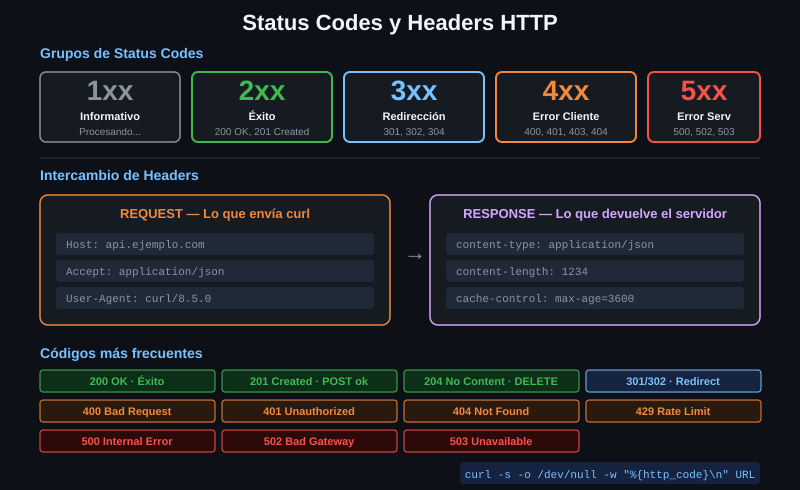

# Códigos de estado

> `curl -s https://api/deploy` sale con código **0** aunque el servidor responda
> 500. Para curl la transferencia fue un éxito: pidió, y le contestaron. Este
> archivo existe para que eso no te pille nunca.



## 🎯 Objetivos

- Nombrar las cinco familias y saber de quién es la culpa en cada una
- Reconocer los diez o doce códigos que verás de verdad
- Explicar por qué el código de salida de curl y el código HTTP son cosas distintas
- Hacer que un script detecte un error HTTP, de dos formas

---

## 1. Qué problema resuelve

Después de una petición hay dos preguntas distintas, y confundirlas es el error
más caro de la semana:

1. **¿Pude hablar con el servidor?** — la responde el **código de salida de
   curl**
2. **¿El servidor hizo lo que le pedí?** — la responde el **código de estado
   HTTP**

curl solo contesta la primera por su cuenta. Para la segunda hay que
preguntarle.

```bash
curl -s -o /dev/null http://localhost:8080/status/500 ; echo "exit=$?"
# exit=0    ← el 500 llegó perfectamente. Transferencia exitosa.
```

Un script que solo mire `$?` da por bueno un despliegue que falló.

---

## 2. Las cinco familias

El primer dígito es lo único que hay que memorizar.

| Familia | Significa | ¿De quién es la culpa? |
|---|---|---|
| **1xx** | Informativo: sigue esperando | De nadie. Casi nunca los verás |
| **2xx** | Éxito | De nadie |
| **3xx** | Redirección: está en otro sitio | De nadie, pero tienes que seguirla |
| **4xx** | Error del **cliente**: la petición está mal | **Tuya** |
| **5xx** | Error del **servidor**: la petición estaba bien, él falló | **Suya** |

La frontera 4xx / 5xx es la que decide qué haces:

- **4xx**: reintentar no sirve de nada. Mandaste algo mal y volver a mandarlo
  igual dará lo mismo. Arréglalo.
- **5xx**: reintentar sí puede servir. El servidor tuvo un mal momento.

Esa distinción es exactamente lo que la Semana 07 convierte en política de
reintentos.

---

## 3. Los que verás de verdad

### 3.1 Éxito

| Código | Nombre | Cuándo |
|:--:|---|---|
| 200 | OK | Lo normal |
| 201 | Created | Un `POST` creó algo. Suele traer `Location` con la URL nueva |
| 204 | No Content | Fue bien y no hay cuerpo. Típico de `DELETE` |

### 3.2 Redirección

| Código | Nombre | Cuándo |
|:--:|---|---|
| 301 | Moved Permanently | Cambió para siempre. Actualiza tus enlaces |
| 302 | Found | Cambió por ahora |
| 304 | Not Modified | No cambió desde tu última copia. **No trae cuerpo**. Semana 09 |
| 307 | Temporary Redirect | Como el 302, pero **conserva el método y el cuerpo** |
| 308 | Permanent Redirect | Como el 301, conservando método y cuerpo |

El 307 y el 308 existen porque históricamente los clientes convertían un `POST`
redirigido en un `GET`, perdiendo el cuerpo por el camino.

### 3.3 Error tuyo

| Código | Nombre | Qué mirar |
|:--:|---|---|
| 400 | Bad Request | El cuerpo o los parámetros están mal formados |
| 401 | Unauthorized | Falta la credencial, o no vale. Semana 03 |
| 403 | Forbidden | Te identificaste bien, pero no tienes permiso |
| 404 | Not Found | La URL no existe. O existe y no te lo quieren decir |
| 405 | Method Not Allowed | El recurso existe; ese método no. Mira el header `Allow` |
| 409 | Conflict | Chocas con el estado actual: ya existe, o alguien lo cambió antes |
| 415 | Unsupported Media Type | Falta o está mal el `Content-Type`. Semana 02 |
| 422 | Unprocessable Content | El formato es válido, los datos no |
| 429 | Too Many Requests | Rate limit. Mira `Retry-After`. Semana 07 |

**401 y 403 se confunden constantemente.** 401 es "no sé quién eres"; 403 es "sé
quién eres y no puedes". Ante un 401 tiene sentido reintentar con otra
credencial; ante un 403, no.

### 3.4 Error suyo

| Código | Nombre | Qué suele significar |
|:--:|---|---|
| 500 | Internal Server Error | Excepción no controlada al otro lado |
| 502 | Bad Gateway | Un proxy no pudo hablar con el servidor de detrás |
| 503 | Service Unavailable | Caído o saturado. A veces trae `Retry-After` |
| 504 | Gateway Timeout | Un proxy esperó al de detrás y se cansó |

502, 503 y 504 casi siempre vienen de un proxy o un balanceador, no de la
aplicación. Son los tres que más sentido tiene reintentar.

---

## 4. Provocarlos a propósito

El laboratorio los sirve todos:

```bash
for c in 200 201 204 301 400 401 403 404 429 500 503; do
  printf '%s -> %s\n' "$c" \
    "$(curl -s -o /dev/null -w '%{http_code}' "http://localhost:8080/status/$c")"
done
```

Provocarlos a mano es la única forma de saber qué hace **tu** código cuando
aparecen. La práctica 04 va de esto.

---

## 5. Cómo detectarlos en un script

### 5.1 Con `--fail`

`-f` hace que curl salga con **22** ante cualquier 4xx o 5xx:

```bash
curl -f -s -o /dev/null http://localhost:8080/status/503 ; echo "exit=$?"
# exit=22
```

El precio: `-f` **descarta el cuerpo del error**, que es justo donde la API
explica qué pasó.

```bash
curl -f -s http://localhost:8080/status/503
# (nada)
```

### 5.2 Con `--fail-with-body` (7.76+)

Hace lo mismo **y conserva el cuerpo**:

```bash
curl --fail-with-body -s http://localhost:8080/status/503 ; echo "exit=$?"
# exit=22
```

Es lo que quieres casi siempre. En 7.81 ya está, así que en este bootcamp se
usa sin reservas. En una máquina anterior a 7.76, la alternativa es la de abajo.

### 5.3 Con `%{http_code}`, sin depender de la versión

```bash
codigo=$(curl -s -o /dev/null -w '%{http_code}' http://localhost:8080/status/503)
if [ "$codigo" -ge 400 ]; then
  echo "Error HTTP $codigo"
fi
# Error HTTP 503
```

Más verboso, y te deja decidir **por familia**: reintentar los 5xx, abortar los
4xx. Es lo que acaba haciendo `api-toolkit` a partir de la Semana 07.

---

## 6. Los códigos de salida de curl

No confundir con los HTTP. Son de curl, y hay unos cien. Los de esta semana:

| Código | Significa |
|:--:|---|
| 0 | La transferencia terminó. **No dice nada del código HTTP** |
| 3 | La URL está mal formada |
| 6 | No se pudo resolver el host (DNS) |
| 7 | No se pudo conectar (host resuelto, puerto cerrado) |
| 22 | `--fail` y el servidor respondió 4xx o 5xx |
| 28 | Se agotó el tiempo (`--max-time` o `--connect-timeout`) |
| 60 | El certificado no se pudo verificar. Semana 05 |

```bash
curl -s -o /dev/null http://no-existe.invalido/ ; echo $?   # 6
curl -s -o /dev/null http://localhost:9/ ; echo $?          # 7
```

La lista completa está en la
[tabla de errores de libcurl](https://curl.se/libcurl/c/libcurl-errors.html).

---

## 7. Antipatrones

| Antipatrón | Por qué duele | Qué hacer en su lugar |
|---|---|---|
| Mirar solo `$?` después de un curl | Un 500 sale con 0: el script sigue como si el despliegue hubiera ido bien | `--fail-with-body`, o comparar `%{http_code}` |
| `-f` cuando la API explica el error en el cuerpo | Pierdes el único sitio donde ponía qué campo estaba mal | `--fail-with-body` |
| Reintentar un 4xx | La petición está mal: reintentarla igual da igual | Reintentar solo 5xx, 429 y errores de red |
| Leer el texto de la status line (`Not Found`) | Es libre y desaparece en HTTP/2 | Comparar el número |
| Tratar 401 y 403 igual | Uno se arregla con otra credencial; el otro con otros permisos | Distinguirlos |
| Dar por hecho que 2xx significa "hay datos" | Un 204 es un éxito sin cuerpo | Comprobar también `%{size_download}` si hace falta |

---

## 8. Trucos

- **Provocar un código concreto para probar tu manejo de errores**:
  `http://localhost:8080/status/418`. Acepta cualquiera, incluidos los raros.

- **Varios códigos posibles, uno al azar**, para probar reintentos:

  ```bash
  curl -s -o /dev/null -w '%{http_code}\n' 'http://localhost:8080/status/200,503'
  ```

- **El header `Allow` te dice qué métodos acepta el recurso** cuando recibes un
  405. No hace falta adivinar.

- **`%{response_code}` es sinónimo exacto de `%{http_code}`.** Las dos existen;
  `%{status_code}` no existe y es el error de tecleo más común.

- **Guardar el código y el cuerpo a la vez**, sin llamar dos veces:

  ```bash
  respuesta=$(curl -s -w '\n%{http_code}' http://localhost:8080/status/404)
  codigo=$(printf '%s' "$respuesta" | tail -1)
  cuerpo=$(printf '%s' "$respuesta" | sed '$d')
  echo "codigo=$codigo"
  ```

---

## 📚 Recursos Adicionales

- [RFC 9110 § 15 — Status Codes](https://datatracker.ietf.org/doc/html/rfc9110#section-15) — la definición de cada uno
- [MDN — Códigos de estado HTTP](https://developer.mozilla.org/es/docs/Web/HTTP/Status) — en español, uno por página
- [Códigos de salida de curl](https://curl.se/libcurl/c/libcurl-errors.html) — la otra tabla, la que no es HTTP

---

## ✅ Checklist de Verificación

- [ ] Dices de memoria qué significa cada familia y de quién es la culpa
- [ ] Explicas la diferencia entre 401 y 403
- [ ] Compruebas que `curl -s` sale con 0 ante un 500
- [ ] Haces que salga distinto de 0, con `--fail-with-body` y con `%{http_code}`
- [ ] Provocas un 6 y un 7 y sabes qué los diferencia
- [ ] Provocas un 28 con `--max-time`
