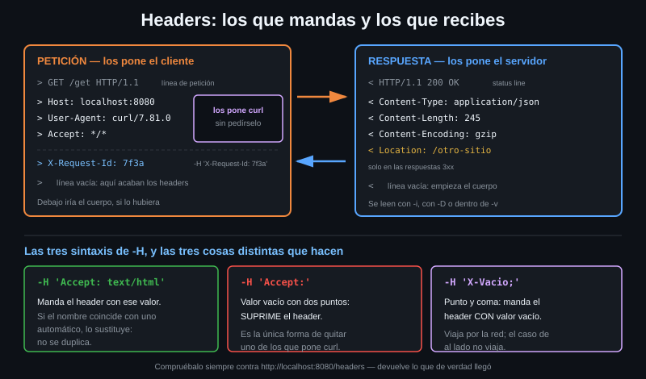

# Headers HTTP

> curl manda tres headers que tú no escribiste, y el servidor te devuelve seis
> que no viste. Este archivo es sobre esas nueve líneas: quién las pone, qué
> significan y cuáles puedes cambiar.



## 🎯 Objetivos

- Distinguir un header de petición de uno de respuesta y saber por qué importa
- Nombrar los tres headers que curl añade solo y decir qué pasa si faltan
- Añadir, cambiar y **quitar** un header con `-H`
- Leer `Content-Type`, `Content-Length` y `Content-Encoding` sin adivinar

---

## 1. Qué problema resuelve

Un mensaje HTTP tiene dos partes: los **headers**, que son metadatos, y el
**cuerpo**, que son los datos. Sin headers el cuerpo es una secuencia de bytes
sin contexto: nadie sabe si es JSON, HTML o un PNG, ni dónde termina, ni si está
comprimido.

El caso concreto: mandas un cuerpo JSON y la API contesta **415 Unsupported
Media Type**. El JSON era correcto; faltaba la línea que dice que es JSON. Sin
ella el servidor asume `application/x-www-form-urlencoded` y no encuentra ni un
campo.

Los headers son además donde viven la autenticación (Semana 03), las cookies
(Semana 05) y el control de caché (Semana 09).

---

## 2. Cómo funciona

### 2.1 El formato

Un header es una línea `Nombre: valor`, terminada en CRLF. El bloque de headers
termina con una línea vacía; lo que venga después es el cuerpo.

```
GET /get HTTP/1.1        ← línea de petición, NO es un header
Host: localhost:8080     ← header
User-Agent: curl/7.81.0  ← header
Accept: */*              ← header
                         ← línea vacía: aquí acaban los headers
```

Tres reglas que se olvidan:

- **El nombre no distingue mayúsculas** (`Content-Type` = `content-type`). El
  valor **sí** distingue.
- **Un header puede repetirse.** `Set-Cookie` aparece una vez por cookie.
- **En HTTP/2 y HTTP/3 los nombres van en minúscula** y comprimidos con HPACK o
  QPACK. `-v` te los sigue enseñando como texto porque curl los reconstruye.

### 2.2 De petición y de respuesta

| | Headers de petición | Headers de respuesta |
|---|---|---|
| Quién los pone | El cliente (tú, o curl por ti) | El servidor |
| Dónde los ves con `-v` | Líneas que empiezan por `>` | Líneas que empiezan por `<` |
| Cómo los cambias | `-H 'Nombre: valor'` | No los cambias. Los lees |
| Ejemplos | `Host`, `User-Agent`, `Accept`, `Authorization` | `Content-Type`, `Content-Length`, `Location`, `Set-Cookie` |

Algunos nombres existen en los dos lados con significados distintos:
`Content-Type` describe el cuerpo que mandas o el que recibes, según el lado.

### 2.3 Los tres que pone curl solo

Cada petición de curl lleva estos tres aunque no escribas ninguno:

| Header | Valor por defecto | Para qué sirve |
|---|---|---|
| `Host` | El host de la URL, con el puerto si no es el estándar | Obligatorio en HTTP/1.1: es lo que permite servir cien dominios desde una IP |
| `User-Agent` | `curl/7.81.0` (tu versión) | Identifica al cliente; hay APIs que rechazan las peticiones sin él |
| `Accept` | `*/*` | "Acepto cualquier formato". Uno más concreto es cómo pides JSON en vez de HTML |

`Host` es el único que no deberías tocar a la ligera: cambiarlo sirve para
probar un vhost concreto contra una IP, y para poco más.

---

## 3. Cómo se usa

### 3.1 Ver los que mandas

El laboratorio tiene un endpoint que te devuelve tus propios headers:

```bash
# /headers refleja exactamente lo que llego al servidor. Es la forma mas
# directa de comprobar que un header salio como creias.
curl -s http://localhost:8080/headers
# {
#   "headers": {
#     "Accept": [ "*/*" ],
#     "Host": [ "localhost:8080" ],
#     "User-Agent": [ "curl/7.81.0" ]
#   }
# }
```

Los tres de la tabla anterior, sin haber escrito ninguno.

### 3.2 Añadir uno

```bash
# -H anade un header a la peticion. Puede repetirse tantas veces como headers
# quieras mandar.
curl -s -H 'X-Request-Id: 7f3a' http://localhost:8080/headers
#   "X-Request-Id": [ "7f3a" ]   ← aparece junto a los otros tres
```

### 3.3 Cambiar uno de los que pone curl

Si el nombre coincide con uno automático, el tuyo **sustituye** al de curl, no
se añade al lado:

```bash
curl -s -A 'api-toolkit/0.1' http://localhost:8080/headers
#   "User-Agent": [ "api-toolkit/0.1" ]   ← ya no dice curl/7.81.0
```

`-A` es el atajo de `-H 'User-Agent: ...'`; `-e` lo es de `Referer`.

### 3.4 Quitar uno

Esta es la parte que casi nadie conoce. Un `-H` cuyo valor está **vacío y
termina en dos puntos** elimina el header:

```bash
# 'Accept:' con el valor vacio NO manda un Accept vacio: lo suprime.
curl -s -H 'Accept:' http://localhost:8080/headers
# {
#   "headers": {
#     "Host": [ "localhost:8080" ],
#     "User-Agent": [ "curl/7.81.0" ]
#   }
# }
```

¿Y si de verdad quieres mandar un header con el valor vacío? Se termina el
nombre en **punto y coma**:

```bash
curl -s -H 'X-Vacio;' http://localhost:8080/headers
#   "X-Vacio": [ "" ]   ← el header viaja, con valor vacio
```

Tres sintaxis muy parecidas y tres resultados distintos:

| Escribes | Resultado |
|---|---|
| `-H 'Accept: text/html'` | Manda `Accept: text/html` |
| `-H 'Accept:'` | **No manda** `Accept` |
| `-H 'Accept;'` | Manda `Accept:` con valor vacío |

### 3.5 Ver los que recibes

Tres formas, y no son intercambiables:

```bash
# -i mezcla headers y cuerpo en la salida estandar. Comodo para leer, malo
# para un pipe: el cuerpo deja de ser JSON valido.
curl -s -i http://localhost:8080/get | head -4
# HTTP/1.1 200 OK
# Access-Control-Allow-Credentials: true
# Access-Control-Allow-Origin: *
# Content-Type: application/json; charset=utf-8
```

```bash
# -D vuelca los headers donde le digas: con '-' a stdout, o a otro archivo para
# separarlos del cuerpo.
curl -s -o cuerpo.json -D headers.txt http://localhost:8080/get

# -I hace un HEAD: pide SOLO los headers, el servidor no envia cuerpo.
# Cuidado: es otro metodo, y hay servidores que responden distinto a HEAD.
curl -sI http://localhost:8080/get
# HTTP/1.1 200 OK
# Access-Control-Allow-Credentials: true
# Access-Control-Allow-Origin: *
# Content-Type: application/json; charset=utf-8
# Date: Sun, 23 Aug 2026 09:46:44 GMT
```

Regla práctica: para inspeccionar un GET real sin ver el cuerpo,
`curl -s -o /dev/null -D - URL`. `-I` solo cuando quieras un HEAD de verdad.

---

## 4. Los headers de respuesta que importan esta semana

### 4.1 `Content-Type`

Dice qué es el cuerpo, en formato `tipo/subtipo` más parámetros opcionales:
`application/json; charset=utf-8`. Sin él, o con uno equivocado, el cliente no
sabe cómo interpretar los bytes. Es el header responsable de que un navegador
te descargue un JSON en vez de mostrarlo.

### 4.2 `Content-Length`

El tamaño del cuerpo en bytes: es lo que permite al cliente saber cuándo ha
terminado de leer sin cerrar la conexión. No siempre está — con
`Transfer-Encoding: chunked` el servidor manda el cuerpo a trozos porque no sabe
de antemano cuánto va a ocupar.

### 4.3 `Content-Encoding`

Dice que el cuerpo viene comprimido. El laboratorio tiene un endpoint que
siempre responde gzip:

```bash
# Sin decirle nada, curl entrega los bytes tal cual llegaron: gzip crudo.
curl -s http://localhost:8080/gzip | head -c 16 | xxd | head -1
# 00000000: 1f8b 0800 0000 0000 00ff 548e bf8a 8430  ..........T....0
#           └─┬─┘ los dos primeros bytes de todo archivo gzip
```

```bash
# --compressed anuncia Accept-Encoding y ademas DESCOMPRIME la respuesta.
curl -s --compressed http://localhost:8080/gzip | head -2
# {
#   "args": {},
```

`--compressed` hace las dos cosas: pedir compresión y deshacerla. Requiere que
tu curl traiga el soporte compilado: `Features:` en `curl --version` (`libz`,
`brotli`, `zstd`).

### 4.4 `Location`

Aparece en las respuestas 3xx y dice a dónde ir:

```bash
curl -s -o /dev/null -D - http://localhost:8080/redirect/2 | grep -iE '^(HTTP|Location)'
# HTTP/1.1 302 Found
# Location: /relative-redirect/1
```

curl **no** la sigue salvo que se lo pidas con `-L`, y es deliberado: seguir
redirecciones a ciegas es cómo un script acaba mandando su `Authorization` a un
host que no era el suyo.

---

## 5. Antipatrones

| Antipatrón | Por qué duele | Qué hacer en su lugar |
|---|---|---|
| Mandar un cuerpo JSON sin `Content-Type: application/json` | El servidor lo interpreta como formulario y responde 400 o 415 con un mensaje que no ayuda | Ponerlo siempre. Desde 7.82, `--json` lo pone por ti |
| Pasar la credencial con `-H "Authorization: Bearer <TOKEN>"` escrito en la línea | Queda en `ps`, en el historial del shell y en los logs de CI | `-H "Authorization: Bearer ${API_TOKEN}"`, o `-H @archivo` con el archivo en modo 600 |
| Usar `-I` para "ver los headers rápido" de un endpoint que solo acepta GET | `-I` manda **HEAD**. Un 405 te hace creer que el recurso no existe | `curl -s -o /dev/null -D - URL` |
| Fiarse de `Content-Length` para saber cuántos datos hay | Con `chunked` no existe, y con `Content-Encoding` es el tamaño **comprimido** | `%{size_download}` de `--write-out`, que cuenta lo que de verdad llegó |
| Escribir `-H 'Accept: */*'` "por si acaso" | curl ya lo manda. Estás duplicando ruido en cada comando | Escribir solo los headers que cambian algo |
| Cambiar `Host` para "arreglar" un fallo de DNS | Rompes TLS: el certificado se valida contra el nombre real | `--resolve host:puerto:IP`, que es la herramienta pensada para eso |

---

## 6. Trucos

- **Solo los headers de respuesta, sin el cuerpo y con un GET de verdad**:

  ```bash
  curl -s -o /dev/null -D - http://localhost:8080/get
  ```

- **Contar cuántos headers devolvió el servidor**, sin leerlos:

  ```bash
  curl -s -o /dev/null -w '%{num_headers}\n' http://localhost:8080/get
  # 5
  ```

- **Muchos headers sin repetir `-H`**: uno por línea en un archivo, y
  `-H @archivo` (7.55+). Es también la forma correcta de pasar una credencial:
  un archivo puede tener permisos, la línea de comandos no.

---

## 📚 Recursos Adicionales

- [RFC 9110 § 6.3 — Header Fields](https://datatracker.ietf.org/doc/html/rfc9110#section-6.3) — la definición formal del formato
- [MDN — Cabeceras HTTP](https://developer.mozilla.org/es/docs/Web/HTTP/Headers) — el catálogo completo, en español, uno por página
- [everything.curl.dev — HTTP request headers](https://everything.curl.dev/http/requests/headers) — las tres sintaxis de `-H` explicadas por el autor de curl

---

## ✅ Checklist de Verificación

- [ ] Ves tus tres headers automáticos con `curl -s http://localhost:8080/headers`
- [ ] Añades `X-Request-Id` y lo ves reflejado
- [ ] Cambias el `User-Agent` y compruebas que sustituye, no duplica
- [ ] Suprimes `Accept` con `-H 'Accept:'` y confirmas que desaparece
- [ ] Mandas un header vacío con `;` y lo distingues del caso anterior
- [ ] Separas cuerpo y headers con `-o` y `-D`, y explicas por qué `-I` no
      siempre sirve para inspeccionar un GET
- [ ] Descomprimes `/gzip` con `--compressed` y ves la diferencia en los bytes
