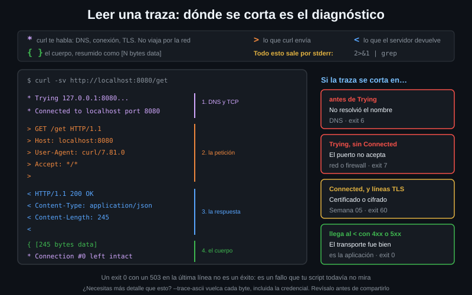

# Leer la traza y el manual

> Cuando algo falla, la respuesta ya está en tu terminal: en las líneas de `-v`
> que casi nadie lee y en las 5.088 del manual que casi nadie abre. Este archivo
> enseña a leer las dos.



## 🎯 Objetivos

- Decir qué significa cada símbolo de `-v` y en qué fase está la petición
- Distinguir un fallo de red de un fallo HTTP mirando solo la traza
- Interpretar el código de salida de curl y saber en qué familia cae
- Encontrar una opción en `curl --help all` y en `curl --manual` sin buscar en internet
- Subir el nivel de detalle a `--trace-ascii` cuando `-v` no llega

---

## 1. Qué problema resuelve

"No me funciona el curl" no es un diagnóstico. Estas cuatro cosas fallan de
formas distintas y se arreglan de formas distintas:

1. El nombre no se resuelve — es DNS
2. Resuelve, pero el puerto está cerrado — es red o firewall
3. Conecta, pero el certificado no valida — es TLS (Semana 05)
4. Todo va bien y el servidor responde 403 — es la aplicación

Sin `-v` las cuatro se ven igual: un comando que no imprime lo que esperabas.
Con `-v`, cada una para en un punto distinto de la traza y se ve a simple vista.

---

## 2. Cómo funciona la traza de `-v`

### 2.1 Los símbolos

Cada línea de la traza empieza por un símbolo que dice de dónde sale:

| Símbolo | Significa |
|:--:|---|
| `*` | Información de curl: DNS, conexión, TLS, reutilización de conexiones. **No viaja por la red** |
| `>` | Una línea que curl **envía** al servidor: la petición y sus headers |
| `<` | Una línea que el servidor **devuelve**: la status line y sus headers |
| `{` `}` | Datos del cuerpo, resumidos como `[N bytes data]`. Con `-v` no se enseña su contenido |

Un detalle que confunde: **`-v` escribe en stderr, no en stdout**. Por eso
`curl -v URL | jq` sigue funcionando (el cuerpo va por su lado), y por eso hay
que redirigir con `2>&1` si quieres filtrar la traza con `grep`.

### 2.2 Una traza completa, línea a línea

```bash
curl -sv http://localhost:8080/get
```

```
*   Trying 127.0.0.1:8080...                          ← 1. resolvió, va a conectar
* Connected to localhost (127.0.0.1) port 8080 (#0)   ← 2. TCP establecido
> GET /get HTTP/1.1                                   ← 3. empieza la petición
> Host: localhost:8080
> User-Agent: curl/7.81.0
> Accept: */*
>                                                     ← 4. fin de los headers
* Mark bundle as not supporting multiuse
< HTTP/1.1 200 OK                                     ← 5. la respuesta
< Content-Type: application/json; charset=utf-8
< Content-Length: 245
<                                                     ← 6. fin de los headers
{ [245 bytes data]                                    ← 7. el cuerpo, resumido
* Connection #0 to host localhost left intact         ← 8. conexión reutilizable
```

Las ocho marcas son las ocho fases. **En qué línea se corta la traza es el
diagnóstico**:

| La traza se corta en… | El problema es |
|---|---|
| `Trying...` sin llegar a `Connected` | El puerto no acepta conexiones: exit 7 |
| Ni siquiera aparece `Trying` | No se resolvió el nombre: exit 6 |
| Después de `Connected`, con líneas `*` de TLS | El certificado, la versión o el cifrado: exit 60 y compañía |
| Llega al `<` con un 4xx o 5xx | Nada falló en el transporte. Es la aplicación |

### 2.3 Cuando `-v` no llega: `--trace-ascii`

`-v` resume el cuerpo. `--trace-ascii` vuelca **todos** los bytes como texto,
con el tamaño exacto de cada bloque; `--trace` hace lo mismo añadiendo el
volcado hexadecimal al lado:

```bash
# --trace-ascii - manda la traza a stdout. Con -o /dev/null el cuerpo no
# estorba. Util cuando sospechas de un byte concreto: un CRLF, un BOM, un
# espacio de mas en un header.
curl -s --trace-ascii - -o /dev/null http://localhost:8080/get | head -8
# == Info:   Trying 127.0.0.1:8080...
# == Info: Connected to localhost (127.0.0.1) port 8080 (#0)
# => Send header, 81 bytes (0x51)
# 0000: GET /get HTTP/1.1
# 0013: Host: localhost:8080
# 0029: User-Agent: curl/7.81.0
# 0042: Accept: */*
# 004f:
```

Los prefijos cambian: `=>` es lo que sale, `<=` lo que entra, `== Info:` lo que
dice curl. El número de la izquierda es el desplazamiento dentro del bloque.

> [!WARNING]
> `--trace-ascii` vuelca **todo**, incluida la cabecera `Authorization` y las
> cookies. No pegues una traza en un ticket ni en un issue sin revisarla antes:
> curl no oculta nada por ti.

---

## 3. Los códigos de salida

curl distingue "no pude hablar con el servidor" de "el servidor me dijo que no".
El código de salida contesta **solo la primera**.

```bash
curl -s -o /dev/null http://no-existe.invalido/ ; echo $?   # 6  no resolvió
curl -s -o /dev/null http://localhost:9/ ; echo $?          # 7  no conectó
curl -s -o /dev/null "http://" ; echo $?                    # 3  URL mal formada
curl -s -o /dev/null --max-time 2 \
     http://localhost:8080/delay/5 ; echo $?                # 28 se agotó el tiempo
curl -s -o /dev/null --fail-with-body \
     http://localhost:8080/status/503 ; echo $?             # 22 4xx/5xx con --fail
```

Los que verás esta semana, agrupados por lo que significan para un script:

| Código | Qué pasó | ¿Reintentar? |
|:--:|---|---|
| 0 | La transferencia terminó. **No dice nada del código HTTP** | — |
| 1 | Protocolo no soportado (`htp://` en vez de `http://`) | No: es una errata |
| 3 | URL mal formada | No |
| 6 | No se resolvió el host | A veces: el DNS puede fallar de forma transitoria |
| 7 | No se pudo conectar | Sí: el servicio puede estar arrancando |
| 22 | `--fail` y respuesta 4xx o 5xx | Solo si era 5xx |
| 28 | Se agotó `--max-time` o `--connect-timeout` | Sí, con cuidado |
| 60 | El certificado no se pudo verificar (Semana 05) | No: se arregla, no se reintenta |

La lista entera —unos cien— está en la
[tabla de errores de libcurl](https://curl.se/libcurl/c/libcurl-errors.html), y
también en la sección `EXIT CODES` de `curl --manual`.

---

## 4. Encontrar la respuesta sin salir de la terminal

### 4.1 `curl --help` frente a `curl --help all`

```bash
curl --help | wc -l       # 17     ← el resumen
curl --help all | wc -l   # 245    ← todas las opciones
```

`curl --help` a secas enseña diecisiete líneas: las más comunes y poco más. La
que buscas casi siempre está en las otras 228.

```bash
# Buscar por lo que hace, no por como se llama. El nombre exacto de la opcion
# es justo lo que no recuerdas.
curl --help all | grep -i 'retry-delay'
#      --retry-delay <seconds> Wait time between retries
```

También se puede pedir una **categoría** concreta:

```bash
curl --help http          # solo las opciones de HTTP y HTTPS
curl --help connection    # timeouts, reintentos y red de bajo nivel
```

La lista de categorías sale con `curl --help category`. Ojo: si te inventas
una, curl no falla en silencio — te devuelve la lista entera.

### 4.2 `curl --manual`

Es el manpage entero, sin depender de que la distribución haya instalado las
páginas de manual:

```bash
curl --manual | wc -l   # 5088
curl --manual | less    # y dentro de less: /--retry-delay para buscar
```

Cuando lo que buscas es **cómo se comporta** una opción, y no solo su nombre, el
manual es el sitio: cada entrada explica los casos raros, las combinaciones que
se anulan entre sí y desde qué versión existe.

### 4.3 La versión de cada opción

El manpage anota la versión en que se introdujo cada opción. Comprobarlo evita
el fallo más caro de este bootcamp: usar un flag que en tu máquina todavía no
existe.

```bash
curl --version | head -1
# curl 7.81.0 (x86_64-pc-linux-gnu) libcurl/7.81.0 ...
```

Con 7.81 —la de Ubuntu 22.04— no tienes `--json` (7.82) ni `--trace-redact`
(8.3). La tabla de referencia está en
[`docs/versiones-de-curl.md`](../../../docs/versiones-de-curl.md).

---

## 5. Antipatrones

| Antipatrón | Por qué duele | Qué hacer en su lugar |
|---|---|---|
| **Añadir `-k` para que "funcione"** | Desactiva la verificación del certificado: la petición sigue cifrada pero ya no sabes con quién hablas, y un intermediario puede leerla entera. Un script con `-k` es un script sin TLS | Arreglar la confianza: `--cacert docs/lab-ca.pem` con la CA del laboratorio, o el bundle correcto en producción |
| `curl -v URL \| grep '^<'` | La traza va por **stderr**: el pipe solo recibe el cuerpo y el `grep` no encuentra nada | `curl -v URL 2>&1 \| grep '^<'` |
| Pegar una traza completa en un ticket | `--trace-ascii` y `-v` incluyen `Authorization`, cookies y tokens | Revisarla antes, o filtrar con `grep -v -i authorization` |
| Buscar el flag en un blog antes que en `--help all` | El blog no sabe qué versión tienes; tu binario sí | `curl --help all \| grep`, y `--manual` para el matiz |
| Leer solo el mensaje de error y no el código de salida | "connection refused" y "could not resolve host" se parecen en la prosa y son 7 y 6: firewall contra DNS | Mirar `$?` y clasificar por familia |
| `2>/dev/null` para "limpiar" la salida de un script | Tiras justo el canal donde curl avisa de lo que va mal | `-sS`: silencia el progreso y **deja pasar** los errores |

---

## 6. Trucos

- **Solo las líneas del protocolo**, sin la información de curl:

  ```bash
  curl -sv http://localhost:8080/get 2>&1 | grep -E '^[<>]'
  ```

- **Guardar la traza para leerla luego** sin mezclarla con el cuerpo:
  `curl -sv URL 2>traza.txt -o cuerpo.json`.

- **`--trace-time` pone marca de tiempo en cada línea.** Es la forma más simple
  de ver qué parte de una petición lenta se está comiendo el tiempo.

- **Un resumen de la transferencia en JSON**, sin traza:
  `curl -s -o /dev/null -w '%{json}' URL | jq` (7.70+). Trae el código, los
  tiempos por fase, la IP local y el número de redirecciones.

- **`curl --help category`** lista las 22 categorías (`auth`, `connection`,
  `http`, `output`, `proxy`, `tls`, `verbose`…). Es más rápido que `grep` cuando
  no sabes ni cómo se llama lo que buscas.

---

## 📚 Recursos Adicionales

- [everything.curl.dev — Verbose mode](https://everything.curl.dev/usingcurl/verbose) — la traza explicada por el autor de curl
- [Códigos de salida de libcurl](https://curl.se/libcurl/c/libcurl-errors.html) — la lista completa, con el nombre interno de cada error
- [curl manpage](https://curl.se/docs/manpage.html) — lo mismo que `--manual`, con buscador y enlaces

---

## ✅ Checklist de Verificación

- [ ] Nombras los cuatro símbolos de `-v` y dices cuál no viaja por la red
- [ ] Provocas un 6 y un 7 y los distingues mirando dónde se corta la traza
- [ ] Filtras la traza con `2>&1 | grep '^[<>]'` y entiendes por qué hace falta
- [ ] Comparas `-v` con `--trace-ascii` sobre la misma petición
- [ ] Encuentras `--retry-delay` con `curl --help all | grep`
- [ ] Buscas una opción dentro de `curl --manual | less`
- [ ] Sabes qué versión de curl tienes y qué flags de este bootcamp te faltan
