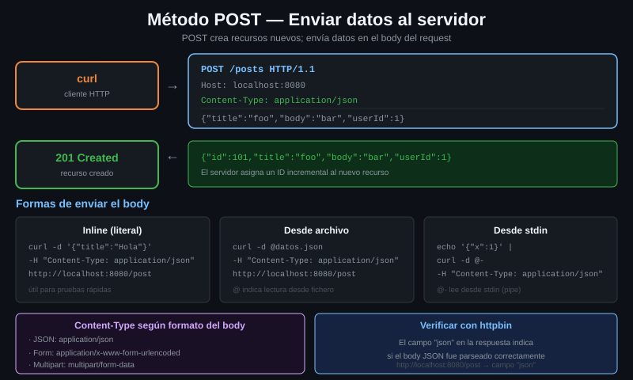

# El cuerpo de la petición

> Hasta ahora tus peticiones eran una línea y unos headers. El cuerpo es la
> cuarta parte del mensaje: la que lleva los datos, y la que curl no manda si no
> se lo pides.



## 🎯 Objetivos

- Nombrar las cuatro partes de una petición HTTP y señalar cuál es el cuerpo
- Enviar un cuerpo con `-d` y decir qué método salió sin que lo pidieras
- Identificar los headers que curl añade solo al haber cuerpo
- Explicar por qué el `Content-Type` por defecto de `-d` no es JSON

---

## 1. Qué problema resuelve

Un GET pide. No lleva datos: lo que quieres decirle al servidor cabe en la URL
y en los headers. Sirve mientras la petición sea "dame el usuario 42".

En cuanto quieres decir "crea un usuario que se llama Ada y es administradora",
la URL se queda corta. Podrías intentar meterlo en la query:

```bash
# Esto es HTTP valido y a la vez una mala idea.
curl -s 'http://localhost:8080/anything/usuarios?nombre=Ada&rol=admin'
```

Y funciona. Pero acabas de escribir los datos en un sitio que:

- **Se guarda en los logs del servidor.** Cada línea de acceso lleva la URL
  entera. Si ahí va una contraseña, la contraseña está en el log.
- **Se queda en el historial del navegador y en el `Referer`.**
- **Tiene un límite de longitud** que nadie especifica igual: en la práctica,
  entre 2.000 y 8.000 caracteres según el servidor.
- **No admite estructura.** Un objeto anidado en una query string es un invento
  distinto en cada framework.

El cuerpo resuelve las cuatro cosas. Va después de los headers, no aparece en
los logs de acceso, no tiene un límite práctico y admite cualquier formato:
JSON, XML, un PNG, lo que sea.

---

## 2. Cómo funciona

### 2.1 Las cuatro partes de una petición

Una petición HTTP es texto, y siempre tiene la misma forma:

```
POST /anything/usuarios HTTP/1.1      ← 1. línea de petición: método, ruta, versión
Host: localhost:8080                  ← 2. headers
Content-Type: application/json
Content-Length: 34
                                      ← 3. línea en blanco: aquí acaban los headers
{"nombre":"Ada","rol":"admin"}        ← 4. cuerpo
```

La línea en blanco es la frontera. Todo lo que va después es cuerpo, y el
servidor sabe cuántos bytes leer porque se lo dice `Content-Length`.

Un GET normal tiene las partes 1, 2 y 3, y la 4 vacía. Eso es todo lo que
cambia.

### 2.2 Qué hace `-d` exactamente

`-d` (o `--data`) hace **tres** cosas de golpe, y conviene saber que son tres:

| Lo que hace | Detalle |
|---|---|
| Pone el contenido en el cuerpo | Tal cual se lo pasas |
| Cambia el método a **POST** | Sin que se lo pidas, y sin `-X` de por medio |
| Añade `Content-Type: application/x-www-form-urlencoded` | **Este es el que muerde**: no es JSON |

Y como consecuencia de tener cuerpo, curl añade también `Content-Length`.

Lo importante de la segunda fila: **no necesitas `-X POST`**. Ponerlo no está
mal, pero no aporta nada, y en cuanto hay una redirección de por medio empieza a
hacer daño. Lo ves entero en la
[teoría 04](04-el-flag-x-y-por-que-sobra.md).

### 2.3 El reflector del laboratorio

El laboratorio trae `go-httpbin`, que devuelve en JSON exactamente lo que
recibió. Es la herramienta con la que se aprende esto: no hay que adivinar qué
mandó curl, se lee.

| Endpoint | Para qué |
|---|---|
| `/post` | Solo acepta POST. Devuelve el cuerpo, los headers y la query |
| `/put`, `/patch`, `/delete` | Igual, cada uno con su método |
| `/anything` | Acepta **cualquier** método y cualquier ruta debajo: `/anything/usuarios/42` |
| `/headers` | Solo los headers que le llegaron |

`/anything` es el que más vas a usar, porque deja simular rutas de una API real
sin que el servidor se queje del método.

> [!NOTE]
> Los headers en `go-httpbin` salen como **listas**, no como cadenas:
> `"Content-Type": ["application/json"]`. Un header puede repetirse en HTTP, y
> esta implementación lo refleja. En `jq` eso significa
> `.headers["Content-Type"][0]`, con el índice.

---

## 3. Cómo se usa

### 3.1 El primer cuerpo

```bash
# -d pone el cuerpo Y cambia el metodo a POST. No hace falta -X.
curl -s http://localhost:8080/post -d 'nombre=Ada&rol=admin' | jq
# {
#   "args": {},
#   "headers": {
#     "Content-Length": ["20"],
#     "Content-Type": ["application/x-www-form-urlencoded"],
#     ...
#   },
#   "method": "POST",
#   "data": "nombre=Ada&rol=admin",
#   "form": {
#     "nombre": ["Ada"],
#     "rol": ["admin"]
#   },
#   ...
# }
```

Tres cosas que confirmar en esa salida, y que son el objetivo del archivo:

1. `"method": "POST"` — y tú no escribiste `POST` en ningún sitio.
2. `Content-Type` es `x-www-form-urlencoded`, que curl puso solo.
3. `Content-Length: 20`, que también puso curl contando los bytes.

### 3.2 Lo que el servidor recibió, en crudo

```bash
# -v enseña la peticion entera. La traza va por stderr: sin 2>&1 el grep no ve
# nada. El '>' marca las lineas que salen de tu maquina.
curl -sv http://localhost:8080/post -d 'nombre=Ada' 2>&1 | grep '^>'
# > POST /post HTTP/1.1
# > Host: localhost:8080
# > User-Agent: curl/7.81.0
# > Accept: */*
# > Content-Length: 10
# > Content-Type: application/x-www-form-urlencoded
# >
```

Ahí está la petición completa. Los dos últimos headers no los escribiste tú.

### 3.3 Un cuerpo JSON, hecho bien

Si mandas JSON con `-d` a secas, el `Content-Type` sigue diciendo
`x-www-form-urlencoded`, es decir, le estás mintiendo al servidor sobre el
formato. Muchas APIs contestan **415 Unsupported Media Type** exactamente por
esto:

```bash
# ❌ MAL: el cuerpo es JSON, la etiqueta dice formulario.
curl -s http://localhost:8080/post -d '{"nombre":"Ada"}' \
  | jq -c '{tipo: .headers["Content-Type"][0], json}'
# {"tipo":"application/x-www-form-urlencoded","json":null}
```

```bash
# ✅ BIEN: se declara el formato real.
curl -s http://localhost:8080/post \
  -H 'Content-Type: application/json' \
  -d '{"nombre":"Ada"}' \
  | jq -c '{tipo: .headers["Content-Type"][0], json}'
# {"tipo":"application/json","json":{"nombre":"Ada"}}
```

Fíjate en el campo `json` de la respuesta: en el primer caso es `null` porque el
servidor no intentó siquiera parsearlo — le dijiste que era un formulario.

### 3.4 Un cuerpo vacío a propósito

Hay endpoints que esperan un POST sin datos: "reinicia esta máquina", "marca
esto como leído". La forma correcta es `-d ''`, no `-X POST`:

```bash
# -d '' manda un POST con Content-Length: 0. Es una peticion completa y correcta.
curl -s -o /dev/null -w '%{http_code}\n' http://localhost:8080/post -d ''
# 200
```

---

## 4. Antipatrones

| Antipatrón | Por qué duele | Qué hacer en su lugar |
|---|---|---|
| `-X POST` sin `-d` | Sale un POST sin cuerpo. La API contesta 400 o 411 y pierdes veinte minutos buscando el fallo en el servidor | `-d ''` si el cuerpo va vacío a propósito; `-d '...'` si no |
| `-d` con JSON y sin `Content-Type` | El servidor lo trata como formulario: 415, o peor, lo acepta y guarda basura | `-H 'Content-Type: application/json'`, o `--json` en 7.82+ |
| Meter datos sensibles en la query | Quedan en los logs de acceso, en el `Referer` y en el historial | El cuerpo. Y si es una credencial, un header |
| `-X POST -d ...` por costumbre | Ruido: `-d` ya implica POST. Y con `-L` fuerza el método en todos los saltos | Quita el `-X`. Ver [teoría 04](04-el-flag-x-y-por-que-sobra.md) |
| Contar `Content-Length` a mano y ponerlo con `-H` | Si te equivocas por un byte, el servidor se queda esperando o corta el cuerpo | Déjaselo a curl. Lo calcula siempre bien |

---

## 5. Trucos

```bash
# Cuantos bytes salieron de verdad en el cuerpo de la peticion.
curl -s -o /dev/null -w '%{size_request} bytes de peticion\n' \
  http://localhost:8080/post -d 'nombre=Ada'
# 162 bytes de peticion
#      ^ el numero exacto depende de la longitud de tu User-Agent
```

```bash
# Que metodo eligieron los flags, sin tener que leer la traza entera.
# %{method} existe desde curl 7.72.
curl -s -o /dev/null -w '%{method}\n' http://localhost:8080/post -d ''
# POST
```

```bash
# Varios -d se concatenan con & entre ellos. Util para construir el cuerpo por
# partes en un script, sin pelearte con la interpolacion.
curl -s http://localhost:8080/post -d 'nombre=Ada' -d 'rol=admin' | jq -c .form
# {"nombre":["Ada"],"rol":["admin"]}
```

```bash
# Ver solo la parte de la respuesta que te interesa, sin leer las 40 lineas.
curl -s http://localhost:8080/post -d 'a=1' | jq -c '{method, data, form}'
# {"method":"POST","data":"a=1","form":{"a":["1"]}}
```

---

## 📚 Recursos Adicionales

- [RFC 9110 §9.3.3 — POST](https://datatracker.ietf.org/doc/html/rfc9110#name-post) — la definición normativa del método
- [everything.curl.dev — HTTP POST](https://everything.curl.dev/http/post) — el capítulo del libro oficial
- [manpage de curl — `-d`](https://curl.se/docs/manpage.html#-d) — la referencia corta
- [go-httpbin](https://github.com/mccutchen/go-httpbin) — qué endpoints trae el reflector del laboratorio

---

## ✅ Checklist de Verificación

- [ ] Nombras las cuatro partes de una petición HTTP y señalas dónde empieza el cuerpo
- [ ] Mandas un cuerpo con `-d` y compruebas en `/post` que el método fue POST sin escribirlo
- [ ] Identificas en la traza `-v` los dos headers que curl añadió solo
- [ ] Explicas por qué `-d '{"a":1}'` sin `Content-Type` puede devolver 415
- [ ] Mandas un POST con cuerpo vacío usando `-d ''` y recibes 200
- [ ] Sacas el método con `-w '%{method}\n'` sin leer la traza

---

## 🔗 Navegación

| Anterior | Actual | Siguiente |
|---|---|---|
| — | **01 — El cuerpo de la petición** | [02 — Las familias de `--data`](02-las-familias-de-data.md) |

[← Volver a la Semana 02](../README.md)
