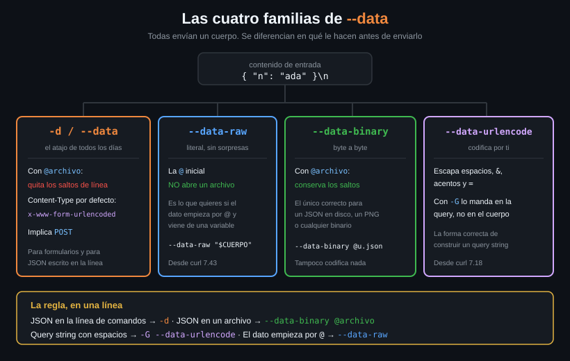

# Las familias de `--data`

> Cuatro flags que parecen sinónimos y no lo son. Uno de ellos te corrompe un
> JSON en silencio, y es el que todo el mundo usa por defecto.



## 🎯 Objetivos

- Elegir entre `-d`, `--data-raw`, `--data-binary` y `--data-urlencode` con criterio
- Explicar qué hace la `@` delante de un valor y cuándo es un problema
- Demostrar que `-d @archivo.json` quita los saltos de línea y `--data-binary @archivo.json` no
- Construir un query string bien codificado con `-G --data-urlencode`

---

## 1. Qué problema resuelve

`-d` funciona para el 80% de los casos, y por eso casi nadie mira los otros
tres. El problema aparece en el 20% restante, y aparece **en silencio**:

```bash
# Un JSON con formato, como lo genera cualquier editor o cualquier `jq`.
printf '{\n  "nombre": "Ada",\n  "rol": "admin"\n}\n' > usuario.json

# Se manda con -d, que es lo que hace todo el mundo.
curl -s http://localhost:8080/post \
  -H 'Content-Type: application/json' -d @usuario.json | jq -c .data
# "{  \"nombre\": \"Ada\",  \"rol\": \"admin\"}"
```

Los saltos de línea **han desaparecido**. En este caso concreto el JSON sigue
siendo válido — JSON ignora los espacios — así que nadie se entera. Pero el
mismo comportamiento sobre un cuerpo donde el salto de línea significa algo
(una clave PEM, un CSV, un texto multilínea) rompe el contenido sin decir nada.

Los cuatro flags existen porque hay cuatro respuestas distintas a la pregunta
"¿qué le hago al contenido antes de mandarlo?".

---

## 2. Cómo funciona

### 2.1 La tabla que resuelve la elección

| Flag | Desde | Con `@archivo` | Codifica | Cuándo es el correcto |
|---|:--:|---|---|---|
| `-d` / `--data` | 4.0 | Lo lee y **quita los saltos de línea** | No | Formularios, y JSON escrito en la propia línea de comandos |
| `--data-raw` | 7.43 | **No abre archivos**: la `@` es texto | No | Cuando el dato puede empezar por `@` |
| `--data-binary` | 7.2 | Lo lee **byte a byte** | No | JSON o cualquier cosa que venga de un archivo |
| `--data-urlencode` | 7.18 | Sí, y codifica el contenido | **Sí** | Query strings y valores con espacios, `&`, `=` o acentos |

Los cuatro implican POST, igual que `-d`. Los cuatro se pueden repetir y se
concatenan con `&`.

### 2.2 La `@`, que es la fuente de la mitad de los sustos

En `-d`, `--data-binary` y `--data-urlencode`, una `@` al principio del valor
significa **"esto es una ruta de archivo, ábrelo"**. No es opcional ni
configurable: es la sintaxis.

```bash
curl -d @usuario.json URL     # manda el CONTENIDO de usuario.json
curl -d '@usuario.json' URL   # exactamente lo mismo: las comillas no cambian nada
```

Las comillas no te salvan, porque quien interpreta la `@` es curl, no el shell.
El problema real aparece cuando el dato viene de una variable:

```bash
CUERPO='@urgente: revisar esto'

# ❌ curl intenta abrir un archivo llamado "urgente: revisar esto". No existe,
# asi que manda un cuerpo VACIO. Fijate en lo que NO pasa: no falla.
curl http://localhost:8080/post -d "$CUERPO" -o /dev/null
# Warning: Couldn't read data from file "urgente: revisar esto", this makes an
# Warning: empty POST.
echo "codigo de salida: $?"
# codigo de salida: 0
```

Eso es lo peligroso de verdad: **curl no falla**. Avisa por `stderr`, manda un
POST vacío y sale con 0. Y como en un script casi siempre hay un `-s`, el aviso
tampoco se ve:

```bash
# Con -s el aviso desaparece y el cuerpo llega vacio sin que nadie se entere.
curl -s http://localhost:8080/post -d "$CUERPO" | jq -c '{data, method}'
# {"data":"","method":"POST"}
```

```bash
# ✅ --data-raw NO interpreta la @. El contenido va literal.
curl -s http://localhost:8080/post --data-raw "$CUERPO" | jq -c .data
# "@urgente: revisar esto"
```

Para eso existe `--data-raw`: para el caso en que el contenido no lo controlas
tú. En un script que recibe datos de fuera, `--data-raw` es la opción por
defecto correcta, no `-d`.

Y para leer de la entrada estándar hay una forma especial, `@-`:

```bash
# @- significa "el cuerpo lo lees de stdin". Sin archivo temporal de por medio.
echo '{"nombre":"Ada"}' | curl -s http://localhost:8080/post \
  -H 'Content-Type: application/json' -d @- | jq -c .json
# {"nombre":"Ada"}
```

### 2.3 `-d` frente a `--data-binary`, en una prueba

```bash
printf '{\n  "nombre": "Ada",\n  "rol": "admin"\n}\n' > usuario.json

# -d: los \n desaparecen.
curl -s http://localhost:8080/post --data @usuario.json | jq -c .data
# "{  \"nombre\": \"Ada\",  \"rol\": \"admin\"}"

# --data-binary: los \n siguen ahi.
curl -s http://localhost:8080/post --data-binary @usuario.json | jq -c .data
# "{\n  \"nombre\": \"Ada\",\n  \"rol\": \"admin\"\n}\n"
```

La regla es corta: **si el cuerpo sale de un archivo, `--data-binary`**. No hay
ningún caso en el que quieras que curl te reformatee el archivo en silencio.

### 2.4 `--data-urlencode` y el `-G`

`--data-urlencode` codifica el valor en `application/x-www-form-urlencoded`
antes de mandarlo: los espacios pasan a `+`, y `&`, `=`, `?` y los acentos pasan
a `%XX`. Sirve para no tener que escaparlos tú.

Combinado con `-G`, el contenido no va al cuerpo: va **a la query string**, y el
método se queda en GET. Es la forma correcta de construir una URL con
parámetros:

```bash
# Sin -G iria en el cuerpo de un POST. Con -G va en la URL de un GET.
curl -s -G http://localhost:8080/get --data-urlencode 'q=hola mundo&x' \
  | jq -c '{args, url}'
# {"args":{"q":["hola mundo&x"]},"url":"http://localhost:8080/get?q=hola+mundo%26x"}
```

Fíjate en lo que pasó: el espacio se convirtió en `+` y el `&` en `%26`, así que
el servidor recibe **un** parámetro `q` cuyo valor contiene un `&`, que es lo que
querías. Escribiéndolo a mano habrías creado dos parámetros por accidente.

> [!NOTE]
> Desde curl **7.87** existe `--url-query`, que es `--data-urlencode` sin
> necesidad de `-G` y sin tocar el método. Es más limpio, pero es reciente:
> Ubuntu 22.04 trae 7.81. Mientras tanto, `-G --data-urlencode` funciona en
> cualquier versión desde 7.18.

### 2.5 Las cuatro formas de `--data-urlencode`

Es el flag con la sintaxis más rara del conjunto, y merece la tabla:

| Forma | Qué codifica | Resultado |
|---|---|---|
| `--data-urlencode 'contenido'` | Todo, y no le pone nombre | `hola+mundo` |
| `--data-urlencode 'q=contenido'` | Solo el contenido, no el nombre | `q=hola+mundo` |
| `--data-urlencode 'q@archivo'` | El contenido del archivo | `q=...` |
| `--data-urlencode '@archivo'` | El archivo, sin nombre | `...` |

El caso que se usa el 95% de las veces es el segundo: `nombre=valor`.

---

## 3. Cómo se usa

### 3.1 La decisión, en cuatro preguntas

```
¿El cuerpo sale de un archivo?          → --data-binary @archivo
¿El cuerpo puede empezar por @?          → --data-raw "$VARIABLE"
¿Va en la query y tiene espacios o &?    → -G --data-urlencode 'k=v'
¿Ninguna de las anteriores?              → -d
```

### 3.2 El caso real: subir un JSON de disco

```bash
# --data-binary conserva el archivo tal cual. -H declara el formato: sin el,
# el servidor lo trata como formulario y contesta 415.
curl -sS --fail-with-body --max-time 10 \
  -H 'Content-Type: application/json' \
  --data-binary @usuario.json \
  http://localhost:8080/post | jq -c .json
# {"nombre":"Ada","rol":"admin"}
```

### 3.3 El caso real: construir una búsqueda

```bash
TERMINO='café & té'

# -G lo pasa a la query. --data-urlencode codifica el espacio, el & y el acento.
curl -sS --max-time 10 -G http://localhost:8080/get \
  --data-urlencode "q=${TERMINO}" \
  --data-urlencode 'limite=10' \
  | jq -c .args
# {"limite":["10"],"q":["café & té"]}
```

El servidor recibe el término original, acentos incluidos, porque curl lo
codificó y el servidor lo decodificó. Sin `--data-urlencode` el `&` habría
partido el parámetro en dos.

---

## 4. Antipatrones

| Antipatrón | Por qué duele | Qué hacer en su lugar |
|---|---|---|
| `-d @cuerpo.json` | Quita los saltos de línea del archivo. Con JSON cuela; con un PEM o un CSV, no | `--data-binary @cuerpo.json` |
| `-d "$VARIABLE"` con datos de fuera | Si el valor empieza por `@`, curl abre un archivo. Si existe, manda su contenido; si no existe, manda un cuerpo **vacío** y sale con 0 | `--data-raw "$VARIABLE"` |
| Escapar el query string a mano con `%20` | Se te escapa uno y el parámetro se parte. Y los acentos no los escapas bien nunca | `-G --data-urlencode` |
| `--data-urlencode` sin `-G` cuando querías la query | Va al cuerpo de un POST, no a la URL. La API no ve el parámetro | Añade `-G`, o `--url-query` en 7.87+ |
| `-d` con un binario (un PNG, un zip) | Los bytes `\r` y `\n` se pierden y el archivo llega corrupto | `--data-binary`, que para eso está el nombre |

---

## 5. Trucos

```bash
# Cuantos bytes iban en el cuerpo, para comprobar que el archivo llego entero.
curl -s -o /dev/null -w '%{size_upload} bytes subidos\n' \
  http://localhost:8080/post --data-binary @usuario.json
# 40 bytes subidos
```

```bash
# Codificar un valor sin llegar a mandarlo: --data-urlencode + -G + un endpoint
# que refleja la URL. Sale util para depurar que es lo que se esta codificando.
curl -s -G http://localhost:8080/get --data-urlencode 'v=a b&c=d' \
  | jq -r .url
# http://localhost:8080/get?v=a+b%26c%3Dd
```

```bash
# Cuidado al partir un cuerpo en varios flags: TODAS las familias de --data
# concatenan metiendo un & entre los trozos, tambien --data-binary. Un JSON
# partido en dos llega roto y el servidor lo rechaza.
curl -s http://localhost:8080/post \
  --data-binary '{"a":1' --data-binary ',"b":2}' | jq -c '{data, json}'
# {"data":"{\"a\":1&,\"b\":2}","json":null}
#                    ^ el & que mete curl
```

---

## 📚 Recursos Adicionales

- [manpage de curl — `--data-binary`](https://curl.se/docs/manpage.html#--data-binary) — la diferencia, en el texto oficial
- [everything.curl.dev — POST binary](https://everything.curl.dev/http/post/binary) — por qué existe la distinción
- [RFC 3986 §2 — Percent-Encoding](https://datatracker.ietf.org/doc/html/rfc3986#section-2) — qué caracteres hay que codificar y por qué
- [docs/versiones-de-curl.md](../../../docs/versiones-de-curl.md) — desde qué versión existe cada uno

---

## ✅ Checklist de Verificación

- [ ] Demuestras con `/post` que `-d @archivo` quita los saltos y `--data-binary @archivo` no
- [ ] Provocas el error `Failed to open/read local data` con un valor que empieza por `@`
- [ ] Lo arreglas con `--data-raw` y compruebas que el `@` llega literal
- [ ] Construyes una query con espacio y `&` usando `-G --data-urlencode` y la lees en `.args`
- [ ] Sabes decir de memoria cuál de los cuatro usar cuando el cuerpo viene de un archivo
- [ ] Mandas un cuerpo desde una tubería con `-d @-`

---

## 🔗 Navegación

| Anterior | Actual | Siguiente |
|---|---|---|
| [01 — El cuerpo de la petición](01-el-cuerpo-de-la-peticion.md) | **02 — Las familias de `--data`** | [03 — PUT, PATCH y DELETE](03-put-patch-delete.md) |

[← Volver a la Semana 02](../README.md)
