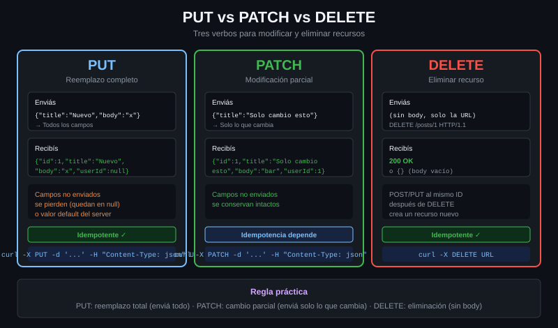

# PUT, PATCH y DELETE

> Tres verbos para modificar. La diferencia entre ellos no la impone curl ni el
> protocolo: la impone lo que pasa cuando el mismo comando se ejecuta dos veces.



## 🎯 Objetivos

- Elegir entre PUT y PATCH según lo que quieras que le pase a los campos que no mandas
- Definir idempotencia y decir cuál de los cuatro verbos de escritura no la tiene
- Enviar un DELETE, con y sin cuerpo, y saber cuándo el cuerpo se ignora
- Decidir si un reintento automático es seguro para un verbo dado

---

## 1. Qué problema resuelve

POST crea. Pero una API completa necesita también reemplazar, modificar y
borrar, y necesita que el cliente diga **cuál de las tres** está haciendo. No
por elegancia: porque de eso dependen la caché, los reintentos y los permisos.

El caso concreto: tienes un usuario con cinco campos y quieres cambiarle el
teléfono. Si mandas un objeto con un solo campo:

- Con **PUT**, la semántica es "el recurso pasa a ser esto". Los otros cuatro
  campos **desaparecen**. Es un reemplazo.
- Con **PATCH**, la semántica es "aplícale este cambio". Los otros cuatro campos
  se quedan como estaban.

Mandar PUT donde querías PATCH es la forma más rápida de borrar datos sin
darte cuenta, y no da error: la API hace exactamente lo que le pediste.

---

## 2. Cómo funciona

### 2.1 Los cuatro verbos de escritura

| Verbo | Qué significa | ¿Idempotente? | ¿Lleva cuerpo? | Éxito típico |
|---|---|:--:|:--:|:--:|
| `POST` | Crea un recurso nuevo, o procesa algo | **No** | Sí | 201 |
| `PUT` | El recurso pasa a ser exactamente esto | Sí | Sí | 200 o 204 |
| `PATCH` | Aplica este cambio parcial | **No garantizada** | Sí | 200 |
| `DELETE` | Elimina el recurso | Sí | Opcional, y suele ignorarse | 204 |

### 2.2 Idempotencia, que no es lo que parece

**Idempotente** no quiere decir "no cambia nada". Quiere decir: *ejecutarlo N
veces deja el servidor en el mismo estado que ejecutarlo una vez*.

- `PUT /usuarios/42` con `{"tel":"600"}` → el teléfono es `600`. Repítelo diez
  veces: el teléfono sigue siendo `600`. **Idempotente.**
- `DELETE /usuarios/42` → el usuario no existe. Repítelo: sigue sin existir (la
  segunda vez contesta 404, pero el **estado** es el mismo). **Idempotente.**
- `POST /usuarios` con `{"nombre":"Ada"}` → hay una Ada. Repítelo diez veces: hay
  **diez** Adas. **No idempotente.**

`PATCH` está en tierra de nadie: `{"tel":"600"}` es idempotente, pero
`{"op":"incrementar","campo":"visitas"}` no lo es en absoluto. Depende del
contenido del parche, y por eso el RFC no lo garantiza.

### 2.3 Por qué esto decide si puedes reintentar

Un timeout no te dice si la petición llegó. Puede que el servidor la procesara
entera y se perdiera la respuesta. Ante esa duda:

| Verbo | ¿`--retry` es seguro? |
|---|---|
| GET, HEAD, PUT, DELETE | Sí. En el peor caso repites algo que ya estaba hecho |
| POST | **No, sin más.** Puedes crear el recurso dos veces |
| PATCH | Depende del parche. Trátalo como POST si no estás seguro |

Esto no es teórico: es la razón por la que `curl --retry` **no reintenta un POST
por defecto** ante un error de red, salvo que el servidor haya devuelto un
código que lo justifique. Y es la razón por la que las APIs serias ofrecen una
clave de idempotencia (`Idempotency-Key`) para los POST.

### 2.4 El cuerpo de un DELETE

DELETE **puede** llevar cuerpo — el RFC 9110 no lo prohíbe — pero dice que no
tiene semántica definida. En la práctica: muchos servidores, proxies y CDN lo
descartan sin avisar.

La consecuencia práctica: si tu API necesita datos para borrar (un motivo, una
confirmación), no los mandes en el cuerpo de un DELETE. Van en la query string o
en un header, o el endpoint es un POST.

---

## 3. Cómo se usa

### 3.1 PUT: reemplazar el recurso entero

```bash
# --request PUT porque no hay ningun otro flag que implique PUT.
# -d pondria POST; --request lo corrige. Este es el caso legitimo de -X.
curl -sS --max-time 10 --request PUT \
  -H 'Content-Type: application/json' \
  -d '{"nombre":"Ada","rol":"admin","tel":"600"}' \
  http://localhost:8080/anything/usuarios/42 \
  | jq -c '{method, json}'
# {"method":"PUT","json":{"nombre":"Ada","rol":"admin","tel":"600"}}
```

Fíjate en que el cuerpo lleva **los tres campos**, no solo el que cambia. Eso es
lo que hace que sea un PUT correcto.

### 3.2 PATCH: cambiar un campo

```bash
curl -sS --max-time 10 --request PATCH \
  -H 'Content-Type: application/json' \
  -d '{"tel":"611"}' \
  http://localhost:8080/anything/usuarios/42 \
  | jq -c '{method, json}'
# {"method":"PATCH","json":{"tel":"611"}}
```

Un solo campo. La API entiende que los demás se quedan como están.

### 3.3 DELETE

```bash
# Sin cuerpo, que es lo normal. --request DELETE es imprescindible: no hay
# ningun flag de datos que implique DELETE.
curl -sS --max-time 10 --request DELETE \
  -o /dev/null -w '%{http_code}\n' \
  http://localhost:8080/anything/usuarios/42
# 200
```

Contra una API real esperarías un **204**, que es "hecho, y no tengo nada que
contarte". El reflector del laboratorio siempre devuelve 200 porque su trabajo
es enseñarte lo que recibió.

### 3.4 Comprobar que el método salió bien

Antes de lanzar un DELETE contra algo que importa, confírmalo:

```bash
# %{method} (7.72+) dice que metodo salio de verdad, sin leer la traza.
curl -s -o /dev/null -w '%{method} %{http_code}\n' \
  --request DELETE http://localhost:8080/anything/usuarios/42
# DELETE 200
```

### 3.5 El ciclo completo, en un vistazo

```bash
# Crear, reemplazar, modificar y borrar el mismo recurso. --next reutiliza la
# conexion y reinicia los flags entre peticiones.
curl -sS --max-time 10 -o /dev/null -w 'POST   %{http_code}\n' \
     -H 'Content-Type: application/json' -d '{"nombre":"Ada"}' \
     http://localhost:8080/anything/usuarios \
  --next -sS -o /dev/null -w 'PUT    %{http_code}\n' \
     --request PUT -H 'Content-Type: application/json' \
     -d '{"nombre":"Ada","rol":"admin"}' \
     http://localhost:8080/anything/usuarios/42 \
  --next -sS -o /dev/null -w 'PATCH  %{http_code}\n' \
     --request PATCH -H 'Content-Type: application/json' -d '{"rol":"lector"}' \
     http://localhost:8080/anything/usuarios/42 \
  --next -sS -o /dev/null -w 'DELETE %{http_code}\n' \
     --request DELETE http://localhost:8080/anything/usuarios/42
# POST   200
# PUT    200
# PATCH  200
# DELETE 200
```

---

## 4. Antipatrones

| Antipatrón | Por qué duele | Qué hacer en su lugar |
|---|---|---|
| PUT con un solo campo | Borras los campos que no mandaste. La API hizo lo que pediste, no hay error que leer | PATCH si es un cambio parcial; PUT solo con el recurso completo |
| `--retry` sobre un POST sin más | Un timeout después de crear el recurso lo crea otra vez | Reintenta solo si la API acepta `Idempotency-Key`, o hazlo idempotente con PUT sobre una ruta que tú eliges |
| Mandar el motivo del borrado en el cuerpo del DELETE | Proxies y servidores lo descartan sin avisar y sin error | Query string, header, o un POST a `/recurso/42/archivar` |
| Tratar el 404 de un DELETE repetido como fallo | El estado final es el correcto: el recurso no existe | Considera 404 un éxito en un borrado idempotente, y dilo en el script |
| `--request GET` para "asegurarse" | No asegura nada y rompe las redirecciones, que dejan de convertir el método | Quita el `--request`. Ver [teoría 04](04-el-flag-x-y-por-que-sobra.md) |

---

## 5. Trucos

```bash
# Comprobar que un DELETE es idempotente en tu API: dos veces seguidas y
# comparar. Contra una API real, el segundo suele ser 404.
for i in 1 2; do
  curl -s -o /dev/null -w "intento $i: %{http_code}\n" \
    --request DELETE http://localhost:8080/anything/usuarios/42
done
# intento 1: 200
# intento 2: 200
```

```bash
# -T (--upload-file) implica PUT sin necesidad de --request, y sube el archivo
# tal cual, sin tocarlo. Aqui interesa solo por el metodo que elige; como
# herramienta de transferencia se ve en la Semana 04.
printf '{"nombre":"Ada","rol":"admin"}' > usuario.json
curl -s -T usuario.json -H 'Content-Type: application/json' \
  http://localhost:8080/anything/usuarios/42 | jq -c '{method, json}'
# {"method":"PUT","json":{"nombre":"Ada","rol":"admin"}}
```

```bash
# Ver el metodo y el codigo de varias peticiones de un vistazo, para verificar
# que un script manda lo que crees.
curl -s -o /dev/null -w '%{method} -> %{http_code}\n' \
  --request PATCH -d '{"a":1}' http://localhost:8080/anything/x
# PATCH -> 200
```

---

## 📚 Recursos Adicionales

- [RFC 9110 §9.2.2 — Idempotent Methods](https://datatracker.ietf.org/doc/html/rfc9110#name-idempotent-methods) — la definición exacta, y por qué PATCH queda fuera
- [RFC 9110 §9.3.4 — PUT](https://datatracker.ietf.org/doc/html/rfc9110#name-put) y [§9.3.5 — DELETE](https://datatracker.ietf.org/doc/html/rfc9110#name-delete)
- [RFC 5789 — PATCH](https://datatracker.ietf.org/doc/html/rfc5789) — el método llegó cinco años después que los demás
- [everything.curl.dev — HTTP methods](https://everything.curl.dev/http/requests/method) — cómo los elige curl

---

## ✅ Checklist de Verificación

- [ ] Explicas qué le pasa a un campo que no mandas, en PUT y en PATCH
- [ ] Defines idempotencia sin decir "no cambia nada"
- [ ] Dices cuál de los cuatro verbos de escritura no es idempotente y por qué importa al reintentar
- [ ] Mandas PUT, PATCH y DELETE contra `/anything` y compruebas `.method` en la respuesta
- [ ] Consigues un PUT sin usar `--request`, con `-T`
- [ ] Sabes por qué no se manda el motivo de un borrado en el cuerpo del DELETE

---

## 🔗 Navegación

| Anterior | Actual | Siguiente |
|---|---|---|
| [02 — Las familias de `--data`](02-las-familias-de-data.md) | **03 — PUT, PATCH y DELETE** | [04 — `-X` y por qué casi siempre sobra](04-el-flag-x-y-por-que-sobra.md) |

[← Volver a la Semana 02](../README.md)
