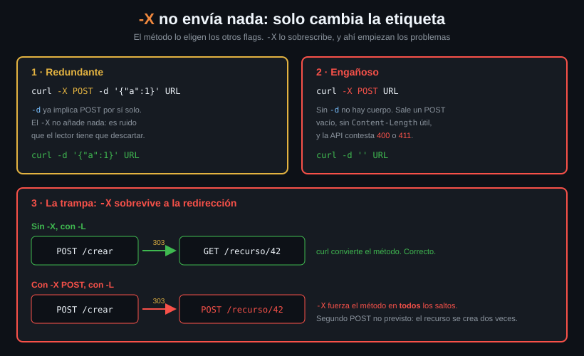

# `-X` y por qué casi siempre sobra

> `-X POST` es lo primero que aparece en cualquier tutorial y lo primero que
> sobra en cualquier comando. No envía datos, no cambia el cuerpo: solo
> sobrescribe una etiqueta. Y ese "solo" es el problema.



## 🎯 Objetivos

- Decir qué flags eligen el método sin que tú lo escribas
- Explicar por qué `-X POST -d ...` es redundante y `-X POST` a secas es engañoso
- Demostrar qué le hace `-X` a una redirección 303 y por qué eso duplica recursos
- Reconocer los tres casos en los que `-X` (o mejor, `--request`) sí es la respuesta

---

## 1. Qué problema resuelve

Ninguno, la mayoría de las veces. Ese es el punto del archivo.

`-X` (forma larga `--request`) hace **una sola cosa**: cambia la palabra que va
al principio de la línea de petición. No añade cuerpo, no añade headers, no
cambia el comportamiento de curl. Sustituye `GET` por lo que le digas.

El problema es que su presencia sugiere lo contrario. `curl -X POST URL` se lee
como "haz un POST con datos", y lo que hace de verdad es "manda una petición sin
cuerpo, pero llámala POST". Cuando la API contesta 400, el alumno busca el fallo
en el servidor.

---

## 2. Cómo funciona

### 2.1 Quién elige el método, si no eres tú

curl decide el método a partir de los flags que ya has puesto:

| Flag presente | Método que sale |
|---|---|
| ninguno | `GET` |
| `-d`, `--data-raw`, `--data-binary`, `--data-urlencode` | `POST` |
| `-F` / `--form` | `POST` |
| `-T` / `--upload-file` | `PUT` |
| `-I` / `--head` | `HEAD` |
| `-X` / `--request` | **Lo que digas, pisando todo lo anterior** |

Las cinco primeras filas cubren la práctica totalidad de los casos. La sexta
existe para los métodos que ningún flag implica: PATCH, DELETE, OPTIONS y los
verbos raros de WebDAV.

### 2.2 Los dos casos habituales, y por qué están mal

**Redundante** — `-d` ya implica POST:

```bash
# Estos dos comandos generan EXACTAMENTE la misma peticion.
curl -s -o /dev/null -w '%{method}\n' -X POST -d 'a=1' http://localhost:8080/post
# POST
curl -s -o /dev/null -w '%{method}\n' -d 'a=1' http://localhost:8080/post
# POST
```

El `-X` no añade nada. Lo que añade es una cosa más que leer y una pista falsa:
quien lo lea pensará que hace falta.

**Engañoso** — `-X POST` sin `-d`:

```bash
# Un POST sin cuerpo. Ni Content-Length, ni Content-Type, ni datos.
curl -s -X POST http://localhost:8080/post \
  | jq -c '{method, data, longitud: .headers["Content-Length"]}'
# {"method":"POST","data":"","longitud":null}
```

Contra una API real eso es un 400 o un 411. Y el mensaje de error hablará del
cuerpo, no del método, así que se busca en el sitio equivocado.

### 2.3 El caso que de verdad muerde: `-X` con `-L`

Aquí `-X` deja de ser ruido y pasa a ser un bug.

Cuando el servidor responde **303 See Other** a un POST, la regla de HTTP es que
el cliente siga la redirección **con GET**. Es el patrón POST/Redirect/GET de
toda la vida: creas el recurso, te mandan a verlo. curl lo hace bien:

```bash
# Sin -X: curl convierte el POST en GET al seguir el 303. Correcto.
curl -s -L -d 'a=1' \
  'http://localhost:8080/redirect-to?url=%2Fanything%2Fdestino&status_code=303' \
  | jq -c '{method, data}'
# {"method":"GET","data":""}
```

Con `-X POST`, curl obedece: le has dicho que el método es POST, y lo fuerza en
**todos** los saltos.

```bash
# Con -X: el metodo POST sobrevive a la redireccion. Llega un segundo POST.
curl -s -L -X POST -d 'a=1' \
  'http://localhost:8080/redirect-to?url=%2Fanything%2Fdestino&status_code=303' \
  | jq -c '{method, data}'
# {"method":"POST","data":""}
```

El destino recibe un POST que nadie pedía. Contra una API que crea recursos con
POST, eso es **el recurso creado dos veces**: uno en la URL original y otro en
la de destino. Y como el cuerpo no se reenvía (`data` está vacío), el segundo
puede además ser un POST malformado.

> [!WARNING]
> Este fallo no da error, no aparece en los logs del cliente y solo se ve
> contando registros en la base de datos del servidor. Es la razón principal
> para quitar `-X` de los comandos que no lo necesitan.

Un 307 y un 308, en cambio, **sí** conservan el método por definición del
protocolo, y ahí curl mantiene el POST con cuerpo y todo, sin necesidad de `-X`:

```bash
curl -s -L -d 'a=1' \
  'http://localhost:8080/redirect-to?url=%2Fanything%2Fdestino&status_code=307' \
  | jq -c '{method, data}'
# {"method":"POST","data":"a=1"}
```

### 2.4 `-X` también pisa a `-I`

`-I` hace un HEAD. Si añades `-X` se acabó el HEAD, pero curl **sigue esperando
una respuesta sin cuerpo**, así que puede quedarse colgado hasta el timeout:

```bash
# -X gana. Ya no es un HEAD: es un POST del que solo se leen los headers.
curl -s -I -X POST -o /dev/null -w '%{method} %{http_code}\n' http://localhost:8080/post
# POST 200
```

---

## 3. Cómo se usa

### 3.1 Cuándo `--request` es la respuesta correcta

Tres casos, y solo tres:

| Caso | Ejemplo |
|---|---|
| Un método que ningún flag implica | `--request PATCH -d '{"a":1}'` · `--request DELETE` · `--request OPTIONS` |
| Un cuerpo con un método distinto de POST | `--request PUT -d '...'` cuando no quieres `-T` |
| Verbos fuera de HTTP estándar | `--request PROPFIND` de WebDAV, `--request PURGE` de un caché |

En los tres, **usa la forma larga `--request`**. En un script que alguien va a
leer dentro de seis meses, `--request DELETE` se entiende solo y `-X DELETE`
hay que buscarlo.

### 3.2 Los equivalentes sin `-X`

```bash
# ❌ -X POST -d      →  ✅ -d
curl -sS --max-time 10 -d '{"a":1}' -H 'Content-Type: application/json' \
  http://localhost:8080/post -o /dev/null -w '%{method}\n'
# POST
```

```bash
# ❌ -X PUT -d       →  ✅ -T (sube el archivo y ademas implica PUT).
#                       Lo que -T sabe hacer de verdad es la Semana 04.
printf '{"a":1}' > cuerpo.json
curl -sS --max-time 10 -T cuerpo.json -H 'Content-Type: application/json' \
  http://localhost:8080/anything/x -o /dev/null -w '%{method}\n'
# PUT
```

```bash
# ❌ -X HEAD         →  ✅ -I
curl -sS --max-time 10 -I http://localhost:8080/get -o /dev/null -w '%{method}\n'
# HEAD
```

### 3.3 La comprobación de dos segundos

Antes de dar por bueno un comando de escritura:

```bash
# Si %{method} no es lo que esperabas, el resto del comando da igual.
curl -s -o /dev/null -w 'metodo=%{method} codigo=%{http_code}\n' \
  --request PATCH -H 'Content-Type: application/json' -d '{"rol":"lector"}' \
  http://localhost:8080/anything/usuarios/42
# metodo=PATCH codigo=200
```

---

## 4. Antipatrones

| Antipatrón | Por qué duele | Qué hacer en su lugar |
|---|---|---|
| `-X POST -d '...'` | Redundante. Sugiere que `-d` no basta, y hace que se copie a comandos donde sí hace daño | `-d '...'` |
| `-X POST` sin cuerpo | POST vacío. La API contesta 400 o 411 y el error habla del cuerpo, no del método | `-d ''` si el cuerpo va vacío a propósito |
| `-X` junto a `-L` | Fuerza el método en todos los saltos. Un 303 se convierte en un segundo POST no previsto | Quita el `-X` y deja que curl aplique las reglas del protocolo |
| `-X GET` "por claridad" | GET ya es el método por defecto, y el `-X` rompe la conversión de método en las redirecciones | Nada. No pongas el flag |
| `-X HEAD` | curl espera una respuesta sin cuerpo y el servidor manda uno. Cuelgue hasta el `--max-time` | `-I` |
| `-X DELETE` en un script largo | Se lee peor que la alternativa, y `-X` se confunde con `-x` (que es `--proxy`) | `--request DELETE` |

---

## 5. Trucos

```bash
# Auditar un script propio buscando los -X que sobran: los que van acompanados
# de un flag de datos son eliminables sin pensar.
grep -nE '\-X (POST|GET)' *.sh
# (sin salida = ningun -X redundante)
```

```bash
# Comprobar de un vistazo si un -X esta cambiando el metodo respecto al que
# habrian elegido los flags: quita el -X y compara.
curl -s -o /dev/null -w 'con -X:  %{method}\n' -X PUT  -d 'a=1' http://localhost:8080/anything
curl -s -o /dev/null -w 'sin -X:  %{method}\n'        -d 'a=1' http://localhost:8080/anything
# con -X:  PUT
# sin -X:  POST
```

```bash
# Ver la linea de peticion tal cual sale, que es donde vive el metodo.
curl -sv -d 'a=1' http://localhost:8080/post 2>&1 | grep -m1 '^> '
# > POST /post HTTP/1.1
```

---

## 📚 Recursos Adicionales

- [everything.curl.dev — Request method](https://everything.curl.dev/http/requests/method) — incluye la advertencia sobre `-X` y las redirecciones
- [manpage de curl — `-X`](https://curl.se/docs/manpage.html#-X) — dice literalmente que no suele hacer falta
- [RFC 9110 §15.4.4 — 303 See Other](https://datatracker.ietf.org/doc/html/rfc9110#name-303-see-other) — por qué el método se convierte a GET
- [RFC 9110 §15.4.8 — 307 Temporary Redirect](https://datatracker.ietf.org/doc/html/rfc9110#name-307-temporary-redirect) — y por qué aquí no

---

## ✅ Checklist de Verificación

- [ ] Enumeras los cinco flags que eligen el método sin que escribas `-X`
- [ ] Compruebas con `%{method}` que `-d` implica POST sin ayuda
- [ ] Reproduces el 303 con y sin `-X` y ves el método distinto en el destino
- [ ] Explicas por qué eso puede crear un recurso dos veces
- [ ] Sustituyes un `-X PUT -d` por `-T` y compruebas que el método sigue siendo PUT
- [ ] Nombras los tres casos en los que `--request` sí hace falta

---

## 🔗 Navegación

| Anterior | Actual | Siguiente |
|---|---|---|
| [03 — PUT, PATCH y DELETE](03-put-patch-delete.md) | **04 — `-X` y por qué casi siempre sobra** | [05 — JSON con curl](05-json-con-curl.md) |

[← Volver a la Semana 02](../README.md)
