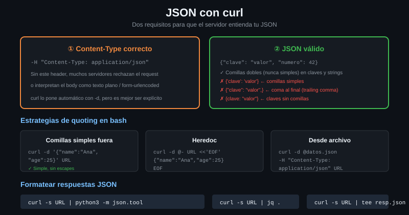

# JSON con curl

> El 90% de las APIs que vas a tocar hablan JSON. curl no sabe nada de JSON: le
> das bytes y los manda. Todo lo que sigue es sobre cómo conseguir que esos
> bytes sean el JSON que querías.



## 🎯 Objetivos

- Enviar JSON declarando el `Content-Type` correcto, y saber qué pasa si no lo haces
- Sobrevivir a las comillas: cuándo el shell te rompe el cuerpo y cómo evitarlo
- Usar `--json` (7.82+) y escribir su equivalente exacto para versiones anteriores
- Construir el cuerpo con `jq` en vez de a mano, y leer la respuesta con `jq`

---

## 1. Qué problema resuelve

Mandar JSON con curl parece trivial y falla por tres sitios distintos, todos
silenciosos:

1. **El `Content-Type`.** `-d` pone `application/x-www-form-urlencoded`. Muchas
   APIs contestan 415; otras, peor, aceptan la petición y guardan basura.
2. **Las comillas.** El JSON lleva comillas dobles, el shell también, y en
   cuanto el cuerpo tiene una variable dentro se convierte en un problema de
   escapado que nadie resuelve bien a la primera.
3. **El archivo.** `-d @cuerpo.json` quita los saltos de línea, como viste en la
   [teoría 02](02-las-familias-de-data.md).

Los tres tienen solución conocida. Este archivo es esa solución.

---

## 2. Cómo funciona

### 2.1 Los dos headers de JSON, que son distintos

| Header | Dirección | Qué dice |
|---|---|---|
| `Content-Type: application/json` | Lo que **envías** | "el cuerpo que te mando es JSON" |
| `Accept: application/json` | Lo que **quieres recibir** | "contéstame en JSON, si puedes" |

Se confunden constantemente. Una petición de escritura correcta lleva los dos:
declara lo que manda y pide lo que quiere.

`Accept` es una **preferencia**, no una orden: el servidor puede ignorarlo. Si
solo sabe hablar XML, te mandará XML con un 200, o un 406 si es estricto.

### 2.2 `--json`, y por qué no puedes usarlo todavía

Desde curl **7.82.0** existe un atajo que hace las tres cosas de golpe:

```bash
# --json equivale EXACTAMENTE a estos tres flags juntos.
curl --json '{"nombre":"Ada"}' http://localhost:8080/post
```

```bash
# El equivalente largo, que funciona en cualquier version desde siempre.
curl -d '{"nombre":"Ada"}' \
  -H 'Content-Type: application/json' \
  -H 'Accept: application/json' \
  http://localhost:8080/post
```

> [!IMPORTANT]
> `--json` es de 7.82 y **Ubuntu 22.04 trae 7.81**. Está a una versión de
> distancia, así que en un script que va a correr en máquinas de otros, el
> equivalente largo es la opción segura. Compruébalo antes de usarlo:
> `curl --help all | grep -- --json`.

Dos detalles de `--json` que sorprenden:

- **No valida el JSON.** Si le pasas `{"a":` lo manda igual y el servidor lo
  rechaza. curl sigue sin saber nada de JSON.
- **Se puede repetir**, y los trozos se concatenan **sin** `&` en medio —
  a diferencia de `-d`. Es la única familia de datos que no mete el separador.

### 2.3 Las comillas, resueltas de una vez

El JSON necesita comillas dobles. Si envuelves el cuerpo en comillas dobles del
shell, tienes que escapar cada una:

```bash
# ❌ Ilegible, y basta olvidar una barra para que el cuerpo salga roto.
curl -d "{\"nombre\":\"Ada\",\"rol\":\"admin\"}" http://localhost:8080/post
```

```bash
# ✅ Comillas simples fuera, dobles dentro. El shell no toca nada.
curl -d '{"nombre":"Ada","rol":"admin"}' http://localhost:8080/post
```

La regla es: **comillas simples fuera, dobles dentro**. Funciona siempre… hasta
que necesitas meter una variable, porque dentro de comillas simples el shell no
interpola:

```bash
NOMBRE="Ada"

# ❌ Manda el texto literal $NOMBRE, no su valor.
curl -s http://localhost:8080/post -d '{"nombre":"$NOMBRE"}' | jq -c .data
# "{\"nombre\":\"$NOMBRE\"}"
```

Y ahí es donde entra `jq`.

### 2.4 `jq` para construir el cuerpo

`jq -n` construye un JSON desde cero, y `--arg` mete una variable **escapándola
correctamente**: comillas, saltos de línea, acentos, todo.

```bash
NOMBRE='Ada "la primera"'

# jq -n construye el objeto; --arg mete el valor ya escapado.
# -d @- lee el cuerpo de la tuberia, sin archivo temporal.
jq -n --arg n "$NOMBRE" --arg r admin '{nombre: $n, rol: $r}' \
  | curl -sS --max-time 10 -H 'Content-Type: application/json' -d @- \
    http://localhost:8080/post | jq -c .json
# {"nombre":"Ada \"la primera\"","rol":"admin"}
```

Las comillas dentro del nombre llegaron intactas. Escribiendo eso a mano habrías
roto el JSON.

Para números y booleanos, `--argjson` en vez de `--arg` (si no, llegan como
cadenas):

```bash
jq -n --arg n Ada --argjson edad 36 --argjson activo true \
  '{nombre: $n, edad: $edad, activo: $activo}'
# {
#   "nombre": "Ada",
#   "edad": 36,
#   "activo": true
# }
```

### 2.5 `jq` para leer la respuesta

La respuesta de una API viene en una sola línea o con cuarenta campos que no te
interesan. `jq` recorta:

```bash
# Solo lo que importa. -c lo deja en una linea.
curl -s http://localhost:8080/post -H 'Content-Type: application/json' \
  -d '{"nombre":"Ada"}' | jq -c '{metodo: .method, enviado: .json}'
# {"metodo":"POST","enviado":{"nombre":"Ada"}}
```

```bash
# -r quita las comillas: imprescindible cuando el valor va a una variable bash.
ID=$(curl -s http://localhost:8080/anything/usuarios/42 | jq -r '.url')
echo "$ID"
# http://localhost:8080/anything/usuarios/42
```

Sin `-r`, `$ID` valdría `"http://..."` **con las comillas incluidas**, y todo lo
que hicieras después con esa variable fallaría.

---

## 3. Cómo se usa

### 3.1 El comando de escritura completo

```bash
# El comando que vas a repetir el resto del bootcamp:
#   --fail-with-body  sale con 22 ante 4xx/5xx y CONSERVA el cuerpo, que es
#                     donde la API explica el motivo del rechazo (7.76+)
#   --max-time        sin el, un servidor colgado cuelga el script
#   -sS               sin barra de progreso, pero sin tragarse los errores
curl -sS --fail-with-body --max-time 10 \
  -H 'Content-Type: application/json' \
  -H 'Accept: application/json' \
  -d '{"nombre":"Ada","rol":"admin"}' \
  http://localhost:8080/post | jq -c .json
# {"nombre":"Ada","rol":"admin"}
```

### 3.2 Cuerpo desde un archivo

```bash
cat > usuario.json <<'JSON'
{
  "nombre": "Ada",
  "rol": "admin",
  "permisos": ["leer", "escribir"]
}
JSON

# --data-binary, no -d: -d quitaria los saltos de linea.
curl -sS --fail-with-body --max-time 10 \
  -H 'Content-Type: application/json' \
  --data-binary @usuario.json \
  http://localhost:8080/post | jq -c .json
# {"nombre":"Ada","permisos":["leer","escribir"],"rol":"admin"}
```

### 3.3 Validar antes de enviar

Un JSON roto se puede detectar en local, sin gastar una petición ni ensuciar la
API:

```bash
# `jq empty` parsea la entrada y no imprime nada: sale con 0 si el JSON es
# valido y con 4 si no lo es. Ojo, SIN -e: con -e el codigo de salida se
# refiere al ultimo valor producido, y `empty` no produce ninguno, asi que
# `jq -e empty` sale con 4 incluso con un JSON perfectamente valido.
echo '{"nombre":"Ada"}'  | jq empty && echo "JSON valido"
# JSON valido

echo '{"nombre":"Ada"'   | jq empty || echo "JSON roto, no lo mandes"
# parse error: Unfinished JSON term at EOF at line 2, column 0
# JSON roto, no lo mandes
```

En un script eso va antes del `curl`, no después.

---

## 4. Antipatrones

| Antipatrón | Por qué duele | Qué hacer en su lugar |
|---|---|---|
| `-d '{"a":1}'` sin `Content-Type` | Va etiquetado como formulario. 415, o aceptado y guardado mal | `-H 'Content-Type: application/json'`, o `--json` en 7.82+ |
| Interpolar variables dentro del JSON a mano | Un valor con una comilla o un salto de línea rompe el cuerpo, y solo pasa con los datos raros | `jq -n --arg` |
| `-d @cuerpo.json` | Quita los saltos de línea del archivo | `--data-binary @cuerpo.json` |
| `jq` sin `-r` al asignar a una variable | La variable se queda con las comillas dentro y todo lo posterior falla | `jq -r` |
| `--fail` a secas en una API que explica el error en el cuerpo | Tiras justo el texto que dice qué campo está mal | `--fail-with-body` (7.76+) |
| Usar `--json` en un script que corre en máquinas ajenas | Falla en cualquier curl anterior a 7.82, incluido el de Ubuntu 22.04 | El equivalente de tres flags |
| Parsear JSON con `grep` y `cut` | Se rompe con el primer campo anidado, con el primer salto de línea y con el primer espacio | `jq` |

---

## 5. Trucos

```bash
# Formatear un JSON sin jq instalado. python3 esta en cualquier sitio.
curl -s http://localhost:8080/json | python3 -m json.tool | head -3
# {
#     "slideshow": {
#         "author": "Yours Truly",
```

```bash
# Comprobar que la API te contesto JSON de verdad y no un HTML de error.
curl -s -o /dev/null -w '%{content_type}\n' http://localhost:8080/json
# application/json; charset=utf-8
```

```bash
# Construir un objeto a partir de variables del entorno, sin escapar nada.
jq -nc --arg host "$HOSTNAME" --arg usuario "$USER" \
  '{host: $host, usuario: $usuario, momento: now | todate}'
# {"host":"...","usuario":"...","momento":"2026-08-23T10:00:00Z"}
```

```bash
# Sacar varios campos a variables bash de una sola pasada, sin llamar a jq
# cuatro veces.
read -r metodo url < <(curl -s http://localhost:8080/anything/x \
  | jq -r '[.method, .url] | @tsv')
echo "$metodo -> $url"   # GET -> http://localhost:8080/anything/x
```

---

## 📚 Recursos Adicionales

- [Manual de jq](https://jqlang.github.io/jq/manual/) — la referencia; la sección de `--arg` y `@tsv` es la que más se usa aquí
- [everything.curl.dev — JSON](https://everything.curl.dev/http/post/json) — incluye la historia de `--json`
- [manpage de curl — `--json`](https://curl.se/docs/manpage.html#--json) — dice en una línea a qué equivale
- [RFC 8259 — JSON](https://datatracker.ietf.org/doc/html/rfc8259) — por si alguna vez discutes si un `NaN` es válido (no lo es)
- [docs/versiones-de-curl.md](../../../docs/versiones-de-curl.md) — la tabla de qué distribución trae qué

---

## ✅ Checklist de Verificación

- [ ] Mandas JSON con el `Content-Type` correcto y compruebas que `.json` no es `null`
- [ ] Escribes el equivalente de `--json` con tres flags, de memoria
- [ ] Compruebas si tu curl tiene `--json` con `curl --help all | grep -- --json`
- [ ] Metes una variable con comillas dentro usando `jq -n --arg` y llega intacta
- [ ] Distingues `--arg` de `--argjson` y sabes cuándo un número llega como cadena
- [ ] Asignas un campo a una variable bash con `jq -r` y compruebas que no lleva comillas
- [ ] Validas un JSON roto con `jq empty` antes de gastar una petición, y sabes por qué no lleva `-e`

---

## 🔗 Navegación

| Anterior | Actual | Siguiente |
|---|---|---|
| [04 — `-X` y por qué casi siempre sobra](04-el-flag-x-y-por-que-sobra.md) | **05 — JSON con curl** | [06 — Headers custom](06-headers-custom.md) |

[← Volver a la Semana 02](../README.md)
