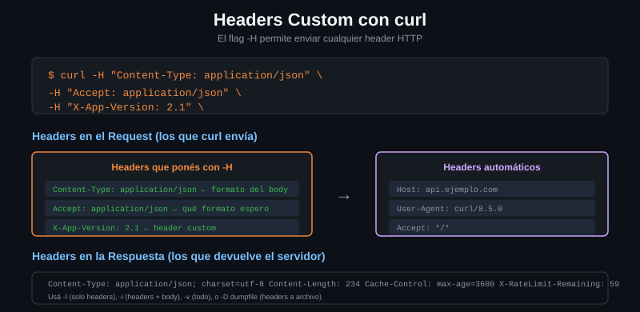

# Headers custom

> Un header es una línea de texto. `-H` la añade. Lo interesante no es añadir:
> es sustituir uno que curl pone solo, mandarlo vacío, quitarlo del todo, y
> hacer todo eso sin que el token acabe en `ps`.



## 🎯 Objetivos

- Añadir, sustituir, vaciar y suprimir headers con `-H`, y distinguir los cuatro casos
- Nombrar los tres headers que curl añade sin que se lo pidas y saber cuál puedes cambiar
- Leer con `/headers` y con `-v` qué llegó de verdad al servidor
- Sacar una credencial de la línea de comandos con `-H @archivo`

---

## 1. Qué problema resuelve

Los headers son los metadatos de la petición: quién eres, qué formato mandas,
qué formato quieres, qué versión de la API usas. Casi todo lo que una API
necesita saber además de los datos viaja ahí.

curl pone tres solo, y son razonables como defecto pero rara vez son los que
quieres:

```bash
curl -s http://localhost:8080/headers | jq -c '.headers | keys'
# ["Accept","Host","User-Agent"]
```

| Header | Valor por defecto | Por qué querrás cambiarlo |
|---|---|---|
| `Host` | El host de la URL | Para probar un vhost por IP sin tocar `/etc/hosts` |
| `User-Agent` | `curl/7.81.0` | Hay APIs y WAF que rechazan el de curl |
| `Accept` | `*/*` | Para pedir JSON en vez de "lo que sea" |

Y falta el que necesitas en cuanto la API está autenticada: `Authorization`.

---

## 2. Cómo funciona

### 2.1 Los cuatro comportamientos de `-H`

La sintaxis parece una sola. Son cuatro, y la diferencia está en el signo de
puntuación:

| Escribes | Qué hace | Cuándo |
|---|---|---|
| `-H 'X-Peticion: 42'` | **Añade** un header que no existía | Lo normal |
| `-H 'User-Agent: bc-curl/1.0'` | **Sustituye** el que ponía curl | Cuando el defecto no vale |
| `-H 'Accept;'` | Lo manda **vacío** (punto y coma) | Para probar cómo reacciona una API a un valor vacío |
| `-H 'Accept:'` | Lo **suprime** del todo (dos puntos, sin valor) | Para que ese header no salga |

Los dos últimos se confunden y hacen cosas distintas:

```bash
# Punto y coma: el header VIAJA, con valor vacio.
curl -s http://localhost:8080/headers -H 'Accept;' | jq -c '.headers.Accept'
# [""]
```

```bash
# Dos puntos sin valor: el header NO viaja. Fijate en que Accept ya no esta.
curl -s http://localhost:8080/headers -H 'Accept:' | jq -c '.headers | keys'
# ["Host","User-Agent"]
```

### 2.2 Se repiten, no se pisan

Varios `-H` con el mismo nombre **no** se sobrescriben entre sí: se mandan
todos. HTTP lo permite, y el servidor decide qué hacer con ellos.

```bash
curl -s http://localhost:8080/headers \
  -H 'X-Prueba: uno' -H 'X-Prueba: dos' | jq -c '.headers["X-Prueba"]'
# ["uno","dos"]
```

Esto es la causa de un fallo clásico: añades un `Content-Type` sin darte cuenta
de que ya había otro, y el servidor coge el primero, o el último, o devuelve
400. Si quieres **sustituir**, asegúrate de que solo hay uno.

La excepción son los headers que pone curl: ahí `-H` sí sustituye, no duplica.

### 2.3 Dónde acaban los headers de respuesta

`-H` es solo para los que envías. Para leer los que llegan:

| Flag | Qué hace |
|---|---|
| `-i` | Headers de respuesta **mezclados** con el cuerpo en stdout |
| `-D -` | Headers a donde le digas (`-` es stdout), el cuerpo aparte |
| `-I` | Hace un HEAD y enseña solo headers. **Cambia el método** |
| `-v` | La traza completa: `>` lo que sale, `<` lo que entra |

En un script, `-D -` con `-o` es el correcto: separa las dos cosas sin cambiar
el método.

```bash
# Los headers de respuesta a stdout, el cuerpo a un archivo. Sin mezclas.
curl -sS --max-time 10 -o cuerpo.json -D - http://localhost:8080/json | head -3
# HTTP/1.1 200 OK
# Access-Control-Allow-Credentials: true
# Access-Control-Allow-Origin: *
```

### 2.4 Headers y secretos

Un `Authorization: Bearer ...` en la línea de comandos es visible para cualquier
usuario de la máquina:

```bash
# ❌ NUNCA. Cualquiera con acceso a la maquina ve el token con `ps aux`, y
# ademas queda en ~/.bash_history y en los logs de CI.
curl -H "Authorization: Bearer <TOKEN>" https://api.ejemplo.com/datos
```

Hay tres salidas, en orden de menos a más seguro:

**1. Variable de entorno.** El token no está en el historial, pero sigue siendo
visible en `/proc/PID/environ` para el mismo usuario:

```bash
curl -sS --max-time 10 -H "Authorization: Bearer ${API_TOKEN}" \
  https://api.ejemplo.com/datos
```

**2. Archivo de headers con `-H @archivo`** (curl 7.55+). El token no aparece en
`ps` en ningún momento:

```bash
# Un header por linea. chmod 600 porque esto es una credencial.
umask 077
cat > cabeceras.txt <<'EOF'
Authorization: Bearer <TOKEN>
Accept: application/json
EOF

curl -sS --max-time 10 -H @cabeceras.txt https://api.ejemplo.com/datos
```

**3. `--netrc` o el gestor de credenciales**, que es lo que verás en la
[Semana 03](../../week-03-autenticacion_basica/README.md).

> [!WARNING]
> `cabeceras.txt` **no se comitea**. Ni ese, ni ningún archivo con un token
> dentro. Si vive en el repositorio, va al `.gitignore` antes de escribirlo.

---

## 3. Cómo se usa

### 3.1 Ver qué llega de verdad

Cuando una API contesta 401 y tú juras que mandaste el token, esto lo resuelve
en diez segundos:

```bash
# El reflector devuelve los headers que le llegaron. Es la unica fuente de
# verdad: lo que tu creias mandar no cuenta.
curl -s http://localhost:8080/headers \
  -H 'X-Api-Version: 2' \
  -H 'Accept: application/json' | jq .headers
# {
#   "Accept": ["application/json"],
#   "Host": ["localhost:8080"],
#   "User-Agent": ["curl/7.81.0"],
#   "X-Api-Version": ["2"]
# }
```

Y si el problema es la petición contra la API real, la traza:

```bash
# Las lineas '>' son exactamente los bytes que salieron de tu maquina.
curl -sv http://localhost:8080/get -H 'X-Api-Version: 2' 2>&1 | grep '^> '
# > GET /get HTTP/1.1
# > Host: localhost:8080
# > User-Agent: curl/7.81.0
# > Accept: */*
# > X-Api-Version: 2
```

### 3.2 Negociar el formato con `Accept`

```bash
# El endpoint /anything responde JSON siempre, pero el header viaja y el
# servidor lo refleja: sirve para comprobar que estas pidiendo lo correcto.
curl -s http://localhost:8080/anything -H 'Accept: application/json' \
  | jq -c '.headers.Accept'
# ["application/json"]
```

Contra una API real, `Accept` es lo que decide si te contesta JSON o XML, y lo
que provoca un **406 Not Acceptable** si pides algo que no sabe generar.

### 3.3 Cambiar el `User-Agent`

```bash
# Hay APIs (la de GitHub, sin ir mas lejos) que exigen un User-Agent propio y
# rechazan el de curl. Ponerle el nombre de tu herramienta es buena educacion:
# el operador del servidor sabe a quien escribir si algo va mal.
curl -s http://localhost:8080/headers -H 'User-Agent: api-toolkit/0.2' \
  | jq -c '.headers["User-Agent"]'
# ["api-toolkit/0.2"]
```

### 3.4 Suprimir un header para ver qué pasa

```bash
# Sin Accept, algunas APIs devuelven su formato por defecto en vez de JSON.
# Provocarlo a proposito es como se depura una respuesta inesperada.
curl -s http://localhost:8080/headers -H 'Accept:' | jq -c '.headers | keys'
# ["Host","User-Agent"]
```

---

## 4. Antipatrones

| Antipatrón | Por qué duele | Qué hacer en su lugar |
|---|---|---|
| Token en la línea de comandos | Visible en `ps`, en `~/.bash_history` y en los logs de CI. Y los logs de CI se guardan años | `-H @archivo` con `chmod 600`, o `--netrc` |
| `-k` para "que el header llegue" | No tiene nada que ver: `-k` apaga la verificación del certificado y deja pasar a cualquiera que se meta en medio | Si el certificado no valida, `--cacert`. Nunca `-k` |
| Añadir un `Content-Type` sin comprobar si ya había otro | Se mandan los dos y el servidor elige. 400 intermitente y difícil de reproducir | Comprueba con `-v` que solo sale uno |
| Confundir `-H 'Accept;'` con `-H 'Accept:'` | Uno manda el header vacío, el otro lo quita. Son escenarios distintos | Punto y coma = vacío. Dos puntos = suprimido |
| Comitear `cabeceras.txt` | El token queda en el historial de git para siempre, aunque lo borres después | `.gitignore` antes de crearlo, y rota el token si ya pasó |
| Deducir qué headers mandaste leyendo el comando | El comando tiene lo que escribiste, no lo que salió. Los defectos de curl no se ven ahí | `/headers` del laboratorio, o `curl -v ... 2>&1 \| grep '^> '` |

---

## 5. Trucos

```bash
# Contar cuantos headers devolvio la respuesta, sin leerlos.
curl -s -o /dev/null -w '%{num_headers} headers de respuesta\n' \
  http://localhost:8080/get
# 5 headers de respuesta
```

```bash
# Todos los headers de respuesta como JSON, para filtrarlos con jq.
# %{header_json} existe desde curl 7.83; en 7.81 usa -D - y grep.
curl -s -o /dev/null -w '%{header_json}' http://localhost:8080/get | jq -c 'keys'
# ["access-control-allow-credentials","access-control-allow-origin",...]
```

```bash
# Pedirle al servidor que te devuelva los headers que tu elijas: util para
# provocar un caso concreto sin montar un servidor.
curl -s -o /dev/null -D - \
  'http://localhost:8080/response-headers?X-Limite=100&X-Restante=99' \
  | grep -i '^x-'
# X-Limite: 100
# X-Restante: 99
```

```bash
# Sacar un solo header de la respuesta a una variable bash.
LIMITE=$(curl -s -o /dev/null -D - \
  'http://localhost:8080/response-headers?X-Limite=100' \
  | awk -F': ' 'tolower($1)=="x-limite"{print $2}' | tr -d '\r')
echo "limite: $LIMITE"
# limite: 100
```

---

## 📚 Recursos Adicionales

- [everything.curl.dev — Custom headers](https://everything.curl.dev/http/requests/headers) — incluye el truco del punto y coma
- [manpage de curl — `-H`](https://curl.se/docs/manpage.html#-H) — la sintaxis de las cuatro formas
- [RFC 9110 §6.3 — Header Fields](https://datatracker.ietf.org/doc/html/rfc9110#name-header-fields) — por qué un header puede repetirse
- [MDN — HTTP headers](https://developer.mozilla.org/es/docs/Web/HTTP/Headers) — el catálogo, en español

---

## ✅ Checklist de Verificación

- [ ] Añades un header custom y lo ves en `/headers` del laboratorio
- [ ] Sustituyes el `User-Agent` y compruebas que el de curl ya no aparece
- [ ] Distingues en la práctica `-H 'Accept;'` de `-H 'Accept:'`
- [ ] Mandas dos veces el mismo header y ves los dos valores en la respuesta
- [ ] Sacas un token de la línea de comandos con `-H @archivo` y `chmod 600`
- [ ] Lees los headers de respuesta con `-D -` sin cambiar el método
- [ ] Compruebas con `-v` que un header que creías mandar salió de verdad

---

## 🔗 Navegación

| Anterior | Actual | Siguiente |
|---|---|---|
| [05 — JSON con curl](05-json-con-curl.md) | **06 — Headers custom** | [07 — HEAD y OPTIONS](07-head-y-options.md) |

[← Volver a la Semana 02](../README.md)
