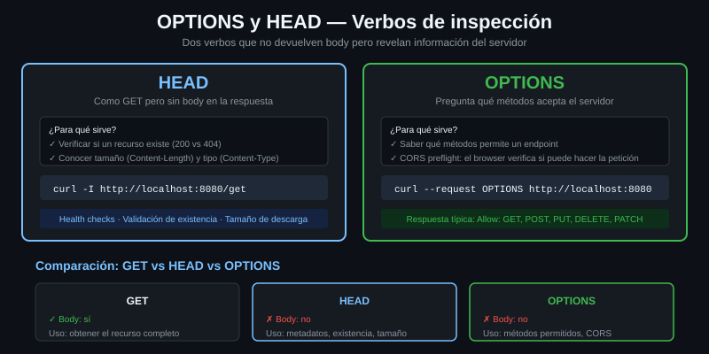

# HEAD y OPTIONS

> Los dos verbos que preguntan en vez de pedir. Sirven para saber algo de un
> recurso sin descargarlo y para saber qué puedes hacerle antes de intentarlo.
> Y uno de los dos te miente si no lo miras con cuidado.



## 🎯 Objetivos

- Comprobar tamaño, tipo y fecha de un recurso sin descargar un solo byte del cuerpo
- Explicar por qué el `Content-Length` de un HEAD puede no coincidir con el del GET
- Descubrir qué métodos acepta un endpoint, por OPTIONS o por el `Allow` de un 405
- Reconocer cuándo `-I` te da una respuesta engañosa y con qué sustituirlo

---

## 1. Qué problema resuelve

Antes de escribir contra un endpoint hay dos preguntas razonables:

- *"¿Cuánto ocupa esto y cuándo cambió?"* — antes de descargar 400 MB por curiosidad.
- *"¿Este endpoint acepta DELETE?"* — antes de descubrirlo con un 405 en producción.

HTTP tiene un método para cada una. **HEAD** devuelve los headers de la
respuesta que habría dado un GET, sin el cuerpo. **OPTIONS** declara qué
métodos admite el recurso.

Sin ellos, la alternativa es descargar el recurso entero para mirar dos campos,
o probar el método a ver qué pasa. Lo primero es caro; lo segundo, en un DELETE,
es irreversible.

---

## 2. Cómo funciona

### 2.1 HEAD: la respuesta sin el cuerpo

Por definición, HEAD devuelve **los mismos headers** que devolvería un GET, y
corta antes del cuerpo. curl lo manda con `-I` (o `--head`):

```bash
curl -sI http://localhost:8080/json
# HTTP/1.1 200 OK
# Access-Control-Allow-Credentials: true
# Access-Control-Allow-Origin: *
# Content-Type: application/json; charset=utf-8
# Date: ...
```

Sirve para tres cosas que se repiten mucho:

| Pregunta | Header que la contesta |
|---|---|
| ¿Cuánto ocupa? | `Content-Length` |
| ¿Qué formato es? | `Content-Type` |
| ¿Ha cambiado desde la última vez? | `Last-Modified` o `ETag` |

### 2.2 Por qué HEAD a veces miente

El RFC dice que los headers **deberían** ser los mismos que en el GET. En la
práctica, muchos servidores no calculan el cuerpo para un HEAD, así que no saben
cuánto ocupa y **omiten el `Content-Length`**. El laboratorio hace exactamente
eso:

```bash
# HEAD: no hay Content-Length.
curl -sI http://localhost:8080/json | grep -ci content-length
# 0
```

```bash
# GET: si lo hay, y son 421 bytes.
curl -s -o /dev/null -D - http://localhost:8080/json | grep -i content-length
# Content-Length: 421
```

```bash
# Y el cuerpo real mide eso mismo.
curl -s -o /dev/null -w '%{size_download} bytes\n' http://localhost:8080/json
# 421 bytes
```

La conclusión práctica: **un `Content-Length` ausente en un HEAD no significa
que el recurso esté vacío.** Si el tamaño importa de verdad, mídelo con un GET a
`/dev/null` y `%{size_download}`.

### 2.3 El otro engaño de `-I`: cambia el método

`-I` no es "enséñame los headers": es "haz un HEAD". Y un HEAD es **otro
método**, así que el servidor puede contestar distinto:

```bash
# /post solo acepta POST. Un HEAD contra el es un 405, y no dice nada del GET.
curl -sI -o /dev/null -w '%{http_code}\n' http://localhost:8080/post
# 405
```

Si lo que quieres son los headers de un GET, el flag es `-D -` con `-o
/dev/null`: hace el GET de verdad, tira el cuerpo y enseña los headers.

```bash
curl -s -o /dev/null -D - http://localhost:8080/get | head -1
# HTTP/1.1 200 OK
```

| Quiero… | Flag |
|---|---|
| Los headers de un **GET**, sin el cuerpo | `-s -o /dev/null -D -` |
| Hacer un **HEAD** de verdad | `-I` |
| Los headers **y** el cuerpo, juntos | `-i` |

### 2.4 OPTIONS: qué métodos acepta esto

OPTIONS pregunta por las capacidades del recurso. La respuesta canónica es el
header **`Allow`**:

```bash
# --request OPTIONS: ningun otro flag implica este metodo.
curl -s --request OPTIONS -D - -o /dev/null http://localhost:8080/anything \
  | grep -iE '^(allow|access-control-allow-methods)'
# Access-Control-Allow-Methods: GET, POST, HEAD, PUT, DELETE, PATCH, OPTIONS
```

Fíjate en lo que devolvió el laboratorio: **no** un `Allow`, sino un
`Access-Control-Allow-Methods`. Es habitual. Muchos servidores implementan
OPTIONS solo para el *preflight* de CORS — el permiso que pide un navegador
antes de una petición entre dominios — y contestan con los headers de CORS en
vez de con `Allow`.

Por eso la regla real es: **mira los dos**.

### 2.5 El plan B, que funciona casi siempre: el 405

Cuando OPTIONS no contesta nada útil, hay una fuente mejor. El RFC obliga a que
una respuesta **405 Method Not Allowed** incluya un `Allow` con los métodos que
sí valen:

```bash
# Un GET contra /post es un 405, y el 405 trae la lista buena.
curl -s -D - -o /dev/null http://localhost:8080/post | grep -iE '^(HTTP|allow)'
# HTTP/1.1 405 Method Not Allowed
# Allow: POST
```

Ahí está la respuesta que OPTIONS no dio: ese endpoint acepta POST y nada más.

> [!TIP]
> Provocar un 405 a propósito con un método inofensivo (GET, HEAD o el
> inexistente `--request PROBE`) es la forma más fiable de averiguar qué acepta
> un endpoint. Y es seguro: un método no permitido no ejecuta nada.

---

## 3. Cómo se usa

### 3.1 Mirar un recurso antes de descargarlo

```bash
# Tres datos de una tacada, sin bajar el cuerpo. -I hace HEAD; si el servidor
# omite el tamano, %{size_download} valdra 0: no te fies de ese cero.
curl -sI -o /dev/null \
  -w 'tipo=%{content_type}\ncodigo=%{http_code}\n' \
  http://localhost:8080/json
# tipo=application/json; charset=utf-8
# codigo=200
```

### 3.2 Medir de verdad lo que ocupa

```bash
# Un GET al vacio: descarga el cuerpo pero no lo guarda. Es el unico numero
# fiable cuando el HEAD no trae Content-Length.
curl -sS --max-time 10 -o /dev/null \
  -w '%{size_download} bytes en %{time_total}s\n' \
  http://localhost:8080/json
# 421 bytes en 0.001883s
```

### 3.3 Interrogar un endpoint antes de escribir contra él

```bash
# Paso 1: preguntar por las buenas.
curl -s --request OPTIONS -D - -o /dev/null http://localhost:8080/post \
  | grep -iE '^(allow|access-control-allow-methods)'
# Access-Control-Allow-Methods: GET, POST, HEAD, PUT, DELETE, PATCH, OPTIONS

# Paso 2: si no convence, provocar el 405 y leer su Allow.
curl -s -D - -o /dev/null http://localhost:8080/post | grep -i '^allow'
# Allow: POST
```

Las dos respuestas se contradicen, y eso es información: la primera es la
política de CORS del servidor, la segunda es lo que ese endpoint concreto
acepta. La que manda es la segunda.

### 3.4 Comprobar si algo cambió, sin descargarlo

```bash
# ETag y Last-Modified son la base del cache condicional. En la Semana 09 se
# usan con --etag-compare; aqui basta con saber leerlos.
curl -sI http://localhost:8080/etag/v1 | grep -iE '^(etag|last-modified)'
# Etag: "v1"
# Last-Modified: Sun, 23 Aug 2026 10:45:25 GMT
```

---

## 4. Antipatrones

| Antipatrón | Por qué duele | Qué hacer en su lugar |
|---|---|---|
| `-I` para ver los headers de un GET | Es otro método. El servidor puede contestar 405, o headers distintos | `-s -o /dev/null -D -` |
| Fiarse del `Content-Length` de un HEAD | Muchos servidores no lo mandan, y `%{size_download}` vale 0 | Mídelo con un GET a `/dev/null` |
| Dar por hecho que si OPTIONS no contesta `Allow` el método no existe | La mayoría de los servidores solo implementan OPTIONS para CORS | Provoca un 405 y lee su `Allow` |
| `-X HEAD` | curl espera una respuesta sin cuerpo, el servidor manda uno, y el comando se cuelga hasta el `--max-time` | `-I` |
| Probar si un DELETE funciona… haciendo el DELETE | Si funciona, ya has borrado | OPTIONS, el `Allow` de un 405, o `--dry-run` de tu propio script |
| `-I` sobre una descarga grande "para no gastar datos" | Correcto en intención, pero si el servidor no manda `Content-Length` no te has enterado de nada | Combínalo con un GET con `--max-filesize` o `-r 0-0` |

---

## 5. Trucos

```bash
# Solo la primera linea de la respuesta: el codigo y su texto.
curl -sI http://localhost:8080/get | head -1
# HTTP/1.1 200 OK
```

```bash
# Descargar solo el primer byte para forzar que el servidor revele el tamano
# total en Content-Range, cuando el HEAD no lo dice. -r es --range.
# Ojo con el endpoint: /bytes NO acepta rangos y devuelve el recurso entero
# con un 200. El que los acepta es /range.
curl -s -r 0-0 -D - -o /dev/null http://localhost:8080/range/1024 \
  | grep -iE '^(HTTP|content-range)'
# HTTP/1.1 206 Partial Content
# Content-Range: bytes 0-0/1024
#                          ^^^^ el tamano total del recurso
```

```bash
# Un metodo inventado tambien provoca el 405 con su Allow, y no ejecuta nada.
curl -s --request PROBE -D - -o /dev/null http://localhost:8080/post \
  | grep -iE '^(HTTP|allow)'
# HTTP/1.1 405 Method Not Allowed
# Allow: POST
```

```bash
# Comparar los headers de un HEAD con los de un GET para ver que se calla el
# servidor. Se quita Date porque cambia en cada peticion.
diff <(curl -sI http://localhost:8080/json | grep -iv '^date') \
     <(curl -s -o /dev/null -D - http://localhost:8080/json | grep -iv '^date')
# 4a5
# > Content-Length: 421
```

---

## 📚 Recursos Adicionales

- [RFC 9110 §9.3.2 — HEAD](https://datatracker.ietf.org/doc/html/rfc9110#name-head) — incluye la advertencia sobre los headers que pueden faltar
- [RFC 9110 §9.3.7 — OPTIONS](https://datatracker.ietf.org/doc/html/rfc9110#name-options) y [§15.5.6 — 405](https://datatracker.ietf.org/doc/html/rfc9110#name-405-method-not-allowed) — el `Allow` es obligatorio en el 405
- [MDN — CORS preflight](https://developer.mozilla.org/es/docs/Web/HTTP/CORS#peticiones_con_verificaci%C3%B3n_previa) — por qué casi todos los OPTIONS que verás son de CORS
- [everything.curl.dev — HEAD](https://everything.curl.dev/http/requests/head) — y por qué `-I` no siempre es lo que quieres

---

## ✅ Checklist de Verificación

- [ ] Sacas tipo y código de un recurso con `-I` sin descargar el cuerpo
- [ ] Demuestras que el HEAD del laboratorio no trae `Content-Length` y el GET sí
- [ ] Mides el tamaño real con `%{size_download}` sobre un GET a `/dev/null`
- [ ] Provocas un 405 con `-I` sobre `/post` y explicas por qué
- [ ] Lees los métodos permitidos por OPTIONS y por el `Allow` de un 405, y sabes cuál manda
- [ ] Sustituyes un `-I` por `-D -` cuando lo que querías eran los headers del GET

---

## 🔗 Navegación

| Anterior | Actual | Siguiente |
|---|---|---|
| [06 — Headers custom](06-headers-custom.md) | **07 — HEAD y OPTIONS** | [08 — Los códigos de la escritura](08-los-codigos-de-la-escritura.md) |

[← Volver a la Semana 02](../README.md)
