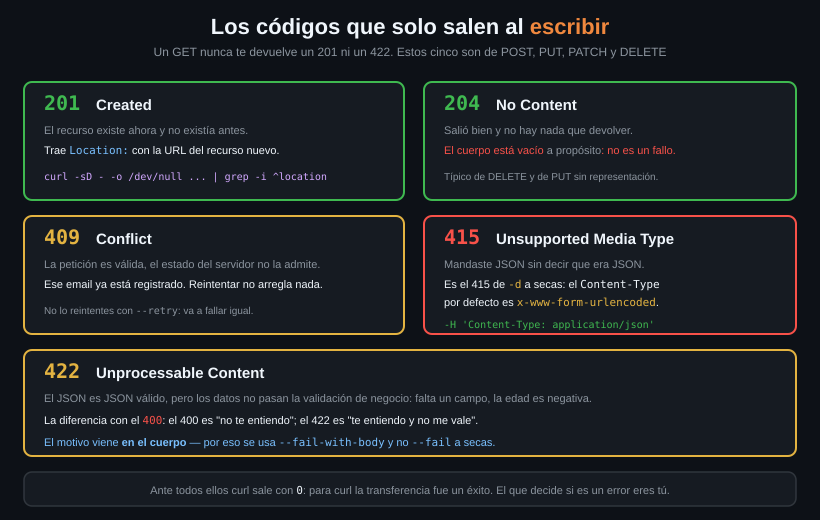

# Los códigos de la escritura

> En la Semana 01 viste 200, 301, 404 y 500. Leyendo, con eso te apañas.
> Escribiendo aparecen otros cinco que no habías visto, y tres de ellos son la
> diferencia entre reintentar y no reintentar nunca.



## 🎯 Objetivos

- Distinguir 201, 204, 409, 415 y 422, y decir qué hay que hacer ante cada uno
- Leer la URL del recurso recién creado en el header `Location`
- Explicar por qué un 204 con el cuerpo vacío no es un fallo
- Decidir cuáles de esos códigos merecen un reintento automático y cuáles no
- Recuperar el motivo del rechazo, que viene en el cuerpo y `--fail` a secas tira

---

## 1. Qué problema resuelve

Un script que escribe tiene que decidir tres cosas ante cada respuesta: si salió
bien, si el fallo es suyo o del servidor, y si conviene reintentar.

El código de estado responde a las tres, pero solo si sabes leer los que
aparecen al escribir. Tratar un 409 como si fuera un 500 lleva a reintentar
cuatro veces algo que va a fallar siempre; tratar un 422 como un 400 genérico
lleva a no leer el mensaje que dice exactamente qué campo está mal.

---

## 2. Cómo funciona

### 2.1 Los cinco códigos nuevos

| Código | Nombre | Qué significa al escribir | ¿Reintentar? |
|:--:|---|---|---|
| **201** | Created | El recurso existe ahora y antes no. Trae `Location` | — |
| **204** | No Content | Salió bien y no hay nada que devolver. Cuerpo vacío a propósito | — |
| **409** | Conflict | La petición es válida, el estado del servidor no la admite | **No** |
| **415** | Unsupported Media Type | El `Content-Type` que declaraste no le sirve | **No** |
| **422** | Unprocessable Content | El formato es correcto, los datos no pasan la validación | **No** |

Los tres errores son **4xx**: el problema está en tu petición, no en el
servidor, y reintentarlos sin cambiar nada da el mismo resultado. Los que sí
merecen reintento son los 5xx y el **429 Too Many Requests** — Semana 07.

### 2.2 El 201 y el header `Location`

Cuando una API crea un recurso, no siempre te devuelve el objeto. Lo que sí
debe devolver es **dónde ha quedado**, en el header `Location`:

```
HTTP/1.1 201 Created
Location: /usuarios/42
```

Ese `/usuarios/42` es la URL del recurso nuevo, y es lo que necesitas para el
siguiente paso del script. Leerlo del cuerpo es un error: puede no estar.

```bash
# El laboratorio no crea recursos, pero /status/201 devuelve el codigo y
# /response-headers deja simular el Location para practicar el parseo.
curl -s -o /dev/null -D - \
  'http://localhost:8080/response-headers?Location=%2Fusuarios%2F42' \
  | grep -i '^location'
# Location: /usuarios/42
```

### 2.3 El 204 y el cuerpo vacío

**204 No Content** significa "hecho, y no tengo nada que contarte": es la
respuesta correcta a un DELETE, y a un PUT que no devuelve representación. El
cuerpo está vacío **a propósito**, y esto rompe scripts constantemente:

```bash
# El cuerpo mide 0 bytes. No es un error: es lo que significa 204.
curl -s -o /dev/null -w 'codigo=%{http_code} cuerpo=%{size_download} bytes\n' \
  http://localhost:8080/status/204
# codigo=204 cuerpo=0 bytes
```

```bash
# ❌ Y esto es lo traicionero: jq sobre un cuerpo vacio NO da error. No imprime
# nada y sale con 0. La variable se queda vacia y el script sigue como si nada.
ID=$(curl -s http://localhost:8080/status/204 | jq -r .id)
echo "salida de jq=$? id=[$ID]"
# salida de jq=0 id=[]
```

No hay excepción que capturar ni código de salida que mirar: el fallo aparece
tres pasos más adelante, cuando alguien usa `$ID` para construir una URL. La
solución es mirar el código **antes** de intentar parsear:

```bash
# ✅ Se separa el codigo del cuerpo y se decide con el codigo.
codigo=$(curl -sS --max-time 10 -o /dev/null -w '%{http_code}' \
  http://localhost:8080/status/204)
if [ "$codigo" = "204" ]; then
  echo "borrado correctamente"
fi
# borrado correctamente
```

### 2.4 El 415 y el 422, que se confunden

Los dos son "no me vale lo que has mandado", por motivos distintos:

| | 415 | 422 |
|---|---|---|
| Qué mira el servidor | El header `Content-Type` | El **contenido** del cuerpo |
| Ejemplo | Mandaste JSON diciendo que era un formulario | Mandaste JSON válido con `"edad": -5` |
| Cómo se arregla | Cambiando un header | Cambiando los datos |

El 415 es, en la práctica, **el error de `-d` sin `Content-Type`**: si te
aparece uno, revisa el header antes que los datos. Y hay un tercero que se
solapa, el **400 Bad Request**: el 400 es "esto ni siquiera es JSON" y el 422 es
"es JSON y no me vale". Muchas APIs usan 400 para todo; las que distinguen te
están dando información gratis.

### 2.5 El motivo viene en el cuerpo

Esta es la diferencia importante frente a la Semana 01. Cuando una API rechaza
una escritura, el código dice **que** falló y el cuerpo dice **por qué**:

```json
{
  "error": "validacion",
  "campos": { "edad": "tiene que ser un entero positivo" }
}
```

Y ahí está la trampa: **`--fail` a secas descarta el cuerpo**. Sale con 22 y te
deja sin el texto que explicaba el problema.

Se ve con el 405 de `/post`, que sí trae un cuerpo explicativo:

```bash
# ❌ --fail: sale con 22 y NI SIQUIERA CREA el archivo. Te quedas sin el motivo.
rm -f respuesta.txt
curl -s --fail http://localhost:8080/post -o respuesta.txt
echo "salida=$? archivo=$(test -f respuesta.txt && echo si || echo no)"
# salida=22 archivo=no
```

```bash
# ✅ --fail-with-body: sale con 22 IGUAL, y ademas guarda el cuerpo (7.76+).
curl -s --fail-with-body http://localhost:8080/post -o respuesta.txt
echo "salida=$? bytes=$(wc -c < respuesta.txt)"
cat respuesta.txt
# salida=22 bytes=19
# Method Not Allowed
```

El código de salida es el mismo, 22. La diferencia son los 19 bytes que dicen
qué pasó. Contra una API real esos bytes son el JSON que nombra el campo mal
validado, y es la razón por la que en este bootcamp **siempre** se usa
`--fail-with-body`.

> [!NOTE]
> `--fail-with-body` es de curl **7.76**. Ubuntu 22.04 trae 7.81, así que lo
> tienes; Debian 11 trae 7.74 y no. La alternativa sin él es no usar `--fail` en
> absoluto y decidir en bash con `-w '%{http_code}'`, como en el ejemplo 3.1.

### 2.6 Y curl sigue saliendo con 0

Recordatorio de la Semana 01, que ahora importa el doble: sin `--fail`, curl
sale con **0** ante cualquiera de estos códigos, porque para él la transferencia
fue un éxito. Un script de escritura sin `--fail-with-body` da por bueno un 422:
te dice que creó el usuario y no lo creó.

```bash
curl -s -o /dev/null http://localhost:8080/status/422; echo "salida=$?"
# salida=0
```

---

## 3. Cómo se usa

### 3.1 Decidir qué hacer con el código

```bash
# Codigo y cuerpo de la MISMA peticion: %{http_code} se pega al final y luego se
# separan. Con dos peticiones estarias mirando dos estados distintos.
respuesta=$(curl -sS --max-time 10 -w '\n%{http_code}' \
  -H 'Content-Type: application/json' -d '{"edad":-5}' \
  http://localhost:8080/status/422)

codigo="${respuesta##*$'\n'}"     # la ultima linea
cuerpo="${respuesta%$'\n'*}"      # todo lo anterior

case "$codigo" in
  201) echo "creado" ;;
  204) echo "hecho, sin contenido" ;;
  409) echo "conflicto: ya existe. No reintentar" ;;
  415) echo "Content-Type incorrecto: revisa el header, no los datos" ;;
  422) echo "datos invalidos: $cuerpo" ;;
  *)   echo "codigo inesperado: $codigo" ;;
esac
# datos invalidos:
```

### 3.2 Sacar el `Location` de un 201

```bash
# -D - manda los headers a stdout y -o /dev/null tira el cuerpo. El tr -d '\r'
# quita el retorno de carro con que HTTP termina cada linea, y que si no rompe
# cualquier comparacion en bash.
UBICACION=$(curl -sS --max-time 10 -o /dev/null -D - \
  'http://localhost:8080/response-headers?Location=%2Fusuarios%2F42' \
  | awk -F': ' 'tolower($1)=="location"{print $2}' | tr -d '\r')
echo "creado en: $UBICACION"
# creado en: /usuarios/42
```

### 3.3 Provocar cada código para probar tu script

```bash
# /status/NNN devuelve el codigo que le pidas, con el cuerpo vacio. Es como se
# prueba el manejo de errores sin esperar a que falle de verdad.
for c in 201 204 409 415 422; do
  curl -s -o /dev/null -w "$c -> %{http_code}  " http://localhost:8080/status/$c
done; echo
# 201 -> 201  204 -> 204  409 -> 409  415 -> 415  422 -> 422
```

---

## 4. Antipatrones

| Antipatrón | Por qué duele | Qué hacer en su lugar |
|---|---|---|
| Escribir sin `--fail-with-body` | curl sale con 0 ante un 422. El script dice que creó el recurso y no lo creó | `--fail-with-body` siempre en escritura |
| `--fail` a secas en una API que explica el error | Sales con 22 pero sin el texto que decía qué campo estaba mal | `--fail-with-body` (7.76+) |
| `--retry` ante un 409, 415 o 422 | Son 4xx: reintentar sin cambiar la petición da el mismo resultado, cuatro veces más despacio | Reintenta solo 5xx y 429 |
| Pasar la respuesta de un 204 a `jq` sin mirar | El cuerpo está vacío por definición y `jq` da error de parseo | Comprueba el código antes de parsear |
| Buscar la URL del recurso creado en el cuerpo | Puede no estar. El sitio normativo es el header `Location` | Léelo de `Location` con `-D -` |
| Tratar el 415 mirando los datos | El 415 habla del header, no del contenido. Los datos pueden estar perfectos | Revisa el `Content-Type` primero |

---

## 5. Trucos

```bash
# Codigo, tamano de cuerpo y tipo en una linea: delata un 204 que deberia traer
# datos o un 200 que llego vacio.
curl -s -o /dev/null -w '%{http_code} %{size_download}b %{content_type}\n' \
  http://localhost:8080/status/204
# 204 0b text/plain; charset=utf-8
```

```bash
# Toda la informacion de la transferencia como JSON, para depurar de un vistazo.
# %{json} existe desde curl 7.70.
curl -s -o /dev/null -w '%{json}' http://localhost:8080/status/409 \
  | jq -c '{http_code, method, size_download, num_headers}'
# {"http_code":409,"method":"GET","size_download":0,"num_headers":5}
```

```bash
# Comprobar de golpe que tu script trata bien toda la familia de errores.
for c in 400 409 422 503; do
  curl -s --fail-with-body -o /dev/null \
    -w "$c: http=%{http_code} " http://localhost:8080/status/$c
  echo "salida=$?"
done
# 400: http=400 salida=22   409: http=409 salida=22
# 422: http=422 salida=22   503: http=503 salida=22
```

---

## 📚 Recursos Adicionales

- [RFC 9110 §15 — Status Codes](https://datatracker.ietf.org/doc/html/rfc9110#name-status-codes) — la lista normativa, y [§15.5.21](https://datatracker.ietf.org/doc/html/rfc9110#name-422-unprocessable-content) para el 422, que dejó de ser exclusivo de WebDAV en 2022
- [MDN — Códigos de estado HTTP](https://developer.mozilla.org/es/docs/Web/HTTP/Status) — en español, con ejemplos
- [Códigos de salida de curl](https://curl.se/libcurl/c/libcurl-errors.html) — el 22 es el de `--fail`

---

## ✅ Checklist de Verificación

- [ ] Dices qué significa cada uno de los cinco códigos sin mirar la tabla
- [ ] Explicas por qué un 409 no se reintenta y un 503 sí
- [ ] Sacas un `Location` de los headers con `-D -` y lo dejas limpio de `\r`
- [ ] Provocas un 204 y compruebas que `%{size_download}` vale 0 y que `jq` no protesta
- [ ] Compruebas que sin `--fail-with-body` curl sale con 0 ante un 422
- [ ] Distingues un 415 de un 422 diciendo dónde mira el servidor en cada caso
- [ ] Capturas código y cuerpo en una sola petición con `-w '\n%{http_code}'`

---

## 🔗 Navegación

| Anterior | Actual | Siguiente |
|---|---|---|
| [07 — HEAD y OPTIONS](07-head-y-options.md) | **08 — Los códigos de la escritura** | — |

[← Volver a la Semana 02](../README.md)
