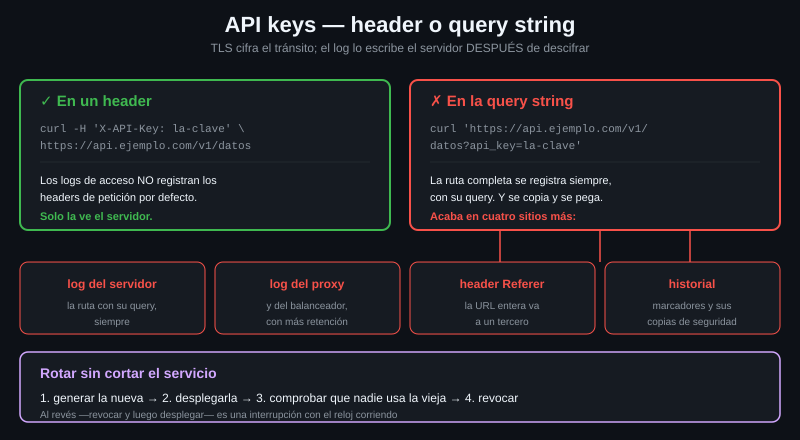

# API keys

> Una cadena fija que identifica a la aplicación, no a la persona. Simple de
> usar y fácil de filtrar: casi todas las filtraciones de claves empiezan por
> ponerla en la URL.



## 🎯 Objetivos

- Mandar una API key por header y comprobar que llegó
- Enumerar los cuatro sitios donde se filtra una key puesta en la query string
- Explicar por qué HTTPS **no** salva a la key de la query string
- Reconocer los prefijos de clave y saber para qué sirven

---

## 1. Qué problema resuelve

Basic Auth identifica a una persona con una password que esa persona conoce. Una
API key identifica a **una aplicación** con una cadena que el servicio generó,
que nadie memoriza y que se puede rotar sin cambiar de usuario.

Es lo que usan las APIs de producto: mapas, pagos, clima, traducción. El servicio
quiere saber a quién facturar y a quién limitar, no quién está sentado delante.

| | Basic Auth | API key |
|---|---|---|
| Identifica a | Una persona | Una aplicación o un proyecto |
| La eligió | El usuario | El servicio, aleatoria |
| Se rota | Cambiando la password en todos lados | Generando otra y borrando la vieja |
| Caduca sola | No | A veces, y casi siempre se puede revocar |
| Alcance | Todo lo que pueda el usuario | Los permisos que le des a la clave |

Que se pueda **revocar sin tocar nada más** es su mejor propiedad. Si una key se
filtra, se genera otra y la vieja deja de valer. Eso con una password compartida
no se puede hacer.

---

## 2. Cómo funciona

### 2.1 No hay estándar

Basic y Bearer están en un RFC. Las API keys no. Cada servicio elige su header,
su nombre y su formato, y la única forma de saberlo es leer su documentación:

| Forma | Ejemplo de header | Se ve en |
|---|---|---|
| Header propio | `X-API-Key: <CLAVE>` | Lo más común |
| Header propio con otro nombre | `apikey: <CLAVE>` | Servicios de datos |
| Reutilizando `Authorization` | `Authorization: <CLAVE>` | Sin esquema delante |
| Como si fuera un Bearer | `Authorization: Bearer <CLAVE>` | Servicios que migraron desde OAuth2 |
| En la query string | `?api_key=<CLAVE>` | **El que hay que evitar** |

El prefijo `X-` de `X-API-Key` es un resto histórico: el
[RFC 6648](https://datatracker.ietf.org/doc/html/rfc6648) desaconseja desde 2012
inventar headers con `X-`, pero el nombre se quedó y hoy es el más habitual.

### 2.2 El problema de la query string

Poner la clave en la URL funciona a la primera y por eso se hace. El coste
aparece después, y en sitios donde ya no lo controlas:

| Dónde acaba | Por qué |
|---|---|
| El log de acceso del servidor | La ruta completa se registra siempre, con su query |
| El log del proxy o del balanceador | Ídem, y ahí suele haber más retención |
| El header `Referer` | Si la respuesta lleva a otra página, el navegador manda la URL entera al tercero |
| El historial del navegador, y los marcadores | Y sus copias de seguridad |
| Un ticket, un chat, un pantallazo | La URL es lo que la gente copia y pega |

> [!IMPORTANT]
> **HTTPS no arregla esto.** TLS cifra la petición en tránsito, y la ruta con su
> query string va cifrada. Pero el servidor descifra y **entonces** escribe el
> log. El problema no es quién la ve por el camino: es dónde queda escrita al
> llegar.

En un header no pasa: los logs de acceso, por defecto, no registran los headers
de la petición.

```bash
# La clave en un header: solo la ve el servidor, y no acaba en su log de acceso.
curl -s -H 'X-API-Key: clave-de-laboratorio' http://localhost:8080/headers \
  | jq -c '.headers["X-Api-Key"]'
# ["clave-de-laboratorio"]
```

```bash
# La misma clave en la query: el reflector la devuelve, igual que la escribiria
# cualquier log de acceso del mundo.
curl -s 'http://localhost:8080/get?api_key=clave-de-laboratorio' | jq -c '.args'
# {"api_key":["clave-de-laboratorio"]}
```

Fíjate en la asimetría: el segundo comando ya tiene la clave en el argv **y**
en la URL. Dos filtraciones por el precio de una.

### 2.3 Cuando la API solo acepta query string

Existen, sobre todo las antiguas. Lo que se puede hacer:

1. **Comprobar de verdad que no acepta header.** Muchas lo aceptan y no lo
   documentan. Cuesta una petición averiguarlo
2. Si no hay alternativa, que la clave tenga **el mínimo alcance posible** y una
   rotación corta
3. Sacarla del argv igualmente: `--config` también sirve para la URL

```bash
# La URL entera, clave incluida, dentro del archivo de opciones. En el argv de
# curl solo queda la ruta del archivo.
(umask 077; printf 'url = "http://localhost:8080/get?api_key=%s"\n' "$API_KEY" > /tmp/q.conf)
curl -s --config /tmp/q.conf | jq -c '.args'
rm -f /tmp/q.conf
```

Sigue quedando en el log del servidor. Eso no lo arregla el cliente.

### 2.4 Los prefijos de clave

Muchos servicios ponen un prefijo delante: `AIza`, `xoxb-`, `sk_live_`… No es
decoración, sirve para dos cosas:

- **Que los escáneres las detecten.** GitHub, GitLab y las herramientas de
  secretos buscan justo esos prefijos. Una clave con prefijo comiteada por error
  se detecta y se revoca sola, muchas veces antes de que nadie la use
- **Que se vea de un vistazo el entorno**: `sk_test_` frente a `sk_live_` evita
  el clásico de borrar datos de producción creyendo que era el entorno de pruebas

Y por eso, **en este material nunca se escribe una clave con formato válido**,
ni inventada: dispararía los mismos detectores sin motivo. Aquí las claves son
`<TOKEN>`, `$API_KEY` o `clave-de-laboratorio`.

---

## 3. Cómo se usa

### 3.1 Desde el entorno, sin pasar por el argv

```bash
#!/usr/bin/env bash
set -euo pipefail

: "${API_KEY:?falta API_KEY en el entorno}"

config=$(mktemp)
trap 'rm -f "$config"' EXIT
(umask 077; printf 'header = "X-API-Key: %s"\n' "$API_KEY" > "$config")

# --fail-with-body para que un 401 sea un fallo y conservar el motivo,
# --max-time para que un servidor colgado no cuelgue el script,
# --retry para lo transitorio, que un 401 no lo es.
curl --config "$config" \
  --fail-with-body --max-time 30 --retry 3 --retry-delay 2 \
  -sS "${BASE_URL}/v1/datos"
```

### 3.2 Averiguar qué header espera una API

La documentación es la fuente, pero se queda vieja. La comprobación son dos
peticiones:

```bash
# Con la clave en el header que dice la documentacion.
curl -s -o /dev/null -w 'header: %{http_code}\n' \
  -H 'X-API-Key: clave-de-laboratorio' http://localhost:8080/headers
# header: 200
```

```bash
# Sin ella, para ver si el endpoint estaba protegido siquiera.
curl -s -o /dev/null -w 'sin clave: %{http_code}\n' http://localhost:8080/headers
# sin clave: 200
```

El endpoint `/headers` del laboratorio es un reflector y no exige nada: contesta
200 en los dos casos. Contra una API real, la diferencia entre esos dos códigos
es la respuesta.

### 3.3 Rotar una clave sin cortar el servicio

El orden importa, y es el mismo en todos los servicios que permiten dos claves
vivas a la vez:

1. Generar la clave nueva. La vieja **sigue valiendo**
2. Desplegar la nueva en todos los sitios que la usen
3. Comprobar que ya nadie usa la vieja: casi todos los paneles dan la fecha de
   último uso
4. Solo entonces, revocar la vieja

Al revés —revocar y luego desplegar— es una interrupción del servicio con el
reloj corriendo.

---

## 4. Antipatrones

| Antipatrón | Por qué duele | Qué hacer en su lugar |
|---|---|---|
| La clave en la query string | Acaba en el log del servidor, en el del proxy y en el `Referer` | Un header. Y si la API no acepta otra cosa, alcance mínimo y rotación corta |
| «Va por HTTPS, así que la query es segura» | TLS protege el tránsito; el log lo escribe el servidor después de descifrar | Igual: header |
| Una sola clave para todos los entornos | La de desarrollo se filtra y se lleva producción por delante | Una por entorno, con prefijo distinto si el servicio lo ofrece |
| La clave en el código, «temporalmente» | Lo temporal se comitea. Y el histórico de git no se olvida | Entorno o archivo con permisos 600, desde el primer minuto |
| Rotar revocando primero | Corte de servicio mientras despliegas | Generar, desplegar, comprobar, revocar |
| Tratar la clave como identidad de usuario | Identifica a la aplicación. No sabes quién la usó | Si necesitas saber quién, hace falta autenticación de usuario: Bearer u OAuth2 |

---

## 5. Trucos

```bash
# Ver que headers llegaron de verdad al servidor, no cuales creias mandar.
curl -s -H 'X-API-Key: clave-de-laboratorio' http://localhost:8080/headers | jq .headers
```

```bash
# Un archivo de headers reutilizable entre varias llamadas (-H @archivo, 7.55+).
# Ojo con la tilde: el shell NO la expande detras de la @, hay que usar $HOME.
(umask 077; printf 'X-API-Key: %s\n' "$API_KEY" > "$HOME/.api-headers")
curl -sS --fail-with-body --max-time 30 \
  -H "@$HOME/.api-headers" "${BASE_URL}/v1/datos"
```

```bash
# Comprobar si la clave sirve, sin bajarte el cuerpo. La clave sigue viniendo
# del archivo: en el argv solo esta su ruta.
curl -s -o /dev/null -w '%{http_code}\n' --max-time 10 \
  -H "@$HOME/.api-headers" "${BASE_URL}/v1/datos"
```

```bash
# Buscar claves olvidadas en el repositorio antes de comitear. Busca la forma,
# no un valor concreto: cadenas largas asignadas a algo que se llama key.
grep -rInE '(api[_-]?key|apikey|secret)[[:space:]]*[=:][[:space:]]*.{16,}' . \
  --exclude-dir=.git
```

---

## 📚 Recursos Adicionales

- [RFC 6648 — Deprecating the "X-" Prefix](https://datatracker.ietf.org/doc/html/rfc6648) — por qué `X-API-Key` es un nombre heredado
- [OWASP API Security — API2:2023 Broken Authentication](https://owasp.org/API-Security/editions/2023/en/0xa2-broken-authentication/) — los fallos reales, con casos
- [GitHub — Secret scanning patterns](https://docs.github.com/en/code-security/secret-scanning/introduction/supported-secret-scanning-patterns) — la lista de prefijos que se detectan, y por qué los servicios los ponen
- [everything.curl.dev — Custom headers](https://everything.curl.dev/http/modify/headers.html) — `-H`, incluido `@archivo`

---

## ✅ Checklist de Verificación

- [ ] He mandado una clave por header y la he visto llegar con `/headers`
- [ ] He mandado una clave por query string y la he visto reflejada en `.args`
- [ ] Sé nombrar cuatro sitios donde se filtra una clave puesta en la query
- [ ] Sé explicar por qué HTTPS no evita ninguno de esos cuatro
- [ ] Sé para qué sirve el prefijo de una clave, y por qué aquí no escribimos ninguno con formato válido
- [ ] Sé en qué orden se rota una clave sin cortar el servicio

---

| Anterior | Siguiente |
|---|---|
| [03 — Dónde no poner la credencial](03-donde-no-poner-la-credencial.md) | [05 — Bearer y el flujo de login](05-bearer-y-el-flujo-de-login.md) |
