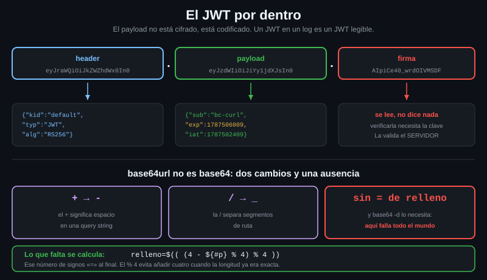

# El JWT por dentro

> Tres cadenas separadas por puntos. Las dos primeras las puede leer cualquiera
> — tú incluido, con `base64` y nada más. La tercera es la que impide
> falsificarlo, y no la vas a comprobar desde el cliente.



## 🎯 Objetivos

- Partir un JWT en sus tres piezas y decodificar el payload sin instalar nada
- Resolver el problema del relleno de base64url, que es donde falla todo el mundo
- Leer `exp`, `iat` y `nbf`, y decir si un token está vigente
- Explicar por qué el cliente **no** valida la firma y qué significa eso

---

## 1. Qué problema resuelve

Un token Bearer puede ser dos cosas. Una cadena aleatoria —opaca, sin nada
dentro, que el servidor busca en su base de datos— o un **JWT**: un token que
lleva la información dentro y viene firmado.

La diferencia importa para quien opera la API:

| | Token opaco | JWT |
|---|---|---|
| El servidor, para validarlo | Consulta su almacén | Comprueba la firma. Sin consultar nada |
| Escala a muchos servidores | Necesitan compartir el almacén | Cada uno valida solo |
| Se puede revocar al instante | Sí: se borra | No: hay que esperar a que caduque, o mantener una lista |
| El cliente puede leer lo que hay dentro | No | **Sí** |

Ese último punto es lo que te sirve hoy: si tu token es un JWT, puedes saber
**cuándo caduca sin preguntarle a nadie**, y eso es lo que permite a un script
renovarlo antes de que falle en vez de después.

---

## 2. Cómo funciona

### 2.1 Las tres partes

```
eyJraWQiOiJkZWZhdWx0In0 . eyJzdWIiOiJiYy1jdXJsIn0 . AIpiCe40_wrdOIVMSDF
└──── header ─────────┘   └──── payload ────────┘   └──── firma ──────┘
```

| Parte | Qué lleva | ¿Se puede leer? |
|---|---|---|
| **Header** | El algoritmo (`alg`) y qué clave se usó (`kid`) | Sí, base64url |
| **Payload** | Las afirmaciones: quién, para qué, hasta cuándo | Sí, base64url |
| **Firma** | Bytes que solo puede generar quien tiene la clave | Se lee, pero no dice nada sin la clave |

Está en el [RFC 7519](https://datatracker.ietf.org/doc/html/rfc7519), y lo que
hay que interiorizar es que **el payload no está cifrado, está codificado**: un
JWT en un log es un JWT legible.

### 2.2 base64url no es base64

Un JWT viaja en URLs y en headers, así que no puede usar los caracteres `+`, `/`
ni `=` de base64 normal. Usa base64**url**, del
[RFC 4648 §5](https://datatracker.ietf.org/doc/html/rfc4648#section-5), con dos
cambios:

| base64 | base64url | Por qué |
|---|---|---|
| `+` | `-` | `+` significa espacio en una query string |
| `/` | `_` | `/` separa segmentos de ruta |
| `=` de relleno | **sin relleno** | `=` tiene significado propio en una query |

Los dos primeros se arreglan con un `tr`. El tercero es el que rompe los
comandos que circulan por internet:

```bash
# Un payload de ejemplo, 39 caracteres. base64 necesita multiplos de 4, y
# 39 % 4 = 3. Le faltan caracteres de relleno.
p='eyJzdWIiOiJiYy1jdXJsIiwiYXVkIjoiYXBpIn0'
echo $(( ${#p} % 4 ))
# 3
```

```bash
# Sin relleno, GNU base64 imprime el resultado Y ADEMAS se queja. En una
# tuberia con `set -o pipefail` eso tumba el script aunque la salida ya
# estuviera impresa: un bug intermitente, porque depende de la longitud.
printf '%s' "$p" | base64 -d
# {"sub":"bc-curl","aud":"api"}base64: invalid input
```

Se calcula cuántos `=` faltan y se añaden:

```bash
# (4 - longitud % 4) % 4 da 0, 1, 2 o 3. El % 4 final es el que evita anadir
# cuatro signos cuando la longitud ya era multiplo de cuatro.
relleno=$(( (4 - ${#p} % 4) % 4 ))
printf '%s%s' "$p" "$(printf '=%.0s' $(seq 1 "$relleno"))" | tr '_-' '/+' | base64 -d
# {"sub":"bc-curl","aud":"api"}
```

Sin el aviso, y con el código de salida en cero.

### 2.3 Las afirmaciones que importan

El payload es un JSON. Sus campos se llaman *claims*, y los estándar son estos:

| Claim | Significa | Formato |
|---|---|---|
| `exp` | *expiration*: no vale a partir de aquí | Segundos desde epoch |
| `iat` | *issued at*: cuándo se emitió | Segundos desde epoch |
| `nbf` | *not before*: no vale **antes** de aquí | Segundos desde epoch |
| `sub` | *subject*: de quién es el token | Cadena |
| `iss` | *issuer*: quién lo emitió | Normalmente una URL |
| `aud` | *audience*: para qué servicio es | Cadena o lista |
| `jti` | Identificador único del token | Cadena |

Los tres tiempos van en **segundos** desde epoch, no en milisegundos. Un `exp`
de trece dígitos es milisegundos y es un error del emisor; con `date -d @…` se
ve enseguida, porque sale un año imposible.

### 2.4 La firma, y por qué no la vas a validar

La firma es lo que impide que alguien cambie `"admin": false` por `true`. Se
calcula sobre el header y el payload con una clave, y se comprueba con esa clave
—o con su pareja pública, si el algoritmo es asimétrico.

**El que valida la firma es el servidor.** Tú, desde curl, no:

- Con `HS256` haría falta la clave secreta compartida. Si la tuvieras en el
  cliente, podrías emitir tokens: no la tienes, y está bien que no la tengas
- Con `RS256` haría falta bajar la clave pública del emisor (`/.well-known/…`),
  elegir la correcta por su `kid` y verificar RSA. Se puede, pero no con `base64`
  y `jq`

Y sobre todo: **no hace falta**. Tú no tienes que decidir si el token es válido,
eso lo decide el servidor cuando lo mandas. Lo que sí te sirve del payload es la
caducidad, para no mandar uno muerto.

> [!WARNING]
> Un payload decodificado **no es una comprobación de nada**. Cualquiera puede
> escribir un JSON, codificarlo en base64url y ponerle una firma falsa: se
> decodifica igual de bien. Si tu código toma decisiones de permisos leyendo el
> payload de un token sin verificar la firma, esas decisiones se pueden
> falsificar. Del lado del cliente, léelo solo para saber cuándo renovarlo.

---

## 3. Cómo se usa

### 3.1 Decodificar el payload, paso a paso

```bash
# Un token de verdad, emitido por el servidor del laboratorio.
TOKEN=$(curl -s --max-time 10 -X POST http://localhost:8081/default/token \
  -d 'grant_type=client_credentials' -d 'client_id=bc-curl' \
  -d 'client_secret=lab' -d 'scope=api' | jq -r '.access_token')
```

```bash
# Comprobar que son tres partes. Si no son tres, no es un JWT y no hay nada
# que decodificar: sera un token opaco.
tr '.' '\n' <<<"$TOKEN" | wc -l
# 3
```

```bash
# El payload es la segunda. Con el relleno calculado, sin avisos.
p=$(cut -d. -f2 <<<"$TOKEN")
relleno=$(( (4 - ${#p} % 4) % 4 ))
printf '%s%s' "$p" "$(printf '=%.0s' $(seq 1 "$relleno"))" | tr '_-' '/+' | base64 -d | jq
# {
#   "sub": "bc-curl",
#   "aud": "api",
#   "nbf": 1787502409,
#   "iss": "http://localhost:8081/default",
#   "exp": 1787506009,
#   "iat": 1787502409,
#   "jti": "6b66f762-311b-4405-ad56-0da5606749e4",
#   "tid": "default"
# }
```

Los valores de `nbf`, `exp`, `iat` y `jti` serán distintos en tu ejecución: el
token se emite en el momento.

### 3.2 Una función reutilizable

```bash
# jwt_payload TOKEN
#
# Imprime el payload de un JWT como JSON. Falla si no parece un JWT, en vez de
# imprimir basura: un token opaco no tiene tres partes.
jwt_payload() {
  local token="$1" p relleno
  [ "$(tr -cd '.' <<<"$token" | wc -c)" -eq 2 ] \
    || { echo "no parece un JWT: no tiene tres partes" >&2; return 1; }
  p=$(cut -d. -f2 <<<"$token")
  relleno=$(( (4 - ${#p} % 4) % 4 ))
  printf '%s%s' "$p" "$(printf '=%.0s' $(seq 1 "$relleno"))" \
    | tr '_-' '/+' | base64 -d
}
```

### 3.3 Saber si caducó

```bash
# exp en segundos desde epoch, y el ahora en la misma unidad: se comparan
# directamente. El -r de jq quita las comillas.
exp=$(jwt_payload "$TOKEN" | jq -r '.exp')
date -d "@$exp" '+%Y-%m-%d %H:%M:%S'
# 2026-08-23 12:26:49
```

```bash
# Con 60 segundos de margen, para que no caduque entre la comprobacion y la
# peticion, y para absorber la diferencia de reloj con el servidor.
if [ "$(date +%s)" -lt $(( exp - 60 )) ]; then
  echo "vigente"
else
  echo "caducado o a punto: hay que renovarlo"
fi
# vigente
```

En macOS `date -d @…` no existe: es `date -r "$exp"`. Para que corra en los dos,
`date -d "@$exp" '+%F %T' 2>/dev/null || date -r "$exp" '+%F %T'`.

### 3.4 El header, cuando el `401` no se explica

```bash
# La primera parte dice el algoritmo y la clave. Util cuando el servidor rechaza
# el token y sospechas que es de otro entorno: el kid lo delata. Es el mismo
# procedimiento del payload, cambiando -f2 por -f1.
h=$(cut -d. -f1 <<<"$TOKEN")
printf '%s%s' "$h" "$(printf '=%.0s' $(seq 1 $(( (4 - ${#h} % 4) % 4 ))))" \
  | tr '_-' '/+' | base64 -d | jq -c
# {"kid":"default","typ":"JWT","alg":"RS256"}
```

---

## 4. Antipatrones

| Antipatrón | Por qué duele | Qué hacer en su lugar |
|---|---|---|
| Decidir permisos leyendo el payload en el cliente | El payload se falsifica en dos minutos. Sin firma verificada no prueba nada | La decisión la toma el servidor. En el cliente, léelo solo para la caducidad |
| Pegar un token en un decodificador web para inspeccionarlo | Acabas de mandarle tu credencial viva a un tercero | `cut`, `tr`, `base64 -d`, `jq`. Está todo en tu máquina |
| Olvidar el relleno de base64url | Funciona con unos tokens y falla con otros según la longitud. Un bug intermitente | Calcular `(4 - len % 4) % 4` siempre |
| `base64 -d` sin `tr '_-' '/+'` | Falla solo cuando el token lleva `-` o `_`. Otro bug intermitente | El `tr` siempre, aunque este token no lo necesite |
| Asumir que todo token Bearer es un JWT | Los opacos no tienen partes que decodificar | Contar los puntos antes: si no son dos, es opaco |
| Loguear el token «para depurar» | El log es persistente y el token es una credencial viva | Loguea el `jti` y el `exp`, nunca el token |
| Interpretar `exp` como milisegundos | Sale un año imposible: la comparación siempre da caducado | Son segundos. `date -d @…` lo confirma de un vistazo |

---

## 5. Trucos

```bash
# El payload en una linea, para pegar en tu .bashrc. Es jwt_payload de la
# seccion 3.2 comprimida, sin la comprobacion de las tres partes.
jwt() { local p; p=$(cut -d. -f2 <<<"$1"); \
  printf '%s%s' "$p" "$(printf '=%.0s' $(seq 1 $(( (4 - ${#p} % 4) % 4 ))))" \
  | tr '_-' '/+' | base64 -d | jq; }

# Y cuanto le queda de vida, en minutos.
echo $(( ($(jwt "$TOKEN" | jq -r .exp) - $(date +%s)) / 60 )) minutos
# 59 minutos   (el tuyo variará: depende de cuándo se emitió)
```

```bash
# Distinguir un JWT de un token opaco sin decodificar nada: dos puntos.
[ "$(tr -cd '.' <<<"$TOKEN" | wc -c)" -eq 2 ] && echo "JWT" || echo "opaco"
# JWT
```

---

## 📚 Recursos Adicionales

- [RFC 7519 — JSON Web Token](https://datatracker.ietf.org/doc/html/rfc7519) — el formato y los claims registrados
- [RFC 4648 §5 — Base 64 con alfabeto seguro para URL](https://datatracker.ietf.org/doc/html/rfc4648#section-5) — de dónde salen el `-`, el `_` y la falta de relleno
- [RFC 8725 — JWT Best Current Practices](https://datatracker.ietf.org/doc/html/rfc8725) — los ataques conocidos, incluido `alg: none`

---

## ✅ Checklist de Verificación

- [ ] He pedido un token al laboratorio y he comprobado que tiene tres partes
- [ ] He decodificado su payload sin que `base64` se queje, calculando el relleno
- [ ] Sé por qué hace falta `tr '_-' '/+'` aunque un token concreto funcione sin él
- [ ] He convertido el `exp` a fecha legible y he dicho si el token está vigente
- [ ] Sé explicar por qué el cliente no valida la firma y qué implica eso
- [ ] Sé distinguir un JWT de un token opaco contando puntos

---

| Anterior | Siguiente |
|---|---|
| [05 — Bearer y el flujo de login](05-bearer-y-el-flujo-de-login.md) | [07 — Digest y la negociación del esquema](07-digest-y-la-negociacion-del-esquema.md) |
