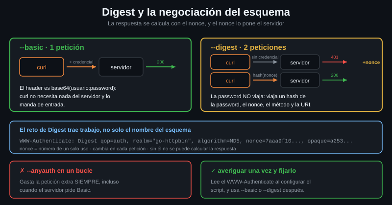

# Digest y la negociación del esquema

> Digest resuelve el problema de Basic —que la password viaja— y a cambio cuesta
> una petición extra y un algoritmo obsoleto. Hoy casi nunca es la respuesta,
> pero está en tu router y en media infraestructura de red.



## 🎯 Objetivos

- Usar `--digest` y explicar por qué obliga a una primera petición sin credencial
- Medir la diferencia de peticiones entre `--basic`, `--digest` y `--anyauth`
- Elegir el flag de esquema correcto y saber cuál es el que curl usa por defecto
- Reconocer el fallo clásico: el esquema equivocado devuelve `401` sin más pistas

---

## 1. Qué problema resuelve

Basic Auth manda la password —codificada, no cifrada— en cada petición. Si el
canal no está bien protegido, la password se lee. Digest, del
[RFC 7616](https://datatracker.ietf.org/doc/html/rfc7616), evita eso: **la
password no viaja nunca**.

En su lugar, el servidor manda un número de un solo uso —el `nonce`— y el
cliente devuelve un hash de la password, el nonce, el método y la URI. El
servidor calcula lo mismo por su lado y compara. Quien intercepte la petición se
lleva un hash que solo sirve para ese nonce y ese método.

Suena bien. En 2026 casi nunca es la elección correcta, y conviene saber por qué:

| Problema | Detalle |
|---|---|
| El algoritmo | La mayoría de implementaciones siguen en MD5, roto hace décadas. El RFC 7616 añadió SHA-256, pero casi nadie lo despliega |
| El servidor necesita la password | Para calcular el hash tiene que poder reconstruirlo: no puede guardarla con un hash lento tipo bcrypt |
| Una petición extra | El nonce lo pone el servidor, así que hay que ir a buscarlo |
| TLS lo hace redundante | Con el canal cifrado, Basic ya no expone nada, y es mucho más simple |

Dónde te lo vas a encontrar igualmente: routers y cámaras IP, equipos de red,
paneles de administración antiguos, algunos servidores WebDAV.

---

## 2. Cómo funciona

### 2.1 El reto de Digest trae trabajo

El `WWW-Authenticate` de Basic solo dice «Basic» y el `realm`. El de Digest trae
todo lo que hace falta para calcular la respuesta:

```bash
curl -s -o /dev/null -D - http://localhost:8080/digest-auth/auth/user/password \
  | grep -i '^www-authenticate' | tr ',' '\n'
# Www-Authenticate: Digest qop=auth
#  realm="go-httpbin"
#  algorithm=MD5
#  nonce=7aaa9f103608d0798db91d238b52875d
#  opaque=a25332d1a1d46d3d154cbafe71088582
#  (nonce y opaque cambian en cada peticion: los tuyos seran otros)
```

| Campo | Para qué sirve |
|---|---|
| `realm` | El espacio protegido, igual que en Basic |
| `nonce` | El número de un solo uso. Es lo que impide reutilizar un hash capturado |
| `qop` | *quality of protection*. Con `auth`, el cliente añade su propio `cnonce` |
| `algorithm` | `MD5` o `SHA-256`. Determina cómo se calcula el hash |
| `opaque` | Un valor que el cliente devuelve tal cual, sin tocarlo |

El `nonce` cambia en cada petición, y ese es justo el motivo de la petición
extra: **no se puede calcular la respuesta antes de tenerlo**.

### 2.2 Por eso Digest cuesta dos peticiones

```bash
# Basic: una sola peticion. curl manda la credencial de entrada.
curl -s --basic -u user:password -o /dev/null -v \
  http://localhost:8080/basic-auth/user/password 2>&1 | grep -c '^> GET'
# 1
```

```bash
# Digest: dos. La primera va sin credencial, solo para que el servidor conteste
# 401 con su nonce; la segunda ya lleva el hash calculado con ese nonce.
curl -s --digest -u user:password -o /dev/null -v \
  http://localhost:8080/digest-auth/auth/user/password 2>&1 | grep -c '^> GET'
# 2
```

Esa petición de más se paga en **cada** invocación de curl. En un bucle de mil
peticiones son mil idas y vueltas extra, y en un enlace con latencia alta se
nota mucho más que en localhost.

### 2.3 Los flags de esquema

| Flag | Qué hace | Peticiones |
|---|---|---|
| *(ninguno)* con `-u` | Basic. Es el defecto de curl | 1 |
| `--basic` | Basic, explícito | 1 |
| `--digest` | Digest | 2 |
| `--anyauth` | Pregunta primero y elige el «más seguro» que ofrezca el servidor | 2 |
| `--ntlm`, `--negotiate` | Esquemas de entornos Windows y Kerberos | 2 |

```bash
# --anyauth tambien gasta dos peticiones incluso cuando el servidor pide Basic:
# la primera se va en averiguar que pide.
curl -s --anyauth -u user:password -o /dev/null -v \
  http://localhost:8080/basic-auth/user/password 2>&1 | grep -c '^> GET'
# 2
```

La utilidad de `--anyauth` es no tener que saber el esquema de antemano. Su
coste es esa petición, siempre. La regla práctica: **averigua el esquema una
vez, a mano, y fíjalo en el script.**

### 2.4 El fallo clásico: esquema equivocado

Si mandas Basic a un endpoint que quiere Digest, el servidor no te dice «te has
equivocado de esquema». Te dice `401`, igual que si la password estuviera mal:

```bash
# La credencial es CORRECTA. El esquema no.
curl -s -o /dev/null -w '%{http_code}\n' \
  -u user:password http://localhost:8080/digest-auth/auth/user/password
# 401
```

```bash
# La misma credencial, con el esquema que toca.
curl -s -o /dev/null -w '%{http_code}\n' \
  --digest -u user:password http://localhost:8080/digest-auth/auth/user/password
# 200
```

Por eso el primer paso ante un `401` inexplicable es leer el reto, no cambiar la
password:

```bash
curl -s -o /dev/null -D - URL | grep -i '^www-authenticate'
```

### 2.5 El `.curlrc` que te cambia el esquema sin avisar

curl lee `~/.curlrc` en cada invocación. Un `--digest` puesto ahí meses atrás
convierte todos tus comandos Basic en Digest, y el síntoma es un `401` que no
casa con nada:

```bash
# Que hay en tu .curlrc, si es que hay algo.
cat ~/.curlrc 2>/dev/null || echo "(no existe)"
```

```bash
# -q hace que curl ignore el .curlrc. Es la primera prueba ante un
# comportamiento que no te explicas.
curl -q -s -o /dev/null -w '%{http_code}\n' \
  -u user:password http://localhost:8080/basic-auth/user/password
# 200
```

`--basic` explícito también deshace un `--digest` heredado, porque el último
flag de esquema es el que manda. El `.curlrc` a fondo es la Semana 06.

---

## 3. Cómo se usa

### 3.1 Digest contra el laboratorio

```bash
# El endpoint lleva el qop, el usuario y la password en la ruta:
# /digest-auth/<qop>/<usuario>/<password>.
curl -s --digest -u user:password \
  http://localhost:8080/digest-auth/auth/user/password | jq -c .
# {"authenticated":true,"user":"user","authorized":true}
```

### 3.2 Con la credencial fuera del argv

Todo lo de la teoría 03 sigue valiendo: el esquema cambia, el sitio del secreto
no.

```bash
# --netrc-file da usuario y password; --digest elige el esquema. La credencial
# no aparece en la linea de comandos.
(umask 077; printf 'machine localhost login user password password\n' > /tmp/lab.netrc)
curl -s --digest --netrc-file /tmp/lab.netrc \
  http://localhost:8080/digest-auth/auth/user/password | jq -c .
# {"authenticated":true,"user":"user","authorized":true}
rm -f /tmp/lab.netrc
```

### 3.3 Averiguar el esquema una vez, y fijarlo

```bash
#!/usr/bin/env bash
set -euo pipefail

# Una peticion sin credencial para leer el reto. Se hace UNA vez, al configurar
# el script, no en cada ejecucion.
reto=$(curl -sS --max-time 10 -o /dev/null -D - "$URL" \
  | grep -i '^www-authenticate' || true)

case "$reto" in
  *Digest*) esquema=--digest ;;
  *Basic*)  esquema=--basic ;;
  *Bearer*) echo "usa un token, no usuario y password" >&2; exit 1 ;;
  *)        echo "el servidor no pide autenticacion" >&2; esquema="" ;;
esac

echo "esquema detectado: ${esquema:-ninguno}"
```

---

## 4. Antipatrones

| Antipatrón | Por qué duele | Qué hacer en su lugar |
|---|---|---|
| `--anyauth` en un bucle | Duplica las peticiones y no se ve en la salida | Detectar el esquema una vez y fijarlo |
| Digest sobre HTTP «porque la password no viaja» | El resto de la petición y toda la respuesta sí viajan en claro | TLS. Y con TLS, Basic ya basta |
| Cambiar la password ante un `401` sin leer el reto | Muchas veces la password está bien y el esquema no | `curl -s -o /dev/null -D - URL \| grep -i www-authenticate` |
| Poner `--digest` en el `.curlrc` | Rompe en silencio todos los comandos Basic de esa máquina | Flags de esquema en el comando, no en la configuración global |
| Elegir Digest para una API nueva | Ata al servidor a guardar la password de forma reversible | Bearer con tokens de vida corta, u OAuth2 |
| Suponer que Digest protege de la reutilización para siempre | El `nonce` acota la ventana, no la elimina | TLS, que es lo que cierra el canal |

---

## 5. Trucos

```bash
# El reto entero, un campo por linea, legible.
curl -s -o /dev/null -D - http://localhost:8080/digest-auth/auth/user/password \
  | grep -i '^www-authenticate' | tr ',' '\n'
```

```bash
# Contar cuantas peticiones gasta de verdad un esquema. Sirve para justificar
# en una revision por que no usas --anyauth.
for f in --basic --anyauth; do
  printf '%s -> ' "$f"
  curl -s "$f" -u user:password -o /dev/null -v \
    http://localhost:8080/basic-auth/user/password 2>&1 | grep -c '^> GET'
done
# --basic -> 1
# --anyauth -> 2
```

```bash
# Descartar el .curlrc como causa de un comportamiento raro: -q lo ignora.
curl -q -sS -o /dev/null -w '%{http_code}\n' URL
```

```bash
# Ver el header Authorization que genera Digest: no se parece en nada al de
# Basic, y ahi estan el nonce, el cnonce y el response.
curl -s --digest -u user:password -o /dev/null -v \
  http://localhost:8080/digest-auth/auth/user/password 2>&1 \
  | grep -i '^> authorization' | cut -c1-72
# > Authorization: Digest username="user", realm="go-httpbin", nonce="f681
#   (el nonce cambia en cada peticion: el tuyo sera otro)
```

---

## 📚 Recursos Adicionales

- [RFC 7616 — HTTP Digest Access Authentication](https://datatracker.ietf.org/doc/html/rfc7616) — incluida la parte de SHA-256 que casi nadie implementa
- [manpage de curl — `--digest`](https://curl.se/docs/manpage.html#--digest) y [`--anyauth`](https://curl.se/docs/manpage.html#--anyauth)
- [everything.curl.dev — HTTP authentication](https://everything.curl.dev/http/auth.html) — la comparación de esquemas del libro oficial
- [manpage de curl — `-q`](https://curl.se/docs/manpage.html#-q) — para descartar el `.curlrc` en un diagnóstico

---

## ✅ Checklist de Verificación

- [ ] He leído el reto de Digest del laboratorio y he identificado el `nonce`
- [ ] He comprobado que `--digest` gasta dos peticiones y `--basic` una
- [ ] Sé por qué Digest **necesita** esa primera petición
- [ ] He visto que la credencial correcta con el esquema equivocado da `401`
- [ ] Sé qué hace `-q` y por qué es lo primero que se prueba ante un fallo raro
- [ ] Sé decir en una frase por qué Digest no es la elección para una API nueva

---

| Anterior | Siguiente |
|---|---|
| [06 — El JWT por dentro](06-jwt-por-dentro.md) | [08 — Cuando la credencial falla](08-cuando-la-credencial-falla.md) |
