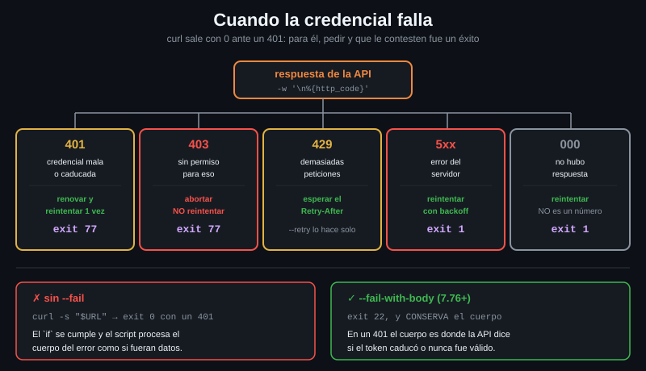

# Cuando la credencial falla

> curl sale con 0 ante un `401`. Para curl la transferencia fue un éxito: pidió y
> le contestaron. Si tu script no distingue «no me conozco» de «el servidor está
> caído», reintentará lo que nunca va a funcionar y abandonará lo que sí.



## 🎯 Objetivos

- Clasificar un fallo en las cinco categorías que se tratan distinto
- Traducir cada categoría a un código de salida que quien llame al script pueda usar
- Saber por qué `--retry` de curl no reintenta un `401`, y por qué eso está bien
- Escribir el bucle de renovación de token sin que se convierta en un bucle infinito

---

## 1. Qué problema resuelve

Este script parece correcto y es peligroso:

```bash
# ❌ Sin --fail, curl sale con 0 aunque el servidor conteste 401. El `if`
#    siempre se cumple y el script continua como si tuviera los datos.
if datos=$(curl -s "$URL"); then
  procesar "$datos"    # procesa el cuerpo del error 401
fi
```

```bash
# El 401 con codigo de salida 0. Este es el comportamiento por defecto.
curl -s -o /dev/null http://localhost:8080/bearer; echo "salida: $?"
# salida: 0
```

Con `--fail-with-body` la cosa cambia, y además conserva el cuerpo, que es donde
la API explica el motivo:

```bash
# 22 es el codigo de curl para "el servidor devolvio un error HTTP".
curl --fail-with-body -s -o /dev/null http://localhost:8080/bearer; echo "salida: $?"
# salida: 22
```

Pero `22` es el mismo para un `401`, un `404` y un `500`. Y esos tres se tratan
de forma distinta. Ahí empieza esta teoría.

---

## 2. Cómo funciona

### 2.1 Las cinco categorías

| Situación | Código HTTP | ¿Reintentar? | Qué hace un script sensato |
|---|---|---|---|
| **Credencial inválida o caducada** | `401` | Solo tras **renovarla** | Renovar y reintentar **una** vez. Si vuelve a fallar, abortar |
| **Sin permiso** | `403` | **No** | Abortar y avisar. Otra credencial del mismo tipo no cambia nada |
| **Demasiadas peticiones** | `429` | Sí, esperando | Respetar `Retry-After`. Nunca reintentar de inmediato |
| **Error del servidor** | `5xx` | Sí, con backoff | `--retry` lo hace solo |
| **Error de red** | sin código | Sí | `--retry` también, y `--max-time` acota |

Las dos primeras son las de esta semana, y la diferencia entre ellas es toda la
teoría 01: `401` puede arreglarse con **otra** credencial, `403` no.

### 2.2 Qué reintenta `--retry` y qué no

`--retry` de curl **no reintenta un `401`**, y es correcto que no lo haga:
repetir la misma petición con la misma credencial daría el mismo `401`.

Lo que reintenta por defecto:

| Condición | ¿La reintenta `--retry`? |
|---|---|
| Error de red, DNS, conexión rechazada | Sí |
| Timeout de la operación | Sí |
| `408`, `429`, `500`, `502`, `503`, `504` | Sí |
| `401`, `403`, `404`, `422` | **No** |
| Cualquier otro 4xx | No, salvo `--retry-all-errors` |

La forma de comprobarlo sin creerte la tabla: contar las peticiones que salen
de verdad en la traza de `-v`.

```bash
# El 503 se reintenta: 1 peticion + 2 reintentos = 3.
curl -s --retry 2 --retry-delay 1 --fail-with-body -o /dev/null -v \
  http://localhost:8080/status/503 2>&1 | grep -c '^> GET'
# 3
```

```bash
# El 401 no: una sola peticion, y sale. Reintentarla daria el mismo 401.
curl -s --retry 2 --retry-delay 1 --fail-with-body -o /dev/null -v \
  http://localhost:8080/bearer 2>&1 | grep -c '^> GET'
# 1
```

> [!CAUTION]
> `--retry-all-errors` fuerza el reintento de **todo**, incluidos los `4xx`. Con
> un `401` eso son tres intentos idénticos condenados al mismo fallo, y contra
> una API que cuente intentos fallidos, un camino directo al bloqueo de la
> cuenta. Úsalo solo cuando sepas exactamente por qué.

### 2.3 Códigos de salida: el contrato con quien te llama

Un script que sale siempre con `1` obliga a quien lo llama a leer el texto del
error para saber qué pasó. Un código por categoría convierte eso en un `case`:

| Código | Significado | De dónde sale |
|---|---|---|
| `0` | Todo bien | — |
| `1` | Error genérico, incluido un `5xx` | Convención de todo el mundo |
| `77` | Problema de credencial o de permisos (`401`/`403`) | `EX_NOPERM` de `sysexits.h` |
| `22` | Error HTTP, si dejas pasar el de curl | El propio curl con `--fail` |
| `28` | Timeout | El propio curl |

`77` no es un número inventado: es el que `sysexits.h` reserva para «permiso
denegado» desde los BSD de los ochenta, y no colisiona con ninguno de curl —que
usan del 1 al 99 pero no el 77—. Lo importante no es cuál elijas, sino que sea
**estable y esté documentado** en la cabecera del script.

```bash
# Asi lo usa quien te llama, sin leer ni una linea de texto.
./api-toolkit.sh get /v1/datos || case $? in
  77) echo "credencial: renuevala y vuelve a intentarlo" >&2 ;;
  28) echo "timeout: el servidor no responde" >&2 ;;
  *)  echo "fallo generico" >&2 ;;
esac
```

### 2.4 Distinguir `000` de un código de verdad

Cuando no hay respuesta —DNS que no resuelve, puerto cerrado, timeout— curl
escribe `000` en `%{http_code}`. No es un código HTTP y no se puede comparar
como número:

```bash
# Puerto donde no hay nada escuchando: no hay respuesta, y por tanto no hay
# codigo. curl pone 000 y sale con 7 (no pudo conectar).
curl -s -o /dev/null -w '%{http_code}\n' --max-time 3 http://localhost:9/get
echo "salida: $?"
# 000
# salida: 7
```

Un `case` con patrones lo trata bien sin convertir nada a número:

```bash
case "$codigo" in
  401|403)  exit 77 ;;
  [123]??)  exit 0 ;;    # 1xx, 2xx y 3xx: la peticion llego a su destino
  *)        exit 1 ;;    # 4xx, 5xx y el 000
esac
```

---

## 3. Cómo se usa

### 3.1 Separar el cuerpo del código en una sola petición

Necesitas las dos cosas: el código para decidir, el cuerpo para explicar. Y no
quieres pagar dos peticiones:

```bash
# --write-out pega '\n<codigo>' al final de la respuesta. La ultima linea es el
# codigo; el resto, el cuerpo.
salida=$(curl -sS --max-time 10 -w '\n%{http_code}' http://localhost:8080/bearer)
codigo="${salida##*$'\n'}"
cuerpo="${salida%$'\n'*}"
echo "codigo=$codigo"
echo "cuerpo=$cuerpo"
# codigo=401
# cuerpo={
#   "status_code": 401,
#   "error": "Unauthorized"
# }
```

Ese cuerpo es lo que `--fail` a secas tira a la basura y `--fail-with-body`
conserva. En un `401` es donde muchas APIs distinguen «token caducado» de «token
inválido», y esas dos cosas se tratan distinto.

### 3.2 El bucle de renovación, sin que se vuelva infinito

El patrón es siempre el mismo, y tiene una regla: **se reintenta una vez, no en
un bucle**. Si el token recién renovado también da `401`, el problema no es el
token.

```bash
peticion() { curl -sS --max-time 10 -w '\n%{http_code}' --config "$CONFIG" "$1"; }

salida=$(peticion "$URL"); codigo="${salida##*$'\n'}"

if [ "$codigo" = 401 ]; then
  echo "token rechazado, renovando" >&2
  renovar_token                      # reescribe $CONFIG con el token nuevo
  salida=$(peticion "$URL"); codigo="${salida##*$'\n'}"
fi

case "$codigo" in
  401|403) echo "credencial rechazada tras renovar" >&2; exit 77 ;;
  [123]??) printf '%s\n' "${salida%$'\n'*}" ;;
  *)       echo "error HTTP $codigo" >&2; exit 1 ;;
esac
```

Sin ese límite, un token que el servidor rechaza siempre —revocado, del entorno
equivocado— se convierte en un bucle que pide tokens sin parar. Es una de las
formas más rápidas de que te bloqueen una cuenta de servicio.

### 3.3 Renovar **antes** de que falle

Mejor que reaccionar al `401` es no llegar a él. Si el token es un JWT, sabes
cuándo caduca sin preguntar a nadie (teoría 06):

```bash
# 60 segundos de margen: para que no caduque entre la comprobacion y la
# peticion, y para absorber la diferencia de reloj con el servidor.
if [ "$(date +%s)" -ge $(( exp - 60 )) ]; then
  renovar_token
fi
```

Las dos cosas, no una: renovar por adelantado ahorra la mayoría de los `401`, y
el manejo del `401` cubre lo que no previste —un token revocado a mano, un
reloj desajustado, una rotación de claves del servidor.

### 3.4 El `429`, que se parece pero no lo es

`429` no es un problema de credencial: la tuya vale, has ido demasiado rápido.
`--retry` ya lo reintenta solo —tres peticiones con `--retry 2`— y **respeta el
`Retry-After` desde curl 7.66**, salvo que le pases un `--retry-delay` fijo, que
sustituye al backoff exponencial.

```bash
# El laboratorio devuelve el 429 sin ese header; contra una API real, si viene.
curl -s -o /dev/null -D - "http://localhost:8080/status/429" \
  | grep -i '^retry-after' || echo "(sin Retry-After: toca backoff exponencial)"
# (sin Retry-After: toca backoff exponencial)
```

El tema completo, con los headers de cuota, es la Semana 07.

---

## 4. Antipatrones

| Antipatrón | Por qué duele | Qué hacer en su lugar |
|---|---|---|
| `curl -s` sin `--fail` en un script | El `401` sale con 0 y el script procesa el cuerpo del error como si fueran datos | `--fail-with-body` siempre |
| `--fail` a secas cuando la API explica el error en el cuerpo | Tiras justo la información que necesitas para decidir | `--fail-with-body` |
| Reintentar el `401` sin renovar | Misma credencial, mismo resultado. Y contadores de fallos subiendo | Renovar primero, reintentar **una** vez |
| Bucle `while` de renovación sin límite | Un token revocado lo convierte en un bucle infinito contra el emisor | Un solo reintento, y abortar |
| `--retry-all-errors` «por si acaso» | Reintenta también `401`, `403` y `404`: fallos que no mejoran | Deja que `--retry` decida, que ya lo hace bien |
| Salir con `1` para todo | Quien te llama no puede distinguir un timeout de una credencial mala | Un código por categoría, documentado en la cabecera |
| Loguear el token cuando falla la autenticación | El log es persistente y el token es una credencial viva | Loguea el código, el `jti` y el `exp` |
| Tratar `000` como un código HTTP | No es un número comparable y se cuela como éxito | `case` con patrones, con el `*)` cubriendo el `000` |

---

## 5. Trucos

```bash
# El codigo y el cuerpo en UNA sola peticion, sin archivos temporales.
salida=$(curl -sS --max-time 10 -w '\n%{http_code}' URL)
codigo="${salida##*$'\n'}"; cuerpo="${salida%$'\n'*}"
```

```bash
# Ver la diferencia entre --fail y --fail-with-body sobre el mismo 401: uno
# conserva el motivo y el otro lo tira.
curl --fail            -s http://localhost:8080/bearer; echo "[--fail: $?]"
curl --fail-with-body  -s http://localhost:8080/bearer; echo "[--fail-with-body: $?]"
```

---

## 📚 Recursos Adicionales

- [manpage de curl — `--fail-with-body`](https://curl.se/docs/manpage.html#--fail-with-body) — disponible desde **7.76**; antes, `--fail` y perder el cuerpo
- [manpage de curl — `--retry`](https://curl.se/docs/manpage.html#--retry) — la lista exacta de lo que reintenta
- [Códigos de salida de curl](https://everything.curl.dev/cmdline/exitcode.html) — los 99, con su significado
- [`sysexits.h`](https://man.freebsd.org/cgi/man.cgi?query=sysexits) — de dónde sale el `77` y qué otros hay

---

## ✅ Checklist de Verificación

- [ ] He comprobado que `curl -s` sale con 0 ante un `401` y con 22 usando `--fail-with-body`
- [ ] Sé nombrar las cinco categorías de fallo y qué se hace con cada una
- [ ] He comprobado que `--retry` **no** reintenta un `401` y sí un `503`
- [ ] Mi script sale con `77` ante `401` y `403`, y con `1` ante un `500`
- [ ] Sé por qué el reintento tras renovar el token tiene que ser uno, y no un bucle
- [ ] Sé qué es `000` en `%{http_code}`, por qué no se compara como número, y por qué `--retry-all-errors` es peligroso con autenticación

---

| Anterior | Siguiente |
|---|---|
| [07 — Digest y la negociación del esquema](07-digest-y-la-negociacion-del-esquema.md) | [Prácticas de la semana](../2-practicas/01-basic-auth-y-el-reto.md) |
